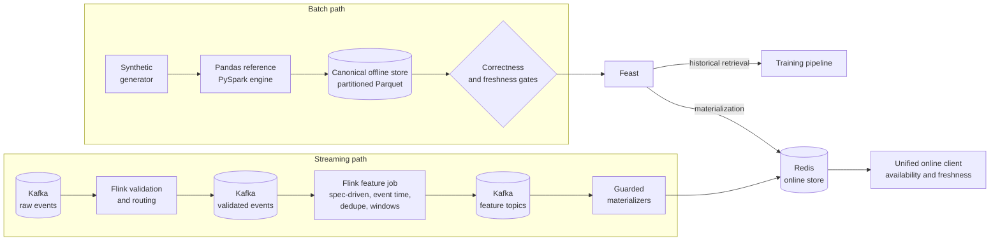
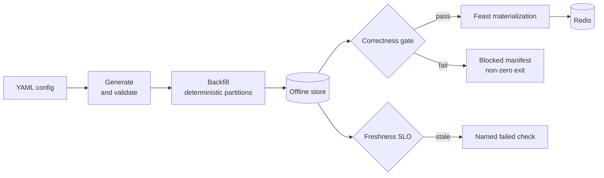
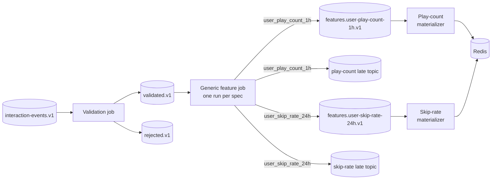
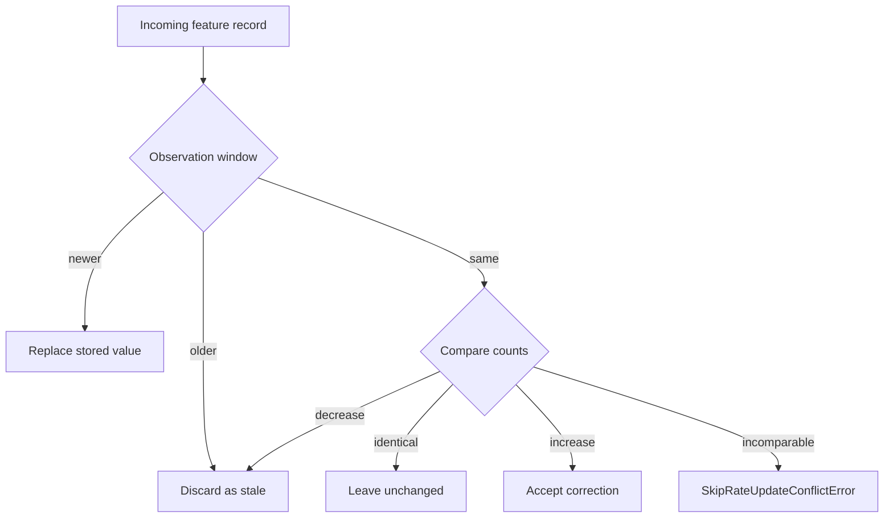
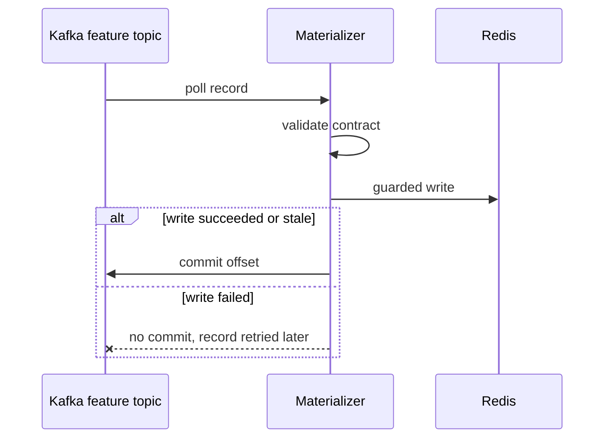
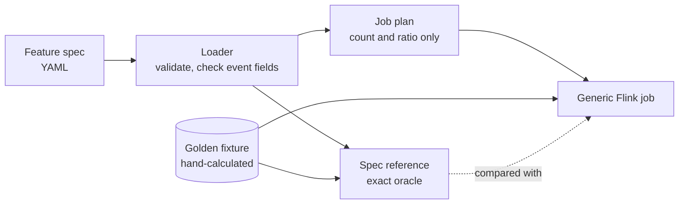
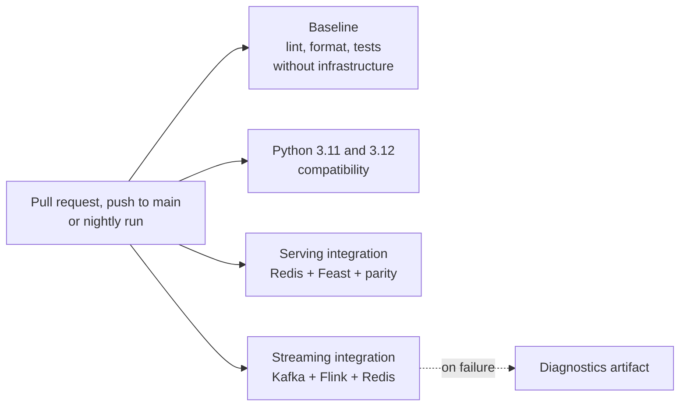
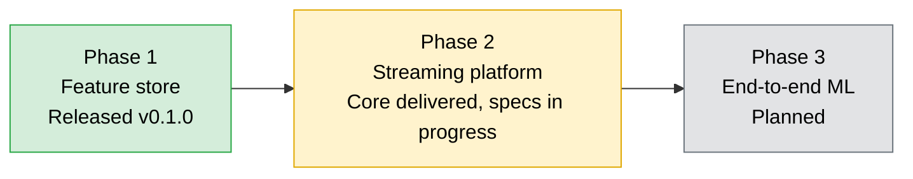

# FeatureForge Architecture

FeatureForge computes features once and serves them consistently for offline
training and low-latency online inference, from batch and streaming sources.

This document describes what is **implemented and tested today**.

---

## 1. System overview

| Concern | Implementation |
|---|---|
| Batch features | Pandas (reference), PySpark (parity-tested) |
| Offline store | One canonical Parquet root, Hive-style `observation_date` partitions |
| Retrieval and materialization | Feast, point-in-time joins |
| Streaming | Kafka, Flink (PyFlink), Pydantic contracts |
| Feature definitions as data | YAML specs, Pydantic validation, exact reference, one generic Flink job for both streaming features |
| Online store | Redis, feature-specific write policies |
| Quality | pytest, Ruff, four CI layers |

---

## 2. Batch path

- **One canonical source.** Backfill, correctness gate, freshness check, Feast
  and parity tests all read the same offline path. This prevents validating one
  path while serving another. See ADR-001 and ADR-002.
- **Idempotent backfills.** The same inputs overwrite the same partitions and
  write a run manifest.
- **Correctness and freshness are separate.** Correctness blocks bad data from
  reaching Redis. Freshness is a serving-safety check based on business-time
  partitions, not file timestamps. See ADR-003.
- **Time semantics.** Windows are `(t - window, t]`: the lower boundary is
  excluded, the observation time is included. Spark timestamps are encoded as
  UTC epoch microseconds to avoid timezone drift across the Python/JVM boundary.

---

## 3. Streaming path

### Topics and jobs

| Parameter | `user_play_count_1h` | `user_skip_rate_24h` |
|---|---|---|
| Window | 1 h, 1 min slide | 24 h, 1 min slide |
| Dedupe TTL | 24 h | 48 h |
| Watermark delay | 10 min | 10 min |
| Allowed lateness | 30 min | 30 min |
| Checkpoint interval | 10 s | 10 s |
| Emits | play count | play count, skip count, skip rate |

The generic job runs once per spec and takes these parameters from the spec.
For each feature it assigns event time, deduplicates by the spec's dedupe key
(`event_id` in both shipped specs), aggregates in user-keyed sliding windows,
and sends events that are too late for every window to a side-output topic. A
conflicting payload for a known `event_id` fails the job with
`EventIdentityConflictError`. A bounded mode lets tests consume the current
Kafka range and terminate.

**Savepoint resume.** The generic job can be stopped with a savepoint and
resumed by a new job from it. The Compose stack shares one savepoint volume
between JobManager and TaskManager. The recovery test shows for the play-count
spec that the resumed job restores the savepoint (it does not replay from the
earliest offset), that a redelivered event is not counted again because the
dedupe state survives, and that a late correction lands in the restored window
state. This covers a planned stop. It does not cover automatic recovery from a
checkpoint after a crash.

### Contracts

`InteractionEventV1` rejects invalid timestamps, ingestion before event time,
unknown fields, unsupported event types or sources, and invalid play semantics.
Invalid input becomes a rejection record with a stable schema and reason code.
It never blocks the valid events behind it.

### Online write policies

Each feature has its own store policy. They are deliberately not generic.

- **Play count** is append-only. Within one window the count may only grow.
- **Skip rate** compares `(play_count, skip_count)` componentwise, never the
  rate itself. An extra play lowers the rate and is a valid correction.
- **Concurrency.** Writers use Redis `WATCH`/`MULTI` with bounded retries.

### Materializers

Offsets are committed only after the Redis write. A materializer refuses an
empty Kafka range instead of silently completing without work.

---

## 4. Declarative feature specs

A feature can be described as a YAML spec instead of new platform code. The
spec language is bounded on purpose (ADR-008): it is not a general SQL or
streaming compiler.

- **A spec is data.** It declares entity keys, source, aggregations, derived
  values, window, lateness, deduplication, online policy, offline target and
  freshness SLO. Expressions use a small side-effect-free subset and are
  evaluated without `eval()`.
- **Validation before execution.** The spec model rejects a slide that does not
  divide the window, a dedupe TTL shorter than window plus allowed lateness,
  an online TTL shorter than the window, monotone update policies with
  non-count aggregations, and expressions outside the safe subset. The loader
  also rejects fields that are not in the event contract.
- **One exact reference.** The spec reference evaluates every operator over
  `(t - size, t]`, validates event identities across the whole input before any
  filtering, and returns `None`, never zero, for an empty `avg`, `min` or `max`.
  It is the oracle the engines are compared with.
- **Golden fixtures.** The skip-rate fixture holds hand-calculated values for
  both window edges, a duplicate delivery, ignored event types, a second user
  and expiry to a zero denominator. The play-count fixture covers the window
  edges and a deduplicated event. The Python reference and the spec reference
  both reproduce them.
- **Generic Flink job.** `jobs/feature_from_spec.py` builds the windowed
  computation from a plan derived from the spec. The plan supports count
  aggregations and one entity key. Other operators and composite keys raise
  `UnsupportedSpecError` instead of being computed wrongly. It is the only
  implementation of `user_play_count_1h` and `user_skip_rate_24h`: on the golden
  fixtures every emitted window matches both references, and the integration
  tests cover late corrections, too-late routing, replay, savepoint resume and
  the Redis path.
- **Still hand-written.** The Redis store policies and the materializers are
  written by hand per feature. `online.ttl` and `offline.store` in the specs
  are declarative only: the Redis stores write keys without expiry and no
  Iceberg store exists.

---

## 5. Serving

`OnlineFeatureClient` reads batch features (via Feast) and streaming features
(via the Redis streaming store) through one interface. Every value carries its
backend, availability, observation time, age and freshness class.

- A missing value is never converted to `0`.
- Availability and freshness are separate dimensions.
- Multi-feature reads are explicitly reported as non-atomic.
- Exit codes of `python -m featureforge.online`: `0` success including explicit
  missing values, `1` feature errors, `2` invalid request.

Serving parity tests compare Redis values with the latest canonical offline
partition.

---

## 6. Testing and CI

| CI job | Proves |
|---|---|
| Baseline | Clean install, Ruff, all tests marked not `integration` |
| Python 3.11 and 3.12 | The tests marked not `integration` on two more supported versions |
| Serving integration | Generate, backfill, apply, materialize, online parity, Redis store tests |
| Streaming integration | Full Compose stack, joined Kafka, Flink and Redis tests, including the generic spec-driven job |

Streaming integration tests that start Flink jobs each recreate the TaskManager
first. Reusing one long-lived worker across many PyFlink jobs became unstable
in CI. The root cause is not yet identified, so this isolates the tests but
does not explain the failure. See [Known limits](#known-limits).

The Flink image installs its Python dependencies explicitly and checks the
project imports at build time. A new runtime dependency of the job path must
be added to `docker/flink/Dockerfile`.

Failure simulations (stale partitions, invalid windows, missing Feast
repository) live in `tests/failure_simulations/`, with runbooks in
`docs/runbooks/`.

---

## 7. Roadmap

Planned and **not implemented**: spec-driven store policies, further operators
in Flink, Iceberg history, Cassandra backend, serving service with load tests,
observability and recovery drills, ML workflow with registry and rollback.
Scope and order: [STATUS.md](STATUS.md) and
[docs/PLATFORM_BLUEPRINT.md](docs/PLATFORM_BLUEPRINT.md).

---

## Known limits

- Local reference implementation: Docker Compose, synthetic data, no production
  scale claim. AWS (S3, DynamoDB, managed Kafka and Flink) is documented in
  [aws-production-profile.md](docs/aws-production-profile.md), not deployed.
- Replay tests cover fresh bounded executions. Stop with a savepoint and resume
  is verified for the play-count spec on the generic job. **Not** verified:
  automatic recovery from a checkpoint after a failure, dedupe after TTL
  expiry, multi-partition Kafka.
- Flink Kafka sinks use `AT_LEAST_ONCE`. Idempotency comes from dedupe and
  guarded Redis writes, not from end-to-end exactly-once.
- Streaming history and point-in-time retrieval of streaming features are not
  implemented.
- The event-identity conflict failure is tested for the play count only. The
  skip-rate spec runs the same code path.
- The TaskManager instability seen in CI is isolated, not explained.

## Decisions

| ADR | Topic |
|---|---|
| 001 | Offline/online feature store split |
| 002 | Canonical offline store contract |
| 003 | Freshness SLOs and fail-safe serving |
| 004 | GitHub Actions CI |
| 005 | AWS S3 production profile |
| 006 | Streaming platform integration |
| 007 | User skip rate 24h integration |
| 008 | Declarative feature specification |

## Principles

Event time, never ingestion time. Explicit time boundaries. Executable data
contracts. Deterministic output paths. Fail before bad data reaches consumers.
Commit offsets only after successful writes. Keep store policies feature-specific.
Every guarantee links to a test.