

  

# FeatureForge Architecture

[Overview](#1-system-overview) · [Batch path v1](#2-batch-path-v1) · [Streaming](#3-streaming-path) · [Specs](#4-declarative-feature-specs) · [History and datasets](#5-history-event-facts-and-training-datasets) · [Online stores](#6-online-stores) · [Serving](#7-feature-serving) · [Metrics and benchmarks](#8-observability-and-benchmarks) · [CI](#9-testing-and-ci) · [Known limits](#known-limits)

FeatureForge computes features once and serves them consistently for offline
training and online reads, from batch and streaming sources.

> [!NOTE]
> This document describes what is **implemented and tested today**. What is delivered, in
> progress and out of scope is in [STATUS.md](STATUS.md), and the reasons behind the design are
> in [docs/DESIGN.md](docs/DESIGN.md).

The platform is the spec-driven path: one YAML spec drives the Flink job, the
Spark backfill for count, sum and avg specs, the Redis or Cassandra store, the feature serving service, the
publication history and the training datasets. The Feast-based batch path (section 2) is batch
path v1. It serves the original batch features and was built first. Those features are not yet
defined as specs.

---

## 1. System overview

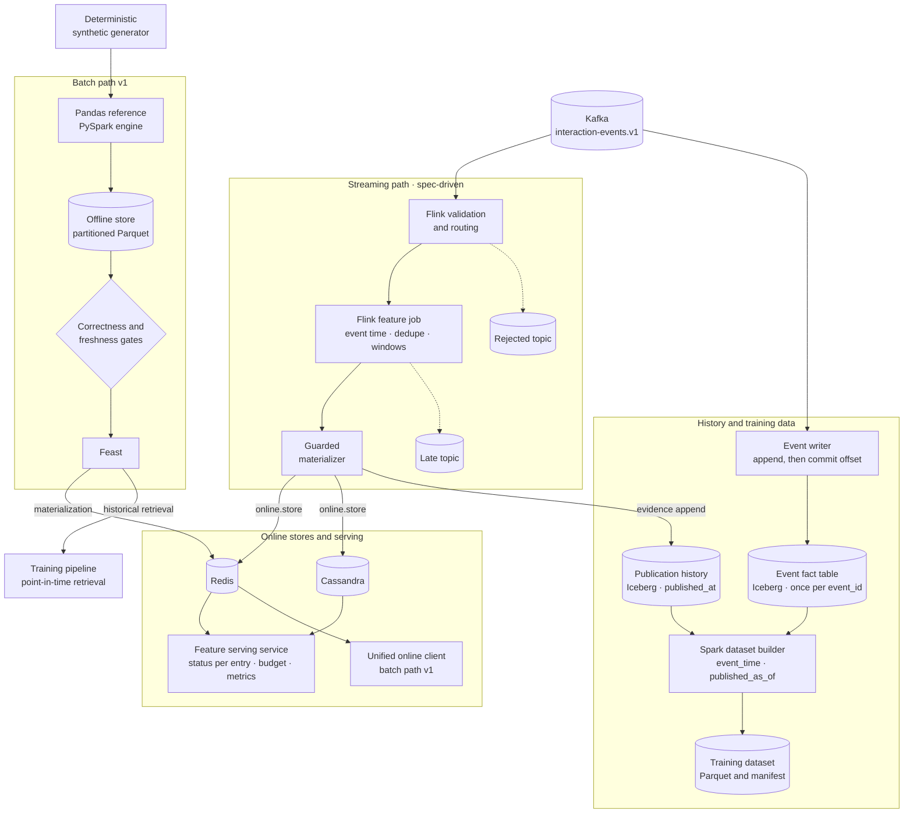

| Concern | Implementation |
|---|---|
| Batch features | Pandas (reference), PySpark (parity-tested) |
| Spec-driven backfill | PySpark, count, sum and avg specs: values at explicit observation times, equal to the spec reference, no availability time |
| Offline store | One canonical Parquet root, Hive-style `observation_date` partitions |
| Streaming | Kafka, Flink (PyFlink), Pydantic contracts |
| Feature definitions as data | YAML specs, Pydantic validation, exact reference, one generic Flink job for all spec-defined streaming features |
| Online store | Redis and Cassandra behind the `OnlineStore` protocol, chosen by `online.store` in the spec. One spec-driven store and materializer for count, sum and ratio specs. The two original features keep their typed models and command lines as thin wrappers over it |
| Feature serving | A FastAPI service (`featureforge-serve`) with a `ServingReader` per backend: one entry with a status for every entity and feature, a budget per request, no retries |
| Publication history | One Iceberg table per spec (PyIceberg writes, Spark reads, SQLite or PostgreSQL catalog), appended idempotently by `materialize_spec` with `--history-root` |
| Event fact store | One Iceberg table of validated events, idempotent by `event_id`, read at a pinned snapshot |
| Training datasets | Spark: features from events (`event_time`) or from a pinned history snapshot (`published_as_of`), a label from events, Parquet by UTC day and a manifest |
| Batch path v1: retrieval and materialization | Feast, point-in-time joins |
| Observability | Prometheus metrics of the service, a provisioned Grafana dashboard, an open-load benchmark with a compare script |
| Quality | pytest, Ruff, mypy, six CI jobs |

---

## 2. Batch path v1

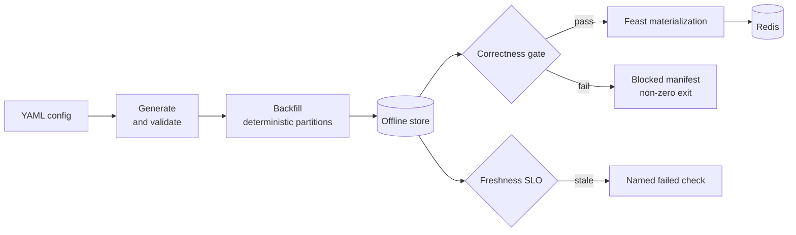

- **One canonical source.** Backfill, correctness gate, freshness check, Feast
  and parity tests all read the same offline path. This prevents validating one
  path while serving another. See ADR-001 and ADR-002.
- **Idempotent backfills.** The same inputs overwrite the same partitions and
  write a run manifest.
- **Correctness and freshness are separate.** Correctness blocks bad data from
  reaching Redis. Freshness is a serving-safety check based on business-time
  partitions, not file timestamps. See ADR-003.
- **Time semantics.** Windows are `(t - window, t]`: the lower boundary is
  excluded, the observation time is included. Spark timestamps are encoded as
  UTC epoch microseconds to avoid timezone drift across the Python/JVM boundary.

---

## 3. Streaming path

### Topics and jobs

The diagram shows the three shipped specs. Every spec gets its own feature topic and its own late topic.

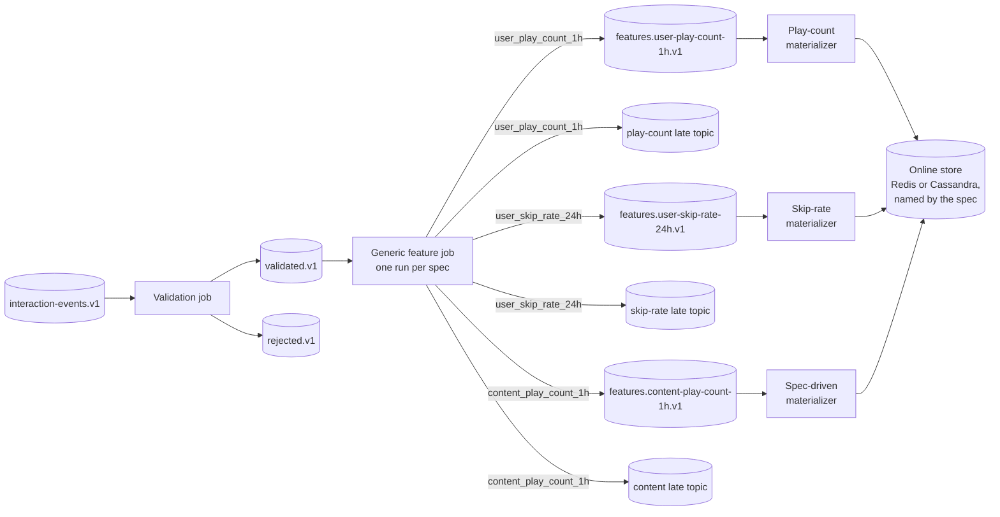

| Parameter | `user_play_count_1h` | `user_skip_rate_24h` | `content_play_count_1h` |
|---|---|---|---|
| Window | 1 h, 1 min slide | 24 h, 1 min slide | 1 h, 1 min slide |
| Dedupe TTL | 24 h | 48 h | 24 h |
| Watermark delay | 10 min | 10 min | 10 min |
| Allowed lateness | 30 min | 30 min | 30 min |
| Checkpoint interval | 10 s | 10 s | 10 s |
| Emits | play count | play count, skip count, skip rate | play count |

The generic job runs once per spec and takes these parameters from the spec.
For each feature it assigns event time, deduplicates by the spec's dedupe key
(`event_id` in all shipped specs), aggregates in sliding windows keyed by the
spec's entity key,
and sends events that are too late for every window to a side-output topic. A
conflicting payload for a known `event_id` fails the job with
`EventIdentityConflictError`. A bounded mode lets tests consume the current
Kafka range and terminate.

The dedupe state expires through a processing-time timer that the job registers
for each event ID when it first sees it. Flink state TTL is not used for this:
on PyFlink 1.20.3 it did not expire the state (see
[streaming provenance](docs/streaming-migration.md), PR #30). Replay
protection is therefore bounded by the spec's dedupe TTL, and an event
redelivered after expiry is counted again.

**Spec-only feature.** `content_play_count_1h` has entity `content_id` and is
defined by a YAML spec alone. It runs on the same job without code changes, and
its integration test checks every window of two contents against
hand-calculated values. Its feature topic is materialized into Redis by the
spec-driven store and materializer, also without feature-specific code (see
[Spec-driven online path](#4-declarative-feature-specs)). An end-to-end test
runs it from events through the validation job, the generic job and that path.

**Savepoint resume.** The generic job can be stopped with a savepoint and
resumed by a new job from it. The Compose stack shares one savepoint volume
between JobManager and TaskManager. The recovery test shows for the play-count
spec that the resumed job restores the savepoint (it does not replay from the
earliest offset), that a redelivered event is not counted again because the
dedupe state survives, and that a late correction lands in the restored window
state. This covers a planned stop. Crash recovery follows.

**Crash recovery.** The recovery test kills the TaskManager while the job runs.
The restart strategy of the cluster (fixed delay, 30 attempts) restarts the same
job. It restores the latest checkpoint, which the test requires to have been
triggered after the first event was processed and which is not a savepoint. A
redelivered event is not counted again, and a late correction lands in the
restored window. The JobManager keeps running and holds the checkpoints in
memory, so this does not cover JobManager loss. Kafka sinks are
`AT_LEAST_ONCE`, so the test checks the final value per window, not the number
of emissions.

### Contracts

`InteractionEventV1` rejects invalid timestamps, ingestion before event time,
unknown fields, unsupported event types or sources, and invalid play semantics.
Invalid input becomes a rejection record with a stable schema and reason code.
It never blocks the valid events behind it.

### Online write policies

The update policy is part of the spec (`online.update_policy`). The stores of
the two original features are thin wrappers over the spec-driven store, which
implements the ordering for any count, sum or ratio spec.

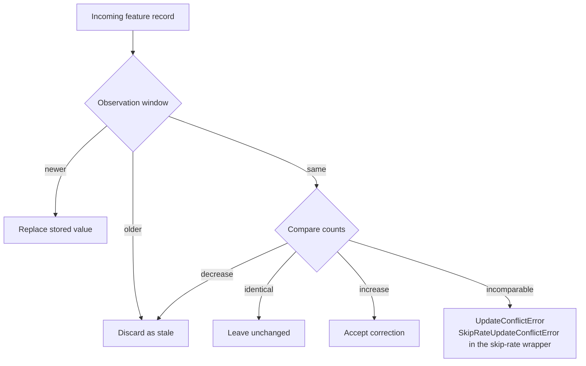

- **Play count** is append-only. Within one window the count may only grow.
- **Skip rate** compares `(play_count, skip_count)` componentwise, never the
  rate itself. An extra play lowers the rate and is a valid correction.
- **Spec-driven store.** One decision function orders count vectors: a vector
  with one component is the append-only rule, a vector with several components
  the componentwise rule. It is checked against the hand-written skip-rate
  policy on 768 combinations. `window_replace` is not implemented and the store
  refuses it at construction.
- **TTL.** The spec-driven store sets `online.ttl` as an expiry with every
  written update (`SET ... EX` in Redis, `USING TTL` in Cassandra). The expiry runs in wall-clock time from the last accepted
  write, and unchanged or stale updates do not extend it. An expired key reads
  as missing, never as zero. The wrappers of the two original features use the
  same store, so their keys expire too.
- **Keys.** In Redis `featureforge-stream:online:v{spec.version}:{spec.name}:{entity}`,
  identical to the keys of the two original features. A new spec version opens a
  new namespace. Cassandra keeps the same namespace per spec in one table
  (see [Online stores](#6-online-stores)).
- **Concurrency.** The write is guarded and retried at most 16 times: Redis
  `WATCH`/`MULTI`, Cassandra lightweight transactions.

### Materializers

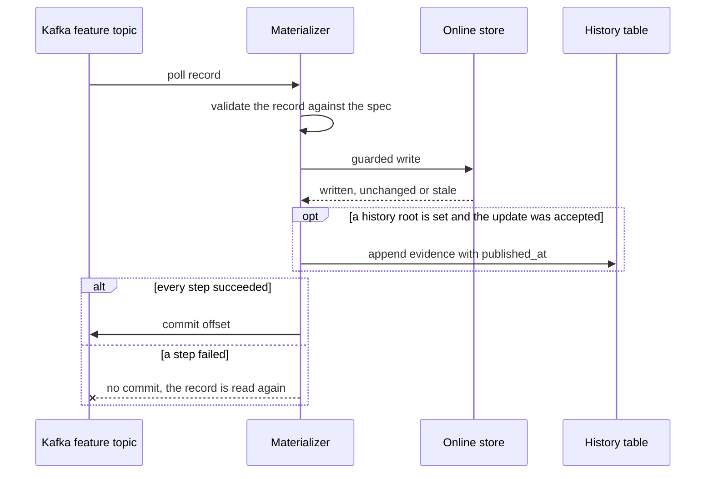

The order is fixed: store write, evidence append, offset commit. Offsets are committed only after
the store write and the evidence append, so a crash repeats work and never skips it. A replay
decides again and sees `unchanged` for a write that was already applied. A materializer refuses an
empty Kafka range instead of silently completing without work.

The spec-driven materializer (`materialize_spec`) takes a spec instead of a
feature-specific module. It derives the feature topic from the spec
(`features.{name with hyphens}.v{version}`, which equals the topics of the two
original features), validates every record against the spec with
`parse_feature_record`, including the derived values, and writes it through the
spec-driven store. The store comes from the store factory, which follows `online.store` in the spec, so the same
materializer writes to Redis or to Cassandra. It reads single-partition topics only and rejects
tombstones. An invalid record stops the run without committing its offset.

<a href="#top">Back to top</a>

---

## 4. Declarative feature specs

A feature can be described as a YAML spec instead of new platform code. The
spec language is bounded on purpose (ADR-008): it is not a general SQL or
streaming compiler.

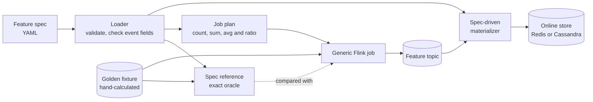

- **A spec is data.** It declares entity keys, source, aggregations, derived
  values, window, lateness, deduplication, online policy, offline target and
  freshness SLO. Expressions use a small side-effect-free subset and are
  evaluated without `eval()`.
- **Validation before execution.** The spec model rejects a slide that does not
  divide the window, a dedupe TTL shorter than window plus allowed lateness,
  an online TTL shorter than the window, `append_only` with anything but one
  count, `componentwise_monotonic` with operators other than count and sum, and
  expressions outside the safe subset. The loader also rejects fields that are
  not in the event contract, and a summed field that is not a non-negative
  integer under `componentwise_monotonic`.
- **One exact reference.** The spec reference evaluates every operator over
  `(t - size, t]`, validates event identities across the whole input before any
  filtering, and returns `None`, never zero, for an empty `avg`, `min` or `max`.
  It is the oracle the engines are compared with.
- **Golden fixtures.** The skip-rate fixture holds hand-calculated values for
  both window edges, a duplicate delivery, ignored event types, a second user
  and expiry to a zero denominator. The play-count fixture covers the window
  edges and a deduplicated event. The Python reference and the spec reference
  both reproduce them.
- **Generic Flink job.** `jobs/feature_from_spec.py` builds the windowed
  computation from a plan derived from the spec. The plan supports count
  aggregations and one entity key. Other operators and composite keys raise
  `UnsupportedSpecError` instead of being computed wrongly. It is the only
  implementation of `user_play_count_1h` and `user_skip_rate_24h`: on the golden
  fixtures every emitted window matches both references, and the integration
  tests cover late corrections, too-late routing, replay, savepoint resume,
  crash recovery and the Redis path. A third spec, `content_play_count_1h` with
  entity `content_id`, runs on it without code changes.
- **Spec-driven online path.** `parse_feature_record` validates the record the
  job emits against the spec: field set, entity id, window length, counts and
  recomputed derived values. `RedisSpecStore` or `CassandraSpecStore` writes it with the policy of the
  spec, and `materialize_spec` moves a feature topic into the store that the spec names. For
  `content_play_count_1h` the whole path from events to Redis is covered by an
  end-to-end test with hand-calculated windows, a redelivered event, the TTL, an
  idempotent rerun and a replay that cannot undo the stored state (ADR-009).
- **Thin wrappers.** The stores and materializers of the two original features
  (`online_store.py`, `skip_rate_store.py`, `materialize.py`,
  `materialize_skip_rate.py`) keep their typed models, constructors and command
  lines and delegate to the spec-driven store and materializer. They load their
  spec from `feature_repo/specs/` next to the source tree. `offline.store` in
  the specs is declarative only: no Iceberg offline feature store exists (the history table of section 5 only records publication evidence).

---

## 5. History, event facts and training datasets

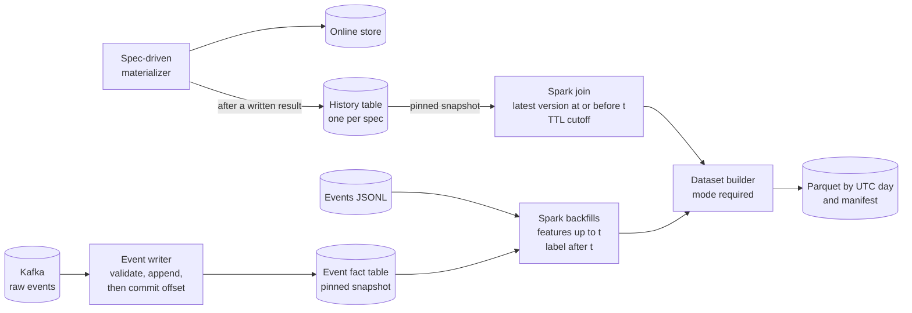

- **Publication evidence.** After the store returns `written`, the materializer
  appends the update to the history table of the spec with `published_at`, one
  UTC clock reading. The table is partitioned by the day of `published_at`, the
  first row of an update identity wins, and one appender per table is the rule
  (ADR-010, ADR-011).
- **Published-as-of rule.** A version is available at `T` if its `published_at`
  is at or before `T`, no later accepted version has `published_at` at or before
  `T`, and `T` is before `published_at + online.ttl`. Past that the value is
  missing, never zero. `published_as_of` answers this for one time in Python and
  is the oracle for the Spark join.
- **Labels.** A label is computed from events over `(t, t + horizon]`. An
  observation whose window ends after `data_end` is excluded and counted, and a
  label is never null (ADR-012).
- **Two modes, never substituted.** `build_training_dataset` requires a mode.
  `event_time` computes features from events over `(t - size, t]`, including
  events that arrived late. `published_as_of` takes them from a pinned history
  snapshot with one Spark scan per table: the version with the highest rank
  (`published_at`, `observation_time`, the counts, `update_id`) among those at or
  before `t`, expired when `t` reaches `published_at + online.ttl`. A feature
  that is not published or expired has null values and a `status` column.
- **History start.** An observation before the latest history start of all
  features has no evidence either way. It is excluded and counted in
  `excluded_before_history`, and an observation exactly at the start stays.
- **Leakage rule.** Features use only information up to `t`, the label only
  events strictly after `t`. An event at `t` belongs to the features.
- **Output.** Parquet partitioned by the UTC day of the observation time, never
  overwritten, with `_manifest.json`: mode, spec versions, `data_end`, counts,
  every partition with its rows, the Spark version and, in `published_as_of`
  mode, the snapshot id and start of every history (ADR-014).
- **Boundary.** `training_dataset.py` never imports PyIceberg. The caller reads
  the history and passes one pinned frame per feature. A dataset run never
  writes to the history, and a test checks that the snapshot is unchanged.
- **Limits.** The `published_as_of` mode needs one entity key. `history_start`
  marks only the beginning of the evidence, so a later gap reads as
  `not_published`. The `build-training-dataset` command writes a dataset in either mode and `load_training_dataset` reads it back through the manifest, and `open_training_batches` yields it as Arrow batches. See
  [Known limits](#known-limits) and [STATUS.md](STATUS.md).

### Event fact store

Validated events are kept as immutable facts, so a training dataset can be rebuilt from a pinned
snapshot instead of from a file ([ADR-015](docs/adr/ADR-015-iceberg-event-fact-store.md)).

- **Table.** `facts.interaction_events` is an Iceberg table partitioned by `day(event_time)`. It
  keeps `ingested_at`, which the Flink job drops.
- **Writer.** The event writer reads the raw topic in its own consumer group, validates with
  `route_event_json`, appends and only then commits the offset. Rejections are counted and not
  stored.
- **Idempotent by `event_id`.** The first row wins and keeps its `ingested_at`. The same id with
  another payload fails and writes nothing.
- **Pinned reads.** `build-training-dataset --mode event_time --events-root` reads the table at
  the snapshot that is current at the start, or at `--events-snapshot-id`, and records it in the
  manifest under `events`.
- **Limits.** One writer per table, no compaction and no retention. The writer and the Flink job
  read the topic independently, so an event can be online before it is in the table or the other
  way round.

<a href="#top">Back to top</a>

---

## 6. Online stores

One contract, two backends ([ADR-013](docs/adr/ADR-013-online-store-protocol.md)). `OnlineStore`
is a protocol with two methods: `read(entity_value)` returns a validated record or `None`, and
`write(record)` returns `written`, `unchanged` or `stale`. Record validation, the decision
function and the outcomes are shared. A backend supplies only the read, the guarded write and the
expiry.

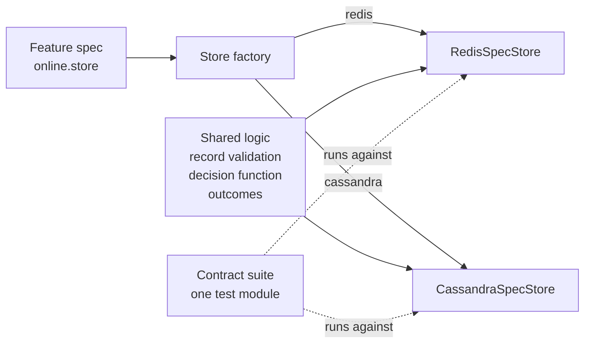

| | Redis | Cassandra |
|---|---|---|
| Guarded write | `WATCH`/`MULTI`, at most 16 attempts | `INSERT ... IF NOT EXISTS`, `UPDATE ... IF payload = <value read>` (lightweight transaction), at most 16 attempts |
| Expiry | `SET ... EX online.ttl` | `USING TTL` |
| Consistency | single node | `LOCAL_SERIAL` for the Paxos phase, `LOCAL_QUORUM` for commit and reads |
| Layout | one key per spec, version and entity | one table `online_features`, partition `(entity_key, entity_value)`, clustering column `feature` |
| Payload | JSON | the same JSON, unchanged |
| Read in the service | one `MGET` per request | one partition read per entity, run concurrently |

- **Backend choice.** `online.store` in the spec accepts `redis` and `cassandra`. The store
  factory returns the store, and nothing else selects a backend.
- **Same rules.** An unknown entity reads as `None`, never zero. An incomparable count vector
  raises and leaves the stored value unchanged. The expiry is set only on `written`.
- **Schema.** `ensure_schema` creates the keyspace and the table if they are absent and never
  alters them. A table that does not match fails loudly.
- **Proof.** `tests/integration/test_online_store_contract.py` runs for both backends. One
  end-to-end test runs `content_play_count_1h` from events through the validation job, the
  generic Flink job, the materializer and the service on Cassandra, with only `online.store`
  changed.
- **Limits.** The local Cassandra is one node. It proves the protocol logic and nothing about
  replication or the failure of a node. The Cassandra write path is not measured.

---

## 7. Feature serving

The feature serving service answers a lookup for several entities and features in one request
([ADR-016](docs/adr/ADR-016-feature-serving.md)). It serves features that are defined by specs.

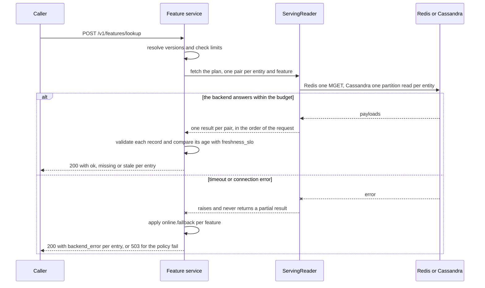

| Endpoint | Purpose |
|---|---|
| `POST /v1/features/lookup` | At most 100 entities and 50 features. One entry for every pair, never dropped |
| `GET /healthz` | The process is alive |
| `GET /readyz` | The specs are loaded and the store answers a ping |
| `GET /metrics` | Prometheus metrics |

| Status | Meaning | Value in the entry |
|---|---|---|
| `ok` | Present and fresh | The stored values |
| `missing` | No key, an unknown entity or an expired key | Null, or the declared default with `defaulted: true` |
| `stale` | Older than `freshness_slo`, or an observation time in the future | Kept, with its age, so the caller decides |
| `backend_error` | A timeout, a connection error or a record that fails validation | Null, or the declared default with `defaulted: true` |

- **Never a silent zero.** A default exists only where the spec declares `online.fallback` with
  the policy `default_value`, and the entry says so.
- **Fallback per feature.** `omit` (default) keeps the status and a null value, `default_value`
  returns the configured values, and `fail` answers the whole request with 503 when that feature
  is a `backend_error`. `missing` is a data state and never fails a request.
- **Budget.** 50 ms per request by default, enforced as the socket timeout of the store client. It
  is not a deadline over the whole request: validation and serialization come on top.
- **No retries** in the request path. A retry hides tail latency inside the budget.
- **Readers.** The Redis reader makes one `MGET` over the keys of all pairs and reads on the
  event loop with `redis.asyncio`. The Cassandra reader makes one partition read per entity,
  runs them concurrently at `LOCAL_QUORUM` and runs in the thread pool. One process serves one
  backend.
- **Isolation.** A corrupt record is `backend_error` for its own entry. The other entries of the
  request stay valid.
- **Versions.** Without a version in the request, the highest loaded version of a name is used and
  the response states it. An unknown name or version answers 422.
- **Not atomic.** The response states `atomic: false`.
- **Out of scope.** Authentication, TLS and rate limiting.

### Unified client for batch path v1

`OnlineFeatureClient` reads batch features (via Feast) and streaming features
(play count and skip rate, via the Redis streaming store) through one
interface. Every value carries its
backend, availability, observation time, age and freshness class.

- A missing value is never converted to `0`. An expired streaming key reads as
  missing.
- Availability and freshness are separate dimensions.
- Multi-feature reads are explicitly reported as non-atomic.
- Exit codes of `python -m featureforge.online`: `0` success including explicit
  missing values, `1` feature errors, `2` invalid request.

Serving parity tests compare Redis values with the latest canonical offline
partition.

<a href="#top">Back to top</a>

---

## 8. Observability and benchmarks

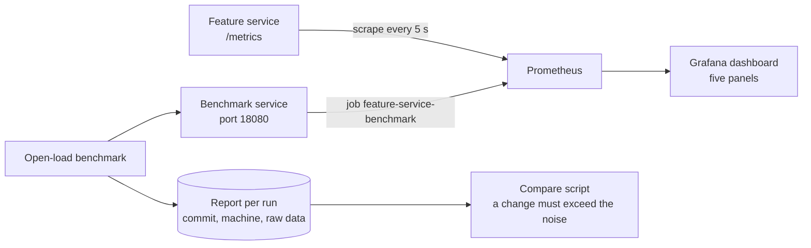

The service exports four metrics: the lookup duration, the entries by status, the requests by
outcome and the event loop lag ([docs/observability.md](docs/observability.md)). The benchmark
sends requests at a fixed rate whether or not earlier ones have returned, so a slow service
cannot hide its own queue.

| Serving backend | Highest measured rate with p99 at most 25 ms | p99 at that rate | Saturation of one process | CPU per request |
|---|---|---|---|---|
| Redis 7.4 | 4,000 req/s | 5.1 to 7.3 ms | 4,600 to 4,900 req/s | 0.19 to 0.29 ms |
| Cassandra 5.0, one node | 1,500 req/s | 14.2 to 14.8 ms | about 2,100 req/s | 0.46 to 0.51 ms |

> [!NOTE]
> One laptop (Apple M4 Pro), client and service on the same machine, both databases in Docker
> Desktop, 1,000,000 users with 2 features each, 5 entities per request, one uvicorn process, 3
> runs of 30 s per rate. These are local measurements and no production numbers, and p99 at most
> 25 ms is a target, not an SLO. Setup, raw data and every limit: [docs/benchmarks.md](docs/benchmarks.md).

---

## 9. Testing and CI

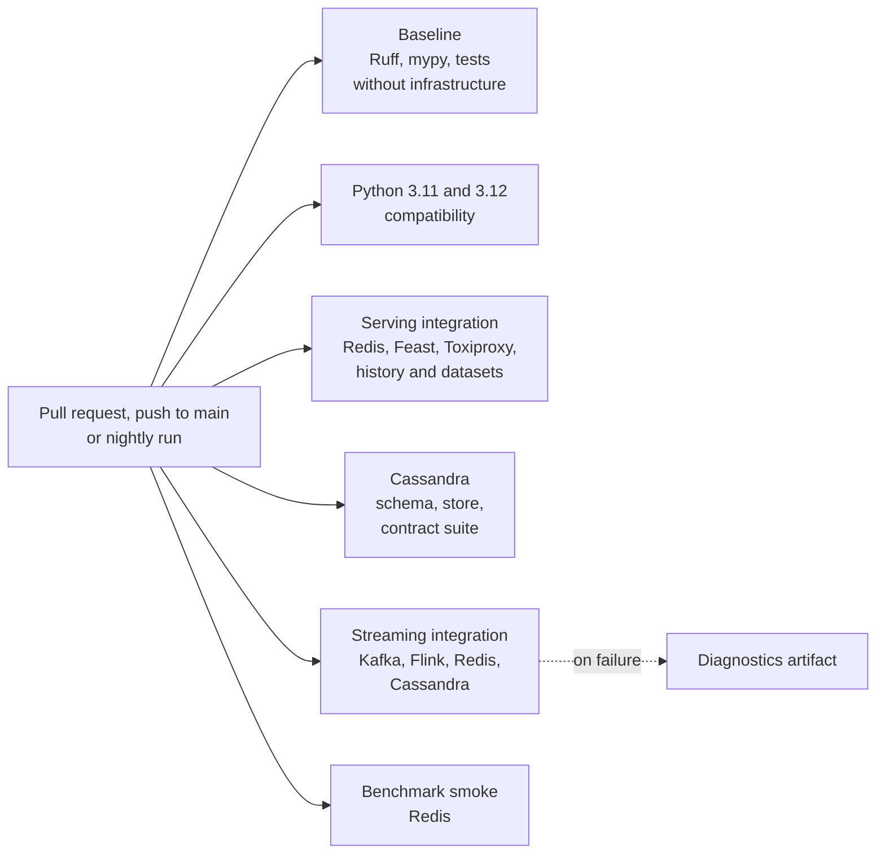

| CI job | Proves |
|---|---|
| Baseline | Clean install, Ruff, mypy, all tests marked not `integration` |
| Python 3.11 and 3.12 | The tests marked not `integration` on two more supported versions |
| Serving integration | Generate, backfill, apply, materialize, online parity, Redis store tests, the contract suite on Redis, the feature service on a real, a stopped and a slow Redis, history, published-as-of join and training dataset tests. Fails on a skipped test |
| Cassandra | The node, the table schema, the contract suite on Cassandra and the Cassandra serving reader. Fails on a skipped test |
| Streaming integration | Full Compose stack with the Cassandra profile, 20 modules of joined Kafka, Flink, Redis and Cassandra tests, including the generic spec-driven job |
| Benchmark smoke | The benchmark tool runs against Redis. It is not a performance gate |

Streaming integration tests that start Flink jobs each recreate the TaskManager
first. Reusing one long-lived worker across many PyFlink jobs became unstable
in CI. The root cause is not yet identified, so this isolates the tests but
does not explain the failure. See [Known limits](#known-limits).

The Flink image installs its Python dependencies explicitly and checks the
project imports at build time. A new runtime dependency of the job path must
be added to `docker/flink/Dockerfile`.

Failure simulations (stale partitions, invalid windows, missing Feast
repository) live in `tests/failure_simulations/`, with runbooks in
`docs/runbooks/`.

---

## 10. Where the work stands

```mermaid
flowchart LR
    subgraph Done["Delivered"]
        direction TB
        A1[Batch path v1<br/>released as v0.1.0]:::done
        A2[Streaming correctness<br/>late data, replay, recovery]:::done
        A3[Online stores<br/>Redis and Cassandra]:::done
        A4[Feature serving<br/>measured on one laptop]:::done
        A5[Event fact store]:::done
    end
    subgraph Wip["In progress"]
        direction TB
        B1[Spec engine<br/>operators beyond count,<br/>composite keys]:::wip
        B2[History and datasets<br/>Iceberg offline store]:::wip
        B3[Operations<br/>alerts, drills, soak run]:::wip
    end
    subgraph Plan["Planned"]
        direction TB
        C1[Catalog and discovery]:::plan
        C2[Embeddings]:::plan
        C3[ML workflow<br/>registry and rollback]:::plan
    end
    Done --> Wip --> Plan

    classDef done fill:#d4edda,stroke:#28a745,color:#000
    classDef wip fill:#fff3cd,stroke:#e0a800,color:#000
    classDef plan fill:#e2e3e5,stroke:#6c757d,color:#000
```

Planned and **not implemented**: a `window_replace` store policy, further
operators in Flink, alerts, recovery drills and a soak run, a catalog, embeddings and an ML
workflow with registry and rollback. Scope and order: [STATUS.md](STATUS.md) and
[docs/PLATFORM_BLUEPRINT.md](docs/PLATFORM_BLUEPRINT.md).

---

## Known limits

> [!WARNING]
> The full list with the impact of every gap is in [STATUS.md](STATUS.md#known-gaps). These are
> the limits that shape the architecture.

- Local reference implementation: Docker Compose, synthetic data, no production
  scale claim. AWS (S3, DynamoDB, managed Kafka and Flink) is documented in
  [aws-production-profile.md](docs/aws-production-profile.md), not deployed.
- Replay tests cover fresh bounded executions. Stop with a savepoint and resume,
  and recovery from a TaskManager crash, are verified for the play-count spec on
  the generic job. Dedupe expiry after the TTL is verified for the play-count
  spec with a shortened TTL: a redelivery after expiry is counted again.
  **Not** verified: JobManager failure, the production TTL values of 24 h and
  48 h, multi-partition Kafka.
- Flink Kafka sinks use `AT_LEAST_ONCE`. Idempotency comes from dedupe and
  guarded store writes, not from end-to-end exactly-once. Kafka, the online store and Iceberg
  do not share a transaction.
- The Flink job and the Spark backfill support count, sum and avg aggregations and one entity
  key. `sum` and `avg` can be served online with `componentwise_monotonic`, the average as
  a derived value. `window_replace` has no store, so `last_k` and `approx_distinct` cannot be
  served online. The
  `published_as_of` dataset mode needs one entity key.
- The parity between Redis and `published_as_of` is tested over two bounded runs of one entity
  (`tests/integration/test_materialize_spec_kafka_to_history.py`). `history_start` marks only the
  beginning of the evidence, so a later gap reads as `not_published`.
- The spec-driven store is proven end to end from events to Redis and from events to Cassandra
  by its own tests for `content_play_count_1h`. The two original features run on the same
  code through their wrappers and are covered by their joined tests and Redis
  integration tests, including a real concurrent writer. Wrappers locate their
  spec relative to the source tree and need a repository checkout.
- The event fact table has one writer, no compaction and no retention, and its append slows
  down with the number of data files.
- Cassandra runs as one local node. Replication and the failure of a node are not shown.
- Serving is measured on one laptop with one service process. The budget is a socket timeout
  and not a deadline over the whole request. Rare bursts of `backend_error` from timeouts
  appeared with both backends, and the cause is open ([docs/benchmarks.md](docs/benchmarks.md)).
- There are no alert rules, no recovery drill beyond a TaskManager crash and no soak run.
- The TaskManager instability seen in CI is isolated, not explained.

## Decisions

| ADR | Topic |
|---|---|
| [001](docs/adr/ADR-001-offline-online-feature-store-split.md) | Offline/online feature store split |
| [002](docs/adr/ADR-002-canonical-offline-store-contract.md) | Canonical offline store contract |
| [003](docs/adr/ADR-003-freshness-slos-and-fail-safe-serving.md) | Freshness SLOs and fail-safe serving |
| [004](docs/adr/ADR-004-github-actions-ci.md) | GitHub Actions CI |
| [005](docs/adr/ADR-005-aws-s3-offline-store-profile.md) | AWS S3 production profile |
| [006](docs/adr/ADR-006-streaming-feature-platform-integration.md) | Streaming platform integration |
| [007](docs/adr/ADR-007-skip-rate-streaming-integration.md) | User skip rate 24h integration |
| [008](docs/adr/ADR-008-feature-spec-design.md) | Declarative feature specification |
| [009](docs/adr/ADR-009-spec-driven-online-stores.md) | Spec-driven online stores and materializer |
| [010](docs/adr/ADR-010-time-and-availability-model.md) | Time and availability model for streaming history |
| [011](docs/adr/ADR-011-history-table-layout.md) | History table layout and evidence append |
| [012](docs/adr/ADR-012-label-specs.md) | Label specs |
| [013](docs/adr/ADR-013-online-store-protocol.md) | Online store protocol |
| [014](docs/adr/ADR-014-training-datasets.md) | Training datasets |
| [015](docs/adr/ADR-015-iceberg-event-fact-store.md) | Iceberg event fact store |
| [016](docs/adr/ADR-016-feature-serving.md) | Feature serving service |

## Principles

Event time, never ingestion time. Explicit time boundaries. Executable data
contracts. Deterministic output paths. Fail before bad data reaches consumers.
Commit offsets only after successful writes. Declare store policies in the
feature spec and test each one. Every guarantee links to a test.

---

[README](README.md) · [Status](STATUS.md) · [Design](docs/DESIGN.md) · [Platform blueprint](docs/PLATFORM_BLUEPRINT.md) · [Benchmarks](docs/benchmarks.md)

<a href="#top">Back to top</a>

