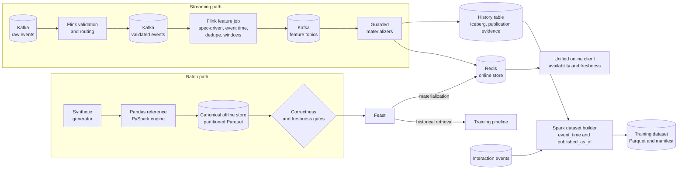
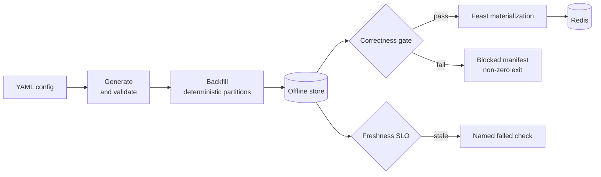
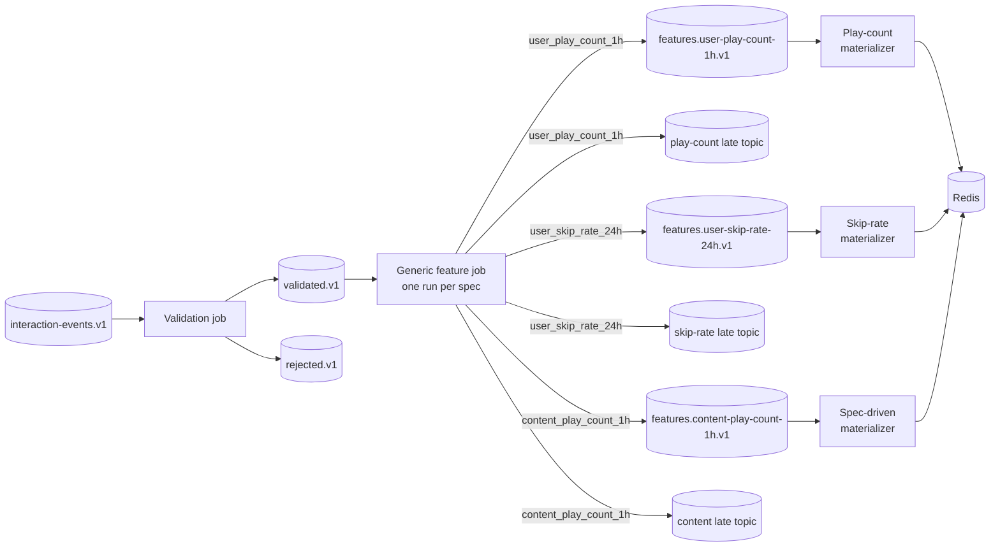
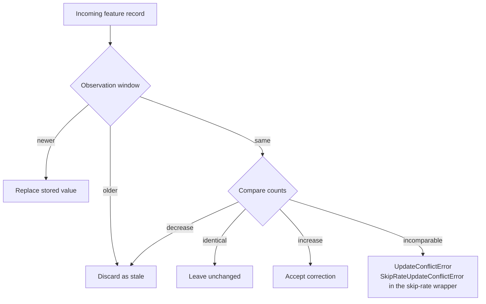
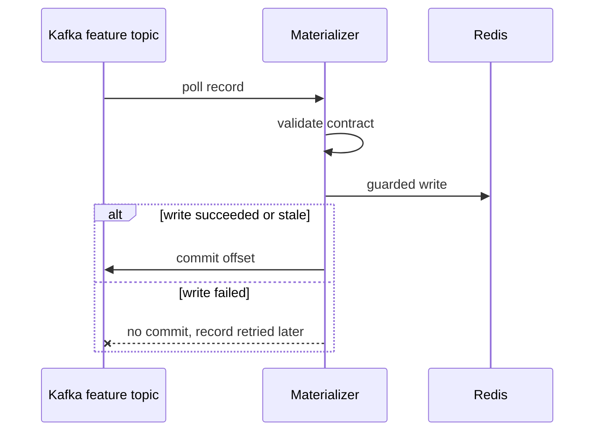
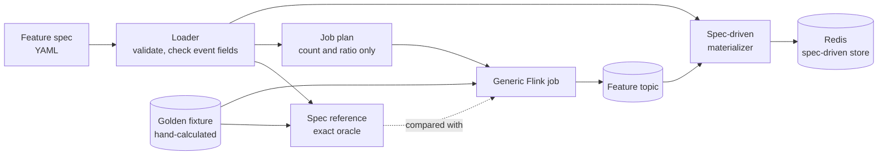
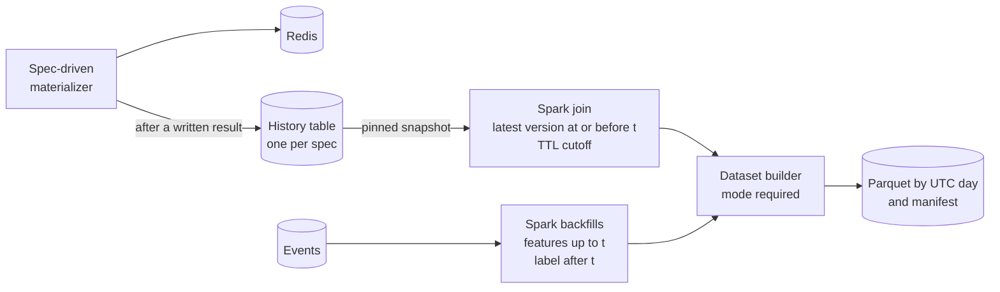
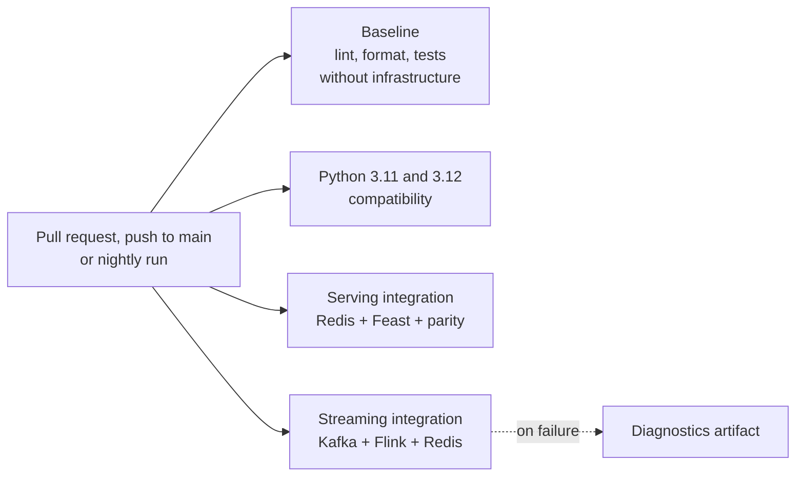
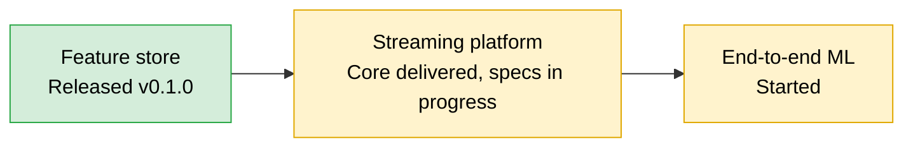

# FeatureForge Architecture

FeatureForge computes features once and serves them consistently for offline
training and online reads, from batch and streaming sources.

This document describes what is **implemented and tested today**.

---

## 1. System overview

| Concern | Implementation |
|---|---|
| Batch features | Pandas (reference), PySpark (parity-tested) |
| Spec-driven backfill | PySpark, count specs: values at explicit observation times, equal to the spec reference, no availability time |
| Offline store | One canonical Parquet root, Hive-style `observation_date` partitions |
| Publication history | One Iceberg table per spec (PyIceberg writes, Spark reads, SQLite or PostgreSQL catalog), appended idempotently by `materialize_spec` with `--history-root` |
| Training datasets | Spark: features from events (`event_time`) or from a pinned history snapshot (`published_as_of`), a label from events, Parquet by UTC day and a manifest |
| Retrieval and materialization | Feast, point-in-time joins |
| Streaming | Kafka, Flink (PyFlink), Pydantic contracts |
| Feature definitions as data | YAML specs, Pydantic validation, exact reference, one generic Flink job for all spec-defined streaming features |
| Online store | Redis. One spec-driven store and materializer for count and ratio specs. The two original features keep their typed models and command lines as thin wrappers over it |
| Quality | pytest, Ruff, mypy, four CI layers |

---

## 2. Batch path

- **One canonical source.** Backfill, correctness gate, freshness check, Feast
  and parity tests all read the same offline path. This prevents validating one
  path while serving another. See ADR-001 and ADR-002.
- **Idempotent backfills.** The same inputs overwrite the same partitions and
  write a run manifest.
- **Correctness and freshness are separate.** Correctness blocks bad data from
  reaching Redis. Freshness is a serving-safety check based on business-time
  partitions, not file timestamps. See ADR-003.
- **Time semantics.** Windows are `(t - window, t]`: the lower boundary is
  excluded, the observation time is included. Spark timestamps are encoded as
  UTC epoch microseconds to avoid timezone drift across the Python/JVM boundary.

---

## 3. Streaming path

### Topics and jobs

| Parameter | `user_play_count_1h` | `user_skip_rate_24h` | `content_play_count_1h` |
|---|---|---|---|
| Window | 1 h, 1 min slide | 24 h, 1 min slide | 1 h, 1 min slide |
| Dedupe TTL | 24 h | 48 h | 24 h |
| Watermark delay | 10 min | 10 min | 10 min |
| Allowed lateness | 30 min | 30 min | 30 min |
| Checkpoint interval | 10 s | 10 s | 10 s |
| Emits | play count | play count, skip count, skip rate | play count |

The generic job runs once per spec and takes these parameters from the spec.
For each feature it assigns event time, deduplicates by the spec's dedupe key
(`event_id` in all shipped specs), aggregates in sliding windows keyed by the
spec's entity key,
and sends events that are too late for every window to a side-output topic. A
conflicting payload for a known `event_id` fails the job with
`EventIdentityConflictError`. A bounded mode lets tests consume the current
Kafka range and terminate.

The dedupe state expires through a processing-time timer that the job registers
for each event ID when it first sees it. Flink state TTL is not used for this:
on PyFlink 1.20.3 it did not expire the state (see
[streaming provenance](docs/streaming-migration.md), PR #30). Replay
protection is therefore bounded by the spec's dedupe TTL, and an event
redelivered after expiry is counted again.

**Spec-only feature.** `content_play_count_1h` has entity `content_id` and is
defined by a YAML spec alone. It runs on the same job without code changes, and
its integration test checks every window of two contents against
hand-calculated values. Its feature topic is materialized into Redis by the
spec-driven store and materializer, also without feature-specific code (see
[Spec-driven online path](#4-declarative-feature-specs)). An end-to-end test
runs it from events through the validation job, the generic job and that path.

**Savepoint resume.** The generic job can be stopped with a savepoint and
resumed by a new job from it. The Compose stack shares one savepoint volume
between JobManager and TaskManager. The recovery test shows for the play-count
spec that the resumed job restores the savepoint (it does not replay from the
earliest offset), that a redelivered event is not counted again because the
dedupe state survives, and that a late correction lands in the restored window
state. This covers a planned stop. Crash recovery follows.

**Crash recovery.** The recovery test kills the TaskManager while the job runs.
The restart strategy of the cluster (fixed delay, 30 attempts) restarts the same
job. It restores the latest checkpoint, which the test requires to have been
triggered after the first event was processed and which is not a savepoint. A
redelivered event is not counted again, and a late correction lands in the
restored window. The JobManager keeps running and holds the checkpoints in
memory, so this does not cover JobManager loss. Kafka sinks are
`AT_LEAST_ONCE`, so the test checks the final value per window, not the number
of emissions.

### Contracts

`InteractionEventV1` rejects invalid timestamps, ingestion before event time,
unknown fields, unsupported event types or sources, and invalid play semantics.
Invalid input becomes a rejection record with a stable schema and reason code.
It never blocks the valid events behind it.

### Online write policies

The update policy is part of the spec (`online.update_policy`). The stores of
the two original features are thin wrappers over the spec-driven store, which
implements the ordering for any count or ratio spec.

- **Play count** is append-only. Within one window the count may only grow.
- **Skip rate** compares `(play_count, skip_count)` componentwise, never the
  rate itself. An extra play lowers the rate and is a valid correction.
- **Spec-driven store.** One decision function orders count vectors: a vector
  with one component is the append-only rule, a vector with several components
  the componentwise rule. It is checked against the hand-written skip-rate
  policy on 768 combinations. `window_replace` is not implemented and the store
  refuses it at construction.
- **TTL.** The spec-driven store sets `online.ttl` as a Redis expiry with every
  written update. The expiry runs in wall-clock time from the last accepted
  write, and unchanged or stale updates do not extend it. An expired key reads
  as missing, never as zero. The wrappers of the two original features use the
  same store, so their keys expire too.
- **Keys.** `featureforge-stream:online:v{spec.version}:{spec.name}:{entity}`,
  identical to the keys of the two original features. A new spec version opens a
  new namespace.
- **Concurrency.** Writers use Redis `WATCH`/`MULTI` with bounded retries.

### Materializers

Offsets are committed only after the Redis write. A materializer refuses an
empty Kafka range instead of silently completing without work.

The spec-driven materializer (`materialize_spec`) takes a spec instead of a
feature-specific module. It derives the feature topic from the spec
(`features.{name with hyphens}.v{version}`, which equals the topics of the two
original features), validates every record against the spec with
`parse_feature_record`, including the derived values, and writes it through the
spec-driven store. It reads single-partition topics only and rejects
tombstones. An invalid record stops the run without committing its offset.

---

## 4. Declarative feature specs

A feature can be described as a YAML spec instead of new platform code. The
spec language is bounded on purpose (ADR-008): it is not a general SQL or
streaming compiler.

- **A spec is data.** It declares entity keys, source, aggregations, derived
  values, window, lateness, deduplication, online policy, offline target and
  freshness SLO. Expressions use a small side-effect-free subset and are
  evaluated without `eval()`.
- **Validation before execution.** The spec model rejects a slide that does not
  divide the window, a dedupe TTL shorter than window plus allowed lateness,
  an online TTL shorter than the window, monotone update policies with
  non-count aggregations, and expressions outside the safe subset. The loader
  also rejects fields that are not in the event contract.
- **One exact reference.** The spec reference evaluates every operator over
  `(t - size, t]`, validates event identities across the whole input before any
  filtering, and returns `None`, never zero, for an empty `avg`, `min` or `max`.
  It is the oracle the engines are compared with.
- **Golden fixtures.** The skip-rate fixture holds hand-calculated values for
  both window edges, a duplicate delivery, ignored event types, a second user
  and expiry to a zero denominator. The play-count fixture covers the window
  edges and a deduplicated event. The Python reference and the spec reference
  both reproduce them.
- **Generic Flink job.** `jobs/feature_from_spec.py` builds the windowed
  computation from a plan derived from the spec. The plan supports count
  aggregations and one entity key. Other operators and composite keys raise
  `UnsupportedSpecError` instead of being computed wrongly. It is the only
  implementation of `user_play_count_1h` and `user_skip_rate_24h`: on the golden
  fixtures every emitted window matches both references, and the integration
  tests cover late corrections, too-late routing, replay, savepoint resume,
  crash recovery and the Redis path. A third spec, `content_play_count_1h` with
  entity `content_id`, runs on it without code changes.
- **Spec-driven online path.** `parse_feature_record` validates the record the
  job emits against the spec: field set, entity id, window length, counts and
  recomputed derived values. `RedisSpecStore` writes it with the policy of the
  spec, and `materialize_spec` moves a feature topic into Redis. For
  `content_play_count_1h` the whole path from events to Redis is covered by an
  end-to-end test with hand-calculated windows, a redelivered event, the TTL, an
  idempotent rerun and a replay that cannot undo the stored state (ADR-009).
- **Thin wrappers.** The stores and materializers of the two original features
  (`online_store.py`, `skip_rate_store.py`, `materialize.py`,
  `materialize_skip_rate.py`) keep their typed models, constructors and command
  lines and delegate to the spec-driven store and materializer. They load their
  spec from `feature_repo/specs/` next to the source tree. `offline.store` in
  the specs is declarative only: no Iceberg offline feature store exists (the history table of section 5 only records publication evidence).

---

## 5. History and training datasets

- **Publication evidence.** After Redis returns `written`, the materializer
  appends the update to the history table of the spec with `published_at`, one
  UTC clock reading. The table is partitioned by the day of `published_at`, the
  first row of an update identity wins, and one appender per table is the rule
  (ADR-010, ADR-011).
- **Published-as-of rule.** A version is available at `T` if its `published_at`
  is at or before `T`, no later accepted version has `published_at` at or before
  `T`, and `T` is before `published_at + online.ttl`. Past that the value is
  missing, never zero. `published_as_of` answers this for one time in Python and
  is the oracle for the Spark join.
- **Labels.** A label is computed from events over `(t, t + horizon]`. An
  observation whose window ends after `data_end` is excluded and counted, and a
  label is never null (ADR-012).
- **Two modes, never substituted.** `build_training_dataset` requires a mode.
  `event_time` computes features from events over `(t - size, t]`, including
  events that arrived late. `published_as_of` takes them from a pinned history
  snapshot with one Spark scan per table: the version with the highest rank
  (`published_at`, `observation_time`, the counts, `update_id`) among those at or
  before `t`, expired when `t` reaches `published_at + online.ttl`. A feature
  that is not published or expired has null values and a `status` column.
- **History start.** An observation before the latest history start of all
  features has no evidence either way. It is excluded and counted in
  `excluded_before_history`, and an observation exactly at the start stays.
- **Leakage rule.** Features use only information up to `t`, the label only
  events strictly after `t`. An event at `t` belongs to the features.
- **Output.** Parquet partitioned by the UTC day of the observation time, never
  overwritten, with `_manifest.json`: mode, spec versions, `data_end`, counts,
  every partition with its rows, the Spark version and, in `published_as_of`
  mode, the snapshot id and start of every history (ADR-014).
- **Boundary.** `training_dataset.py` never imports PyIceberg. The caller reads
  the history and passes one pinned frame per feature. A dataset run never
  writes to the history, and a test checks that the snapshot is unchanged.
- **Limits.** The `published_as_of` mode needs one entity key. `history_start`
  marks only the beginning of the evidence, so a later gap reads as
  `not_published`. The `build-training-dataset` command writes a dataset in either mode and `load_training_dataset` reads it back through the manifest, and `open_training_batches` yields it as Arrow batches. See
  [Known limits](#known-limits) and [STATUS.md](STATUS.md).

---

## 6. Serving

`OnlineFeatureClient` reads batch features (via Feast) and streaming features
(play count and skip rate, via the Redis streaming store) through one
interface. Every value carries its
backend, availability, observation time, age and freshness class.

- A missing value is never converted to `0`. An expired streaming key reads as
  missing.
- Availability and freshness are separate dimensions.
- Multi-feature reads are explicitly reported as non-atomic.
- Exit codes of `python -m featureforge.online`: `0` success including explicit
  missing values, `1` feature errors, `2` invalid request.

Serving parity tests compare Redis values with the latest canonical offline
partition.

---

## 7. Testing and CI

| CI job | Proves |
|---|---|
| Baseline | Clean install, Ruff, mypy, all tests marked not `integration` |
| Python 3.11 and 3.12 | The tests marked not `integration` on two more supported versions |
| Serving integration | Generate, backfill, apply, materialize, online parity, Redis store tests, history, published-as-of join and training dataset tests |
| Streaming integration | Full Compose stack, joined Kafka, Flink and Redis tests, including the generic spec-driven job |

Streaming integration tests that start Flink jobs each recreate the TaskManager
first. Reusing one long-lived worker across many PyFlink jobs became unstable
in CI. The root cause is not yet identified, so this isolates the tests but
does not explain the failure. See [Known limits](#known-limits).

The Flink image installs its Python dependencies explicitly and checks the
project imports at build time. A new runtime dependency of the job path must
be added to `docker/flink/Dockerfile`.

Failure simulations (stale partitions, invalid windows, missing Feast
repository) live in `tests/failure_simulations/`, with runbooks in
`docs/runbooks/`.

---

## 8. Roadmap

Planned and **not implemented**: a `window_replace` store policy, further
operators in Flink, a Cassandra backend, serving service with
load tests, observability and recovery drills, ML workflow with registry and
rollback. Scope and order: [STATUS.md](STATUS.md) and
[docs/PLATFORM_BLUEPRINT.md](docs/PLATFORM_BLUEPRINT.md).

---

## Known limits

- Local reference implementation: Docker Compose, synthetic data, no production
  scale claim. AWS (S3, DynamoDB, managed Kafka and Flink) is documented in
  [aws-production-profile.md](docs/aws-production-profile.md), not deployed.
- Replay tests cover fresh bounded executions. Stop with a savepoint and resume,
  and recovery from a TaskManager crash, are verified for the play-count spec on
  the generic job. Dedupe expiry after the TTL is verified for the play-count
  spec with a shortened TTL: a redelivery after expiry is counted again.
  **Not** verified: JobManager failure, the production TTL values of 24 h and
  48 h, multi-partition Kafka.
- Flink Kafka sinks use `AT_LEAST_ONCE`. Idempotency comes from dedupe and
  guarded Redis writes, not from end-to-end exactly-once.
- Streaming history and point-in-time retrieval of streaming features are only
  partly implemented. The time model is decided in ADR-010 and the table layout in
  ADR-011. The history table and an idempotent append exist in
  `src/featureforge/streaming/history.py`, and `materialize_spec` appends
  evidence when `--history-root` is set. `published_as_of` reads the history by
  the rule of ADR-010. Training datasets read it in two modes (section 5). The `build-training-dataset` command writes a dataset in either mode. The parity between Redis and `published_as_of` is tested in `tests/integration/test_materialize_spec_kafka_to_history.py`.
- The spec-driven store is proven end to end from events to Redis by its own
  test for `content_play_count_1h`. The two original features run on the same
  code through their wrappers and are covered by their joined tests and Redis
  integration tests, including a real concurrent writer. Wrappers locate their
  spec relative to the source tree and need a repository checkout.
- The TaskManager instability seen in CI is isolated, not explained.

## Decisions

| ADR | Topic |
|---|---|
| 001 | Offline/online feature store split |
| 002 | Canonical offline store contract |
| 003 | Freshness SLOs and fail-safe serving |
| 004 | GitHub Actions CI |
| 005 | AWS S3 production profile |
| 006 | Streaming platform integration |
| 007 | User skip rate 24h integration |
| 008 | Declarative feature specification |
| 009 | Spec-driven online stores and materializer |
| 010 | Time and availability model for streaming history |
| 011 | History table layout and evidence append |
| 012 | Label specs |
| 013 | Online store protocol |
| 014 | Training datasets |
| 015 | Iceberg event fact store |

## Principles

Event time, never ingestion time. Explicit time boundaries. Executable data
contracts. Deterministic output paths. Fail before bad data reaches consumers.
Commit offsets only after successful writes. Declare store policies in the
feature spec and test each one. Every guarantee links to a test.