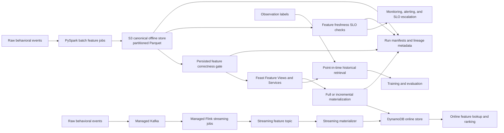

# FeatureForge Architecture


FeatureForge is a production-inspired feature platform for reproducible offline
training data, streaming feature computation, and low-latency online ML feature
serving.


The architecture prioritizes:


- reproducibility;
- event-time correctness;
- point-in-time feature semantics;
- canonical data ownership;
- executable data contracts;
- explicit correctness and freshness gates;
- visible failure behavior;
- offline/online serving parity;
- deterministic operational workflows;
- streaming ingestion, validation, and online materialization;
- feature-specific streaming update policies;
- unified batch and streaming online feature access;
- independent baseline, Redis/Feast, and Flink Kafka-to-Redis CI validation.


## Architecture Overview


FeatureForge separates the platform into eight major concerns:


1. Source-data generation and validation.
2. Point-in-time feature computation.
3. Canonical offline feature storage.
4. Historical retrieval and model training.
5. Streaming ingestion, validation, and feature computation.
6. Online materialization and serving.
7. Operational validation, CI, and failure handling.
8. A documented AWS production operating profile.


```text
validated YAML configuration
        ↓
deterministic synthetic source data
        ↓
source-data quality validation
        ↓
source Parquet datasets
        ↓
Pandas reference / PySpark parity layer
        ↓
point-in-time feature computation
        ↓
idempotent date-partitioned backfill
        ↓
canonical offline feature store
        ↓
correctness gate
        ↓
freshness SLO check
        ├── Feast historical retrieval → time-based training → model artifacts
        └── Feast materialization → Redis → online lookup → ranking
                                      ↓
                              offline/online parity


raw interaction events
        ↓
Kafka
        ↓
Flink validation and routing
        ↓
validated event topic
        ↓
Flink event-time feature computation
        ├── user_play_count_1h (1-hour windows)
        └── user_skip_rate_24h (24-hour windows)
        ↓
streaming feature topics
        ↓
Kafka-to-Redis materializers
        ↓
guarded Redis online stores
        ↓
unified online feature retrieval
```


## Repository Boundaries


```text
featureforge/
├── configs/              Synthetic-data configuration
├── data/                 Generated and training artifacts
├── docker/               Flink runtime image definition
├── docs/
│   ├── adr/              Architecture decisions
│   ├── images/           CI and local-demo evidence
│   ├── runbooks/         Operational recovery procedures
│   ├── aws-production-profile.md
│   ├── streaming-migration.md
│   └── demo.md
├── feature_repo/         Feast entities, sources, views, services, demos
├── jobs/                 Flink streaming jobs
├── scripts/              Training and diagnostic workflows
├── src/featureforge/     Application and platform implementation
├── tests/
│   ├── failure_simulations/
│   ├── integration/
│   └── unit/
├── .github/workflows/    GitHub Actions workflows
├── ARCHITECTURE.md
├── CONTRIBUTING.md
├── Makefile
├── README.md
├── docker-compose.yml
└── pyproject.toml
```


The implementation is intentionally layered. Generation, storage, feature
computation, validation, materialization, serving, and streaming are separate
concerns so that each can be tested independently and composed into end-to-end
workflows.


## Source Data


Synthetic data is generated from a validated YAML configuration. The generator
supports independent and behavioral modes.


The source datasets are written as typed Parquet files:


```text
output/source_data/
├── users.parquet
├── content.parquet
├── events.parquet
├── labels.parquet
└── run_manifest.json
```


The source layer models two clocks:


| Field | Meaning |
|---|---|
| `event_time` | When the user action actually occurred |
| `ingested_at` | When the platform received or processed the event |


Normal events satisfy:


```text
event_time == ingested_at
is_late == false
```


Late events satisfy:


```text
ingested_at > event_time
is_late == true
```


Source-data validation checks:


- referential integrity;
- temporal validity;
- event semantics;
- late-event semantics;
- observation-label validity;
- expected event and label volumes.


Generation writes a machine-readable manifest containing the configuration,
row counts, quality report, and output paths.


## Feature Computation


FeatureForge has Pandas and PySpark implementations of the same feature logic.
Pandas is the readable correctness reference. PySpark is the parity-tested
execution engine for future scale.


The current batch feature views are:


### User Engagement Features


Computed once per `user_id`:


- event count;
- unique content count;
- total watch seconds;
- search, play, and watch counts;
- days since last activity.


### Content Popularity Features


Computed once per `content_id`:


- view count;
- unique viewer count;
- total watch seconds;
- average watch seconds;
- search, play, and watch counts;
- days since last view.


The streaming path adds two Flink-computed features:
`user_play_count_1h` and `user_skip_rate_24h`.


Both batch views use the same point-in-time feature window:


```text
(observation_time - window_days, observation_time]
```


Therefore:


- events at the lower boundary are excluded;
- events at the observation timestamp are included;
- events after the observation timestamp are excluded.


Daily backfills use UTC midnight as the observation timestamp:


```text
observation_date=2026-03-12
observation_time=2026-03-12T00:00:00+00:00
```


The boundary semantics are tested in both Pandas and PySpark.


### Spark Time Handling


Spark timestamp behavior can vary across host and JVM timezone settings. The
Spark implementation avoids implicit timezone conversion by encoding timestamps
as UTC epoch microseconds before Spark processing and converting them back only
after collection.


A change to feature logic is incomplete until the Pandas and PySpark parity
suite passes.


## Canonical Offline Store


FeatureForge uses one canonical local offline feature-store root:


```text
output/offline_store/
```


The Hive-partitioned layout is:


```text
output/offline_store/
├── user_engagement_features/
│   └── observation_date=YYYY-MM-DD/
│       └── features.parquet
├── content_popularity_features/
│   └── observation_date=YYYY-MM-DD/
│       └── features.parquet
└── manifests/
    └── backfill-YYYY-MM-DD-to-YYYY-MM-DD.json
```


This path is a local V1 platform contract shared by:


| Component | Responsibility |
|---|---|
| Backfill | Writes deterministic date-partitioned feature data |
| Correctness gate | Validates persisted feature partitions before Feast writes |
| Freshness check | Evaluates the newest business-time partition per view |
| Feast `FileSource` | Reads canonical partitions for retrieval and materialization |
| Materialization | Validates the canonical source before invoking Feast |
| Serving parity | Compares Redis values with the latest canonical offline partition |
| Makefile workflows | Orchestrates the local lifecycle |
| Serving integration CI | Rebuilds and validates the complete source-to-serving path in a fresh runner |


The central invariant is:


```text
Backfill output
    = correctness-gate input
    = freshness-check input
    = Feast source
    = materialization source
    = serving parity-test source
```


The application-level materialization API always validates this canonical path.
The generic correctness and freshness libraries remain path-configurable for
isolated tests and reusable validation workflows.


This prevents a split-brain failure mode where one path is validated while
Feast reads or materializes another path.


The decision is documented in:


- [ADR-001: Offline/Online Feature Store Split](docs/adr/ADR-001-offline-online-feature-store-split.md)
- [ADR-002: Canonical Offline Store Contract](docs/adr/ADR-002-canonical-offline-store-contract.md)


## Backfills and Idempotency


Backfills create both feature views for an inclusive date range. Output paths
are deterministic:


```text
<offline-store-root>/<feature-view>/observation_date=YYYY-MM-DD/features.parquet
```


Running the same backfill with the same source data, date range, window, and
code overwrites the same partition paths. It does not append random part files
or create duplicate logical snapshots.


Each backfill writes a manifest containing:


- run type;
- status;
- start and completion timestamps;
- date range;
- lookback window;
- execution engine;
- output directory;
- per-partition row counts;
- concrete feature paths.


Idempotency is a platform property, not merely an implementation detail. It
allows retries, reproducible demonstrations, and deterministic downstream reads.


## Correctness and Freshness


Correctness and freshness are separate platform concerns.


Correctness asks:


```text
Are persisted feature values structurally and semantically valid?
```


Freshness asks:


```text
Is the newest persisted feature snapshot current enough for the intended
serving workflow?
```


### Persisted-Feature Correctness Gate


Before every Feast materialization, FeatureForge validates the persisted
canonical offline feature partitions.


If validation fails:


- Feast is not invoked;
- a blocked materialization manifest is written;
- the failure is surfaced as an exception;
- the CLI returns a non-zero status.


This prevents known-invalid feature data from being promoted into Redis.


### Freshness SLO


Freshness is based on the newest Hive-style observation partition:


```text
observation_date=YYYY-MM-DD
```


It uses business observation time rather than filesystem modification time.
The V1 contract is:


```text
latest canonical observation partition
        must be within
configured maximum lag
        of
explicit UTC reference time
```


The local default maximum lag is 24 hours. Freshness checks evaluate every
required feature view independently and expose stable failed-check names such
as:


```text
user_engagement_features.freshness
content_popularity_features.freshness
```


Freshness is a serving-safety check. It must not be converted into an implicit
`datetime.now(UTC)` restriction on every historical materialization request.
A historical re-materialization may be correct even when the newest partition
is not fresh enough for present-time serving.


The decision is documented in
[ADR-003: Feature Freshness SLOs and Fail-Safe Serving](docs/adr/ADR-003-freshness-slos-and-fail-safe-serving.md).


## Feast Integration


Feast provides:


- entities;
- batch sources;
- feature views;
- feature services;
- historical retrieval;
- full materialization;
- incremental materialization;
- online feature lookup.


The Feast repository is located under:


```text
feature_repo/
├── entities.py
├── sources.py
├── feature_views.py
├── feature_services.py
├── historical_retrieval_demo.py
├── online_lookup_demo.py
└── personalization_demo.py
```


The local `FileSource` definitions read from:


```text
../output/offline_store/user_engagement_features
../output/offline_store/content_popularity_features
```


The materialization API intentionally does not accept an arbitrary offline-store
path. The CLI commands also do not expose an `--offline-store-dir` option. This
is a guardrail: validation and Feast must operate on the same canonical source.


### Full Materialization


Full materialization requires explicit timezone-aware UTC boundaries:


```text
start_time
end_time
```


The workflow validates the canonical offline store before invoking Feast and
writes a completed or blocked manifest.


### Incremental Materialization


Incremental materialization uses Feast's stored watermark to determine its
lower boundary. The caller supplies an explicit timezone-aware end time.


Both full and incremental materialization paths have controlled failure tests
for missing Feast repositories.


### Materialization Manifests


Completed and blocked attempts write JSON manifests under:


```text
output/materialization_manifests/
```


They record:


- run type and mode;
- status;
- timestamps;
- Feast repository path;
- canonical offline-store path;
- requested time range;
- correctness-report payload;
- failed check names for blocked runs.


## Historical Retrieval and ML Training


The training pipeline uses Feast historical retrieval with point-in-time joins.
Each training row receives only feature values available at its observation time.


The pipeline performs:


1. historical retrieval;
2. chronological train/validation/test splitting;
3. preprocessing with `StandardScaler`;
4. baseline classification with `LogisticRegression`;
5. persisted model and metric output;
6. diagnostic drift and calibration analysis.


Persisting preprocessing and model state together reduces training-serving skew.


Artifacts are written to:


```text
data/historical_features.parquet
output/models/baseline_logreg_pipeline.joblib
output/models/baseline_logreg_metrics.json
```


## Streaming Architecture


FeatureForge includes a streaming path that turns raw interaction events into
online feature values without replacing the canonical offline feature path.


The streaming path is intentionally separate from the offline backfill path.
Offline features provide reproducible historical snapshots and training data.
Streaming features provide low-latency online updates.


```text
Raw interaction events
        ↓
Kafka: interaction-events.v1
        ↓
Flink validation and routing
        ↓
Kafka: interaction-events.validated.v1
        ↓
Flink event-time feature computation
        ├── user_play_count_1h
        └── user_skip_rate_24h
        ↓
Kafka feature topics
        ↓
Kafka-to-Redis materializers
        ↓
Redis online stores
        ↓
Online feature retrieval
```


The current streaming features are:


```text
user_play_count_1h
user_skip_rate_24h
```


`user_play_count_1h` counts unique play events for a user in a one-hour
event-time window.


`user_skip_rate_24h` computes:


```text
skip_count / (play_count + skip_count)
```


over the right-closed event-time window:


```text
(observation_time - 24 hours, observation_time]
```


The skip-rate job emits independent play and skip counts plus the computed
rate. A lower skip rate can be a valid correction when the play count increases
within the same window.


### Streaming Contracts


The streaming contracts define the boundary between producers, Flink jobs, and
the online store.


`InteractionEventV1` validates:


- event identity;
- event and ingestion timestamps;
- user and content identity;
- event type;
- play duration;
- source;
- schema version.


The contract normalizes timestamps to UTC and rejects:


- invalid timestamps;
- ingestion before event time;
- invalid entity IDs;
- unsupported event types or sources;
- unknown fields;
- invalid play semantics.


`UserSkipRateFeatureV1` additionally validates:


- non-negative integer play and skip counts;
- a skip rate that exactly matches
  `skip_count / (play_count + skip_count)`;
- an exactly 24-hour feature window;
- feature name and schema version;
- a user ID without whitespace.


The routing layer separates valid event JSON from structured validation
failures. Invalid input produces a rejection record with a stable schema and
reason code; it does not silently disappear or block subsequent valid events.


### Event-Time Semantics


Streaming features use event time, not ingestion time.


The feature-time mapping preserves right-closed window membership:


```text
start < event_time <= end
```


A millisecond-level timestamp mapper converts event timestamps into Flink
window timestamps while preserving this boundary behavior.


For example, an event at exactly `11:30:00` belongs to the one-hour window
ending at `12:29`, not the window ending at `12:30`.


This matches the reference implementations and prevents boundary drift between
the batch references, streaming jobs, and online stores.


### Flink Jobs


The validation job reads raw Kafka events and routes them into valid or
rejected topics:


```text
interaction-events.v1
    -> interaction-events.validated.v1
    -> interaction-events.rejected.v1
```


The user play-count job reads validated events and writes streaming features:


```text
interaction-events.validated.v1
    -> features.user-play-count-1h.v1
    -> interaction-events.user-play-count-1h.late.v1
```


The user skip-rate job reads the same validated events and writes its own
feature and late topics:


```text
interaction-events.validated.v1
    -> features.user-skip-rate-24h.v1
    -> interaction-events.user-skip-rate-24h.late.v1
```


Both feature jobs perform:


- event-time timestamp assignment;
- event-ID-based deduplication;
- user-keyed sliding-window aggregation;
- late-event side-output routing;
- Kafka feature emission.


Job-specific parameters:


| Parameter | `user_play_count_1h` | `user_skip_rate_24h` |
|---|---|---|
| Window | 1 hour, 1-minute slide | 24 hours, 1-minute slide |
| Deduplication TTL | 24 hours | 48 hours |
| Watermark allowance | 10 minutes | 10 minutes |
| Allowed lateness | 30 minutes | 30 minutes |
| Checkpointing | 10 seconds | 10 seconds |
| Emission | play count | play count, skip count, skip rate |


The Flink jobs use bounded replay mode for deterministic integration testing.
In bounded mode, a job consumes the available Kafka range and terminates after
processing it.


### Streaming Online Store


The Redis online stores maintain the latest feature value for each user.


For `user_play_count_1h`, the store policy is:


- A newer observation window replaces an older one.
- For the same observation window, the play count may only increase.
- Identical deliveries leave the stored value unchanged.
- A replayed older value cannot undo a later correction.
- Concurrent writers use bounded Redis `WATCH` retries.


For `user_skip_rate_24h`, the store compares `(play_count, skip_count)`
componentwise within the same observation window. It does not compare skip
rates by magnitude:


- A newer observation window replaces an older one, including a zero count
  vector.
- For the same observation window, both counts at least as large with one
  larger is a valid correction, in either rate direction.
- Identical count vectors leave the stored value unchanged.
- Both counts at most as large with one smaller is discarded as `stale`.
- One count increasing while the other decreases raises
  `SkipRateUpdateConflictError`.
- Concurrent writers use bounded Redis `WATCH` retries.


The stores are intentionally feature-specific. They are not a generic revision
policy for arbitrary features and cannot repair an already inflated count. The
skip-rate store never merges conflicting count vectors by componentwise
maxima.


The Redis key layouts are:


```text
featureforge-stream:online:v1:user_play_count_1h:<user_id>
featureforge-stream:online:v1:user_skip_rate_24h:<user_id>
```


The stored payloads are validated JSON feature records containing:


```text
feature_schema_version
feature_name
user_id
observation_time
window_start_exclusive
play_count
skip_count (skip rate only)
skip_rate (skip rate only)
```


### Kafka-to-Redis Materializers


The materializers consume the streaming feature topics and write validated
feature records into Redis.


They use:


- explicit consumer-group offsets;
- synchronous offset commits;
- bounded or continuous consumption;
- single-partition topic validation;
- Redis connectivity validation;
- guarded online-store writes.


The materializers write before committing an offset. If a Redis write fails,
the corresponding Kafka offset is not committed, allowing a later run to retry
the record.


The materializers refuse an empty Kafka range rather than silently completing
without doing work.


## Online Serving and Ranking


Redis is the local online store, provisioned through Docker Compose.
Feast materializes canonical offline feature values into Redis, while the
streaming materializers write streaming feature updates into Redis.


The serving layer provides typed lookup results for:


- user engagement features;
- content popularity features;
- ranked content candidates.


Unknown entities return no feature record rather than fabricated defaults.
Entity IDs must be non-empty.


The deterministic ranking score is intentionally transparent:


```text
ranking_score
    = 0.45 * user_engagement_score
    + 0.55 * content_popularity_score
```


Candidates are sorted by:


1. descending overall score;
2. ascending `content_id` as a stable tie-breaker.


This is a platform-consumer demonstration, not a production recommendation
model.


### Unified Batch and Streaming Online Access


`OnlineFeatureClient` in `src/featureforge/online.py` provides one read
interface across both storage paths:


- user engagement batch features through Feast;
- content popularity batch features through Feast;
- the streaming `user_play_count_1h` feature through the Redis streaming
  store.


Each returned feature includes its name, entity ID, backend, value,
availability, observation time when available, age and freshness classification
against the caller's reference time, schema version when available, and error
type when applicable.


Availability and freshness are separate dimensions. A valid zero remains
present; a missing value is never replaced with zero. Combined reads explicitly
report `atomic: false`.


The same interface is available as a JSON CLI:


```text
python -m featureforge.online
```


Exit codes: `0` for successful reads including explicit missing values, `1`
for responses containing feature errors, `2` for invalid CLI requests.


Skip-rate online access through the unified interface is not yet implemented.


## Offline/Online Serving Parity


The integration suite compares online values from Redis-backed Feast with the
latest corresponding canonical offline partition.


It covers:


- user engagement features;
- content popularity features;
- unknown entities;
- batch lookup with unknown candidates;
- deterministic ranking over materialized values.


The parity contract is:


```text
latest canonical offline partition
        =
Redis-backed Feast online feature value
```


This validates that the materialization path did not silently alter the values
that the offline pipeline produced.


These five online-serving contracts run:


- locally after Redis, Feast, canonical backfill, and materialization are
  prepared;
- automatically in the dedicated Redis and Feast GitHub Actions integration job.


## Streaming Verification


Streaming correctness is verified at several levels.


### Redis Store Verification


The Redis store tests verify:


- feature round trips;
- unknown-user behavior;
- newer-window replacement;
- stale-window rejection;
- identical-delivery idempotency;
- monotone same-window corrections;
- replay protection;
- concurrent `WATCH` retry behavior.


The skip-rate store tests additionally verify:


- componentwise count-vector ordering in both rate directions;
- zero-vector window replacement;
- rejection of same-window count decreases;
- `SkipRateUpdateConflictError` for incomparable count vectors.


These tests run against real Redis and must not skip in the Flink integration
CI job.


### Joined Streaming Verification


The joined Kafka-to-Redis tests verify the complete streaming path:


```text
Kafka input
  -> Flink validation
  -> Flink feature computation
  -> Kafka feature topic
  -> Redis materializer
  -> Redis read
```


They create isolated Kafka topics, produce events, run the Flink jobs in
bounded mode, materialize the resulting features into Redis, and read the
final online values.


The play-count test asserts:


- the expected user;
- a play count of one;
- the right-closed feature window;
- the exact one-hour window relationship.


The skip-rate test additionally verifies late corrections in both rate
directions, duplicate suppression, and replay of retained feature output
through a fresh materializer consumer group.


### Replay and Identity-Conflict Verification


The replay test publishes repeated deliveries of the same logical play event
with different `ingested_at` timestamps. After reprocessing through fresh
bounded executions, the materializer resumes with its existing consumer group,
reports the same window updates as stale or unchanged, and both the decoded
feature and the serialized Redis value remain identical to their values before
replay.


The identity-conflict test publishes two events with the same `event_id` and
different logical payloads. It requires a nonzero exit code from the feature
job, `EventIdentityConflictError` in the captured output, and the conflict
message identifying the expected event ID. The job's optional `--no-restart`
mode disables automatic restarts for this fail-fast diagnostic execution.


### Routing and Late-Event Verification


The routing test publishes invalid JSON, a valid event, a contract-invalid
event, and another valid event. It requires exactly two validated and two
rejected records with the expected reasons, proving that rejected records do
not block valid follow-up processing.


The continuous late-event test submits the play-count job in detached
continuous mode and verifies:


- a late correction updates an already emitted window from one to two;
- an event too late for all assigned windows is routed to the late topic after
  observed watermark-driven progress.


The test waits for observable outputs rather than assuming watermark progress
after a fixed sleep, and cancels its own resolved job ID during cleanup.


### Skip-Rate Job Verification


The isolated Flink-job test verifies golden reference values against the
deterministic Python reference, late corrections, duplicate suppression, and
too-late routing for `user_skip_rate_24h`.


## Testing Strategy


FeatureForge treats tests as enforceable platform contracts.


Unit tests cover:


- configuration and model validation;
- deterministic data generation;
- event and label semantics;
- feature calculations;
- point-in-time boundaries;
- manifests and idempotency;
- persisted-feature correctness;
- freshness behavior;
- materialization timestamp contracts;
- online lookup and ranking behavior;
- unified online access and its CLI;
- Pandas/PySpark parity;
- streaming event contracts;
- streaming routing;
- event-time mapping;
- streaming feature semantics;
- Kafka-to-Redis materializer behavior;
- skip-rate payloads and same-window count ordering;
- the deterministic skip-rate reference.


Integration tests cover:


- CLI execution;
- source Parquet round trips;
- CLI-to-backfill-to-Parquet workflows;
- historical retrieval;
- training workflows;
- materialization and online serving;
- offline/online parity;
- Redis online-store behavior;
- concurrent Redis writes;
- unified Feast/Redis online access;
- joined Kafka-to-Flink-to-Redis execution;
- bounded replay idempotency;
- event-identity conflicts;
- rejected-event routing;
- continuous late-event behavior;
- the skip-rate Redis store, materializer, joined path, and Flink job.


Failure simulations cover:


| Scenario | Expected behavior |
|---|---|
| Stale partitions | Freshness fails with named checks and non-zero status |
| Fresh partitions | Freshness passes |
| Invalid backfill window | Clear validation error |
| Reversed date range | Clear validation error |
| Empty event stream | Valid zero-count features are produced |
| Missing Feast repository, full run | Materialization fails clearly |
| Missing Feast repository, incremental run | Materialization fails clearly |


Failure simulations are located under:


```text
tests/failure_simulations/
```


Operational runbooks are located under:


```text
docs/runbooks/
├── stale-features.md
├── failed-backfill.md
└── failed-materialization.md
```


## Continuous Integration


FeatureForge uses three GitHub Actions jobs on every push to `main` and every
pull request.


### Baseline lint and test


The baseline job runs in a clean Ubuntu environment with Python 3.13 and
validates:


- editable installation from the `src/` layout;
- package importability;
- Ruff formatting;
- Ruff linting;
- the complete pytest suite without provisioning Redis, Flink, Feast, or
  materialized online features.


```text
push / pull request
        ↓
fresh Ubuntu runner
        ↓
editable package installation
        ↓
FeatureForge import verification
        ↓
Ruff format and lint checks
        ↓
pytest validation suite
```


The baseline job intentionally excludes tests marked `integration`:


```yaml
pytest -v -m "not integration"
```


The five online-serving tests skip because they require Redis and materialized
Feast offline snapshots. The streaming integration tests are deselected because
they require Redis, Kafka, and Flink infrastructure.


Last recorded baseline result:


```text
254 passed, 5 skipped, 11 deselected, 0 failed
```


The baseline suite has since grown by the unified-online, routing, late-event,
and skip-rate unit tests; the updated count is pending the next recorded run.


### Redis and Feast serving integration


The second job starts a fresh Redis service container and validates the full
offline-to-online serving path in a clean GitHub Actions runner:


```text
fresh Ubuntu runner
        ↓
Redis service container
        ↓
deterministic source-data generation
        ↓
canonical offline backfill
        ↓
Feast apply
        ↓
persisted-feature correctness validation
        ↓
Feast materialization into Redis
        ↓
online-serving parity and ranking tests
        ↓
unified online access tests
        ↓
Redis online-store and concurrency tests
```


The job also explicitly executes the Redis online-store and concurrency
integration tests. It validates the resulting JUnit report and fails if any
selected test is skipped, failed, or errored.


Last recorded serving-integration result:


```text
Redis store tests: 10 passed
Online-serving tests: 5 passed
```


This separation preserves a fast baseline feedback loop while independently
proving Redis, Feast, materialization, online lookup, ranking, unified access,
and offline/online parity.


### Flink Kafka-to-Redis integration


The third job starts the complete streaming stack and verifies the joined
Kafka-to-Redis flows:


```text
fresh Ubuntu runner
        ↓
Docker Compose stack
        ↓
Kafka, Flink JobManager, TaskManager, and Redis
        ↓
service health checks
        ↓
streaming integration tests
```


The job runs:


```bash
pytest -v -ra -m integration \
  tests/integration/test_user_play_count_kafka_to_redis.py \
  tests/integration/test_user_play_count_replay_idempotency.py \
  tests/integration/test_streaming_validation_routing.py \
  tests/integration/test_user_play_count_late_events.py \
  tests/integration/test_user_skip_rate_job.py \
  tests/integration/test_skip_rate_flink_to_redis.py \
  tests/integration/test_skip_rate_materialization.py \
  tests/integration/test_redis_skip_rate_store.py
```


It proves that Kafka events can be validated, transformed by Flink,
materialized into Redis, and read back as online features — including replay
idempotency, rejected-event routing, continuous late-event behavior, and the
complete skip-rate path.


Last recorded streaming-integration result:


```text
1 passed, 0 skipped, 0 failed
```


The expanded eight-module selection is pending its first recorded run.


On failure, the job uploads streaming diagnostics as a CI artifact.


The CI decision is documented in
[ADR-004: GitHub Actions CI for Reproducible Validation](docs/adr/ADR-004-github-actions-ci.md).


## Demo Evidence


FeatureForge provides committed evidence for the CI layers and the local
end-to-end workflow.


```text
CI evidence
├── Baseline lint and test
├── Redis and Feast serving integration
└── Flink Kafka-to-Redis integration


Local evidence
├── Pipeline and materialization
├── Freshness and ranking
└── Streaming Kafka-to-Redis verification
```


The reviewer workflow is documented in [Demo Guide](docs/demo.md). The local
entry point is:


```bash
docker compose up -d


cd feature_repo
feast apply
cd ..


make demo
```


The demo generates deterministic data, backfills canonical features,
materializes validated values into Redis, checks freshness, retrieves online
features, and produces a deterministic ranked-content result.


## AWS Production Profile


FeatureForge documents a credible AWS production architecture profile without
deploying real infrastructure ahead of local correctness and reliability work.


The profile generalizes the local canonical-source contract to an
environment-owned S3 prefix:


```text
s3://featureforge-<environment>/offline-store/
```





Key production-profile decisions:


- One S3 bucket per environment: `dev`, `staging`, and `prod`. Buckets are
  never shared across environments.
- Hive-style Parquet partitions remain based on
  `observation_date=YYYY-MM-DD`, preserving the local partitioning contract.
- SSE-KMS encryption uses a customer-managed KMS key per environment.
- S3 bucket versioning protects against accidental overwrites and deletion.
- Lifecycle transitions use Infrequent Access and Glacier Instant Retrieval
  according to data access patterns, rather than blanket deletion.
- Three least-privilege IAM roles isolate backfill writes, materialization
  writes, and serving reads:
  - `featureforge-backfill-writer`;
  - `featureforge-materialization-writer`;
  - `featureforge-serving-reader`.
- DynamoDB is the documented AWS online-store profile. Redis remains the
  local Docker Compose online store.
- Managed Kafka and Flink are the documented streaming execution profile.


The canonical-source invariant is unchanged in AWS:


```text
Backfill writer
    = Correctness-gate input
    = Freshness-check input
    = Feast FileSource
    = Materialization source
    = Serving parity-test source
```


Only the resolved URI changes from:


```text
output/offline_store/
```


to:


```text
s3://featureforge-<environment>/offline-store/
```


No AWS resources are provisioned by this documentation. It exists so the
production operating model can be evaluated and defended before any real
deployment occurs.


Full detail is documented in
[`docs/aws-production-profile.md`](docs/aws-production-profile.md) and
[ADR-005: AWS S3 Offline-Store Production Profile](docs/adr/ADR-005-aws-s3-offline-store-profile.md).


## Makefile Workflows


The Makefile exposes common workflows:


```bash
make setup
make docker-up
make docker-down
make lint
make test
make validate
make check-freshness
make e2e
make e2e-no-skip
make e2e-clean
make materialize-incremental
make demo
```


Useful overrides include:


```bash
make demo USER_ID=user_000290 TOP_K=5
make demo OUTPUT_DIR=output_demo
```


The local E2E workflow must preserve the canonical offline-store contract.
Run-scoped output directories may contain artifacts, but they must not cause
Feast to read a different offline source than the one validated by the platform.


## Reliability Principles


FeatureForge follows these principles:


- Prefer idempotent jobs.
- Use explicit time boundaries.
- Require timezone-aware materialization timestamps.
- Use event time for feature and label semantics.
- Make data contracts executable.
- Keep output paths deterministic.
- Maintain one canonical offline source for the local Feast workflow.
- Validate persisted offline correctness before online materialization.
- Check freshness from business-time partitions rather than filesystem metadata.
- Separate correctness from freshness.
- Fail before known-invalid or stale serving data reaches consumers.
- Record completed and blocked run metadata.
- Keep Pandas and Spark behavior parity-tested.
- Verify offline/online serving parity.
- Keep local development reproducible.
- Separate generation, storage, computation, materialization, and serving.
- Use stable ranking tie-breakers.
- Never trust implicit timezone handling across Python/JVM boundaries.
- Persist preprocessing with models to reduce training-serving skew.
- Treat failure simulations and runbooks as version-controlled artifacts.
- Keep baseline and infrastructure-enabled CI validation separate.
- Use event time for streaming feature computation.
- Deduplicate streaming events by logical event identity.
- Fail loudly on conflicting logical event identities.
- Preserve right-closed feature-window semantics across batch and streaming.
- Materialize streaming features only after successful validation.
- Commit Kafka offsets only after successful Redis writes.
- Keep streaming store policies explicit and feature-specific.
- Compare skip-rate count vectors componentwise, never rate magnitudes.
- Keep availability, freshness, and value presence as separate dimensions.
- Keep environment boundaries, encryption, and IAM permissions explicit in the
  AWS production profile.


## Current Limitations


The project intentionally remains a focused local platform implementation:


- Redis is a local development online store.
- DynamoDB is the documented AWS production alternative, not yet deployed.
- Offline storage is local Parquet; S3 is a documented production profile, not
  yet deployed.
- `output/offline_store/` is a fixed local V1 contract.
- AWS environment-owned S3 URIs, KMS keys, IAM roles, and DynamoDB tables are
  documented but not provisioned.
- Freshness currently uses latest observation-date partitions and a configurable
  local maximum lag.
- Production freshness requires per-view ownership, scheduling, alerting, and
  escalation policy.
- The materialization gate protects the local application workflow; external
  incident remediation remains future work.
- Failure simulations do not yet cover Redis outages, Feast API failures,
  object-store failures, network faults, or production-scale chaos.
- The ranking function is a transparent deterministic demonstration, not a
  learned production ranking model.
- Kafka and Flink are local Docker Compose services; managed Kafka and managed
  Flink are documented production profiles, not yet deployed.
- Streaming coverage currently focuses on `user_play_count_1h` and
  `user_skip_rate_24h`; cross-feature orchestration remains future work.
- `user_skip_rate_24h` is not yet exposed through the unified online access
  interface.
- Streaming checkpoint and savepoint recovery, deduplication behavior after
  state TTL expiry, and multi-partition Kafka operation require additional
  dedicated verification.
- Passing replay, correction, duplicate, and guarded-write tests must not be
  described as an end-to-end exactly-once guarantee; the Flink Kafka sinks use
  `AT_LEAST_ONCE` delivery.
- Versioned streaming-history publication and historical retrieval remain
  future work.


## Future Architecture


The documented AWS production profile replaces the local fixed path with one
environment-owned storage URI:


```text
s3://featureforge-<environment>/offline-store/
```


The same resolved URI must be consumed by:


- the backfill writer;
- the persisted-feature correctness gate;
- freshness checks;
- Feast `FileSource` definitions;
- materialization manifests;
- lineage metadata;
- offline/online parity checks.


The next reliability and platform milestones are:


1. Expose `user_skip_rate_24h` through the unified online access interface.
2. Add versioned streaming-history publication and historical retrieval.
3. Add streaming checkpoint and savepoint recovery verification.
4. Verify deduplication behavior explicitly at the state TTL boundary.
5. Add scheduled freshness checks, feature-view ownership, alerting, and SLO
   escalation.
6. Extend materialization manifests with richer lineage and run metadata.
7. Add controlled simulations for Redis, Kafka, Flink, Feast API, and
   object-storage failures.
8. Convert the documented AWS production profile into infrastructure as code.
9. Provision an AWS development environment after the infrastructure design is
   reviewed and cost boundaries are explicit.
10. Add MLflow experiment tracking and a model registry.
11. Add advanced models such as XGBoost or LightGBM where model complexity is
    justified by the platform use case.
12. Publish `v0.1.0` with release notes and documented demo evidence.
13. Publish a technical article about canonical feature ownership,
    point-in-time correctness, streaming materialization, freshness, and CI
    design.
14. Make a focused external Feast or MLflow documentation or test contribution.


## Architecture Decisions


Important durable decisions are documented as ADRs:


- [ADR-001: Offline/Online Feature Store Split](docs/adr/ADR-001-offline-online-feature-store-split.md)
- [ADR-002: Canonical Offline Store Contract](docs/adr/ADR-002-canonical-offline-store-contract.md)
- [ADR-003: Feature Freshness SLOs and Fail-Safe Serving](docs/adr/ADR-003-freshness-slos-and-fail-safe-serving.md)
- [ADR-004: GitHub Actions CI for Reproducible Validation](docs/adr/ADR-004-github-actions-ci.md)
- [ADR-005: AWS S3 Offline-Store Production Profile](docs/adr/ADR-005-aws-s3-offline-store-profile.md)
- [ADR-006: Streaming Feature Platform Integration](docs/adr/ADR-006-streaming-feature-platform-integration.md)
- [ADR-007: User Skip Rate 24h Streaming Integration](docs/adr/ADR-007-skip-rate-streaming-integration.md)


Streaming integration decisions and provenance are documented in
[docs/streaming-migration.md](docs/streaming-migration.md).
