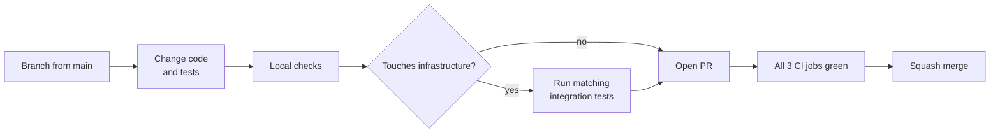
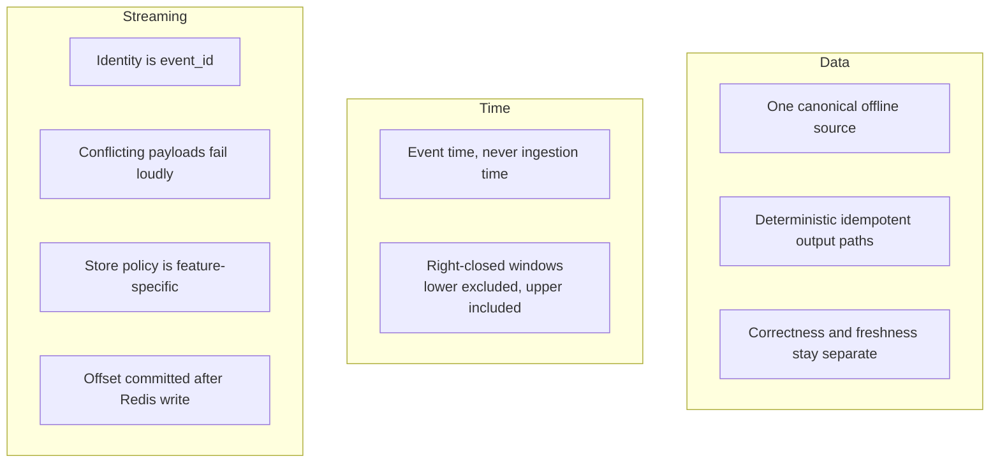
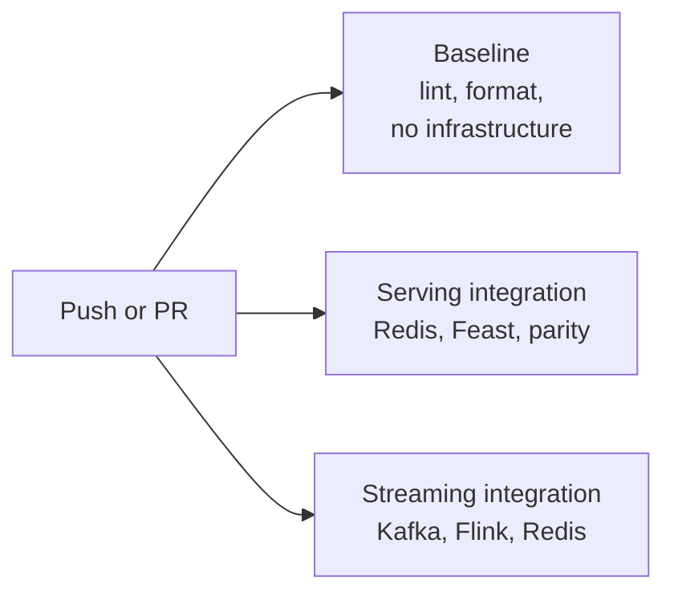

# Contributing to FeatureForge

FeatureForge is a production-inspired ML feature platform. Contributions are
welcome if they keep its core promise: **every guarantee has a test that proves it.**

Read first: [README](README.md) · [ARCHITECTURE](ARCHITECTURE.md) ·
[STATUS](STATUS.md) · [ADRs](docs/adr/)

---

## Quick setup

Prerequisites: Python 3.11–3.13, Docker, GNU Make, Git.

```bash
git clone [https://github.com/oster-dev/featureforge.git](https://github.com/oster-dev/featureforge.git)
cd featureforge
python3 -m venv .venv && source .venv/bin/activate
python -m pip install --upgrade pip
python -m pip install -e ".[dev,feature-store,spark,streaming]"
featureforge --help
```

Start the infrastructure you need:

```bash
make docker-up                     # Redis only, for Feast serving
docker compose up -d --build       # Kafka, Flink, Redis, for streaming
docker compose ps                  # wait until services are healthy
```

Reviewer walkthrough with expected output: [docs/demo.md](docs/demo.md).

---

## Workflow



### Before every commit

```bash
ruff format --check .
ruff check .
pytest -m "not integration"
git diff --check
```

Fix formatting with `ruff format .` and imports with `ruff check --fix .`.
CI fails on both, and it is the cheapest failure to avoid.

### Which integration tests to run

| You changed | Run |
|---|---|
| Batch features, backfill, Spark | `pytest tests/unit/test_spark_features.py tests/unit/test_spark_parquet_features.py` |
| Feast, materialization, online serving | `docker compose up -d`, `feast apply`, then `pytest tests/integration/test_online_serving.py tests/integration/test_unified_online.py` |
| Redis store policies | `pytest -m integration tests/integration/test_streaming_redis_online_store*.py tests/integration/test_redis_skip_rate_store.py` |
| Flink jobs, contracts, routing, materializers | The full streaming selection below |

Full streaming selection (identical to CI):

```bash
pytest -v -ra -m integration \
  tests/integration/test_user_play_count_kafka_to_redis.py \
  tests/integration/test_user_play_count_replay_idempotency.py \
  tests/integration/test_streaming_validation_routing.py \
  tests/integration/test_user_play_count_late_events.py \
  tests/integration/test_user_skip_rate_job.py \
  tests/integration/test_skip_rate_flink_to_redis.py \
  tests/integration/test_skip_rate_materialization.py \
  tests/integration/test_redis_skip_rate_store.py
```

Streaming tests are slow. Each Flink test recreates the TaskManager first, so
expect several minutes. This is intentional: see
[Flink test isolation](#flink-test-isolation).

---

## Platform contracts

These rules protect the guarantees listed in the README. A change that touches
one of them must update code, tests, [ARCHITECTURE.md](ARCHITECTURE.md), and an
ADR if the contract itself changes.



**Data**

- Backfill, correctness gate, freshness check, Feast and parity tests must all
  read `output/offline_store/`. Never add an offline-store override to
  materialization.
- Correctness is mandatory before every Feast write. Freshness is a
  serving-safety check on business-time partitions, not file timestamps.
- Keep partition paths deterministic. Do not switch to random part files
  without adding versioning, lineage and reader selection.

**Time**

- Feature window: `(t - window, t]`. Label window: `t < event_time <= label_end`.
- Changing a boundary means updating the reference, Spark, Flink, the
  feature-time mapper, unit and integration tests, and docs.
- Spark: convert timestamps to UTC epoch microseconds before Spark and back
  after collection. Never rely on session timezone alone.

**Streaming**

- `ingested_at` is receipt metadata, not part of logical identity. Same
  `event_id` with a different payload raises `EventIdentityConflictError`.
  Never keep the first delivery silently or merge payloads.
- Play count is append-only. Skip rate compares `(play_count, skip_count)`
  componentwise. Never compare rates by magnitude and never merge by maxima.
- A new streaming feature needs its own update policy, dedupe horizon,
  late-event behavior and materialization boundary, documented in an ADR.
- Kafka topic names must not contain colons. Redis key prefixes may.

**Failure visibility**

Failures must not look like success: raise a clear exception, return a
non-zero exit code, write a blocked manifest, or expose a stable failed-check
name. Add a failure simulation under `tests/failure_simulations/` and a
runbook under `docs/runbooks/` for new operational incidents.

---

## Testing

| Layer | Location | Purpose |
|---|---|---|
| Unit | `tests/unit/` | Contracts, feature math, boundaries, parity, policies |
| Integration | `tests/integration/` | Multi-component paths on real Redis, Feast, Kafka, Flink |
| Failure simulation | `tests/failure_simulations/` | Controlled reliability scenarios |

Rules:

- Every behavior change ships with a test at the right layer.
- Never delete or weaken a temporal, correctness, freshness, idempotency,
  parity or failure test to make a suite pass.
- Integration tests use isolated topics and key prefixes, never shared names.
- Wait for observable outputs, not fixed sleeps.
- Cleanup code must not mask the original failure.

### Flink test isolation

Running many PyFlink jobs on one long-lived TaskManager became unstable in CI
after roughly 7 to 8 jobs. Tests that start Flink jobs therefore recreate the
TaskManager first (`fresh_taskmanager()`), start jobs with `--parallelism 1`,
and wait for a terminal job state after cancelling. The underlying cause is
still open, so treat this as isolation, not a fix.

When a Flink test fails, read the root cause from the Flink REST API
(`/jobs/<id>/exceptions`) before changing timeouts or retries.

---

## Continuous integration



- **Keep the jobs independent.** Never add Redis, Kafka, Flink or Docker
  Compose setup to the baseline job.
- Never remove skip guards from baseline tests to manufacture a green run.
  Skipped must never look like proven.
- Failed streaming runs upload a diagnostics artifact. Download it before
  guessing: it contains the Compose logs.

Background: [ADR-004](docs/adr/ADR-004-github-actions-ci.md).

---

## Troubleshooting

| Symptom | First checks |
|---|---|
| Freshness check fails | `make check-freshness`, inspect the latest `observation_date=` partition and the backfill manifest. See [runbook](docs/runbooks/stale-features.md) |
| Materialization blocked | Inspect the blocked manifest under `output/materialization_manifests/`. See [runbook](docs/runbooks/failed-materialization.md) |
| Backfill fails | Positive `--window-days`, start date not after end date, all four source Parquet files present. See [runbook](docs/runbooks/failed-backfill.md) |
| Streaming tests fail to connect | `docker compose ps`, Redis published on `127.0.0.1:6379`, no other container on port 6379 |
| Flink job fails or hangs | `docker compose logs jobmanager --tail 100`, `docker compose logs taskmanager --tail 100`, REST root cause |
| Rebuilt job code not picked up | `docker compose build jobmanager && docker compose up -d` |
| `SkipRateUpdateConflictError` | Compare stored and incoming count vectors, find the upstream producer, fix or replay upstream. Never edit Redis by hand or weaken the policy |

Useful commands:

```bash
docker compose exec kafka /opt/kafka/bin/kafka-topics.sh \
  --bootstrap-server kafka:29092 --list
curl -s http://127.0.0.1:8081/overview
```

---

## Documentation and ADRs

Update documentation when a change affects contracts, semantics, canonical
paths, gates, manifests, topics, store policies, CI behavior, or setup commands.

- Write an **ADR** for a durable architecture, ownership, reliability or
  security decision.
- Write a **runbook** for a recognizable operational incident.
- Do not add AWS SDK calls, credentials, S3 paths or deployment steps to local
  workflows. The AWS profile is documentation only, unless the infrastructure
  design, tests, IAM policies, cost boundaries and docs arrive in the same
  change. See [AWS profile](docs/aws-production-profile.md) and
  [ADR-005](docs/adr/ADR-005-aws-s3-offline-store-profile.md).
- Screenshots under `docs/images/` are version-controlled evidence. Never
  include private desktop content, browser tabs or credentials.

---

## Commits and pull requests

Small, focused commits that describe the behavior or contract changed:

```text
feat: add user skip rate 24h streaming feature
test: verify streaming routing and late-event behavior
ci: expand Flink integration selection
fix: preserve UTC timestamp semantics in Spark features
docs: rewrite ARCHITECTURE with current streaming state
```

Before committing: `git status`, `git diff --check`. After staging:
`git diff --cached --check`.

A pull request should cover:

```text
## Problem
## Change
## Contract impact
## Validation
## Operational impact
## Documentation and ADRs
## Follow-up work
```

Run the checks from [Before every commit](#before-every-commit) plus the
integration tests that match your change. Wait for all three CI jobs to pass
on the newest commit before merging.