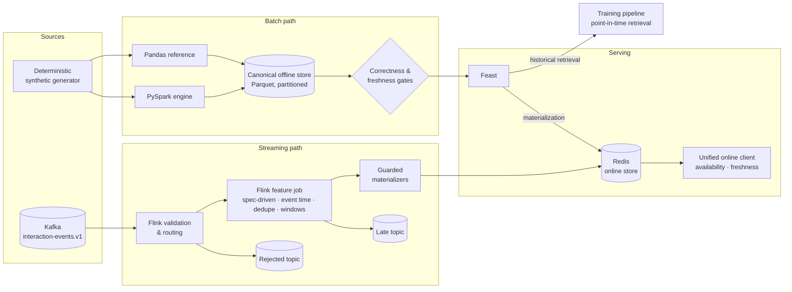

# FeatureForge

[](https://github.com/oster-dev/featureforge/actions/workflows/ci.yml)
[](https://github.com/oster-dev/featureforge/releases)
[](LICENSE)

**A production-inspired ML feature platform that computes features once and serves them correctly for both offline training and low-latency online inference, from batch and streaming sources.**

FeatureForge focuses on the parts that make feature platforms trustworthy:
point-in-time correctness, event-time semantics, idempotent writes, and
offline/online consistency. Every claimed guarantee below links to the test
that proves it.

> **Scope, stated honestly:** FeatureForge is a local reference implementation.
> It runs on Docker Compose, uses synthetic data, and does not claim production
> scale. Its value is in the explicit contracts and the evidence behind them.

---

## Architecture



| Layer | Technology |
|---|---|
| Batch computation | Pandas (reference), PySpark (parity-tested) |
| Stream processing | Apache Kafka 3.9, Apache Flink 1.20 (PyFlink) |
| Offline store | Partitioned Parquet (local); S3 profile documented |
| Feature definitions and retrieval | Feast |
| Declarative feature specs | YAML, validated by a Pydantic model |
| Online store | Redis 7.4 (local); DynamoDB profile documented |
| Contracts | Pydantic |
| Quality | pytest, Ruff, GitHub Actions (baseline, Python 3.11/3.12, serving integration, Flink integration) |

Full design: [ARCHITECTURE.md](ARCHITECTURE.md) ·
[Platform Blueprint](docs/PLATFORM_BLUEPRINT.md) ·
[ADRs](docs/adr/)

---

## Guarantees and the evidence behind them

### Offline and training data

| Guarantee | Evidence |
|---|---|
| Features use only events strictly before the observation time (no label leakage) | [`test_features.py`](tests/unit/test_features.py) |
| Spark and Pandas produce identical features | [`test_spark_parquet_features.py`](tests/unit/test_spark_parquet_features.py), [`test_backfill.py`](tests/unit/test_backfill.py) |
| Backfills are idempotent and auditable via run manifests | [`test_backfill.py`](tests/unit/test_backfill.py), [`test_cli_backfill.py`](tests/integration/test_cli_backfill.py) |
| Invalid feature partitions are blocked before they reach the online store | [`test_failed_materialization.py`](tests/failure_simulations/test_failed_materialization.py) |
| Stale features are detected against an explicit freshness SLO | [`test_stale_features.py`](tests/failure_simulations/test_stale_features.py) |
| Online values match the latest offline snapshot | [`test_online_serving.py`](tests/integration/test_online_serving.py) |

### Streaming

| Guarantee | Evidence |
|---|---|
| Invalid events are routed to a rejected topic without blocking valid events | [`test_streaming_validation_routing.py`](tests/integration/test_streaming_validation_routing.py) |
| Windows are event-time based and right-closed, including exact boundaries | [`test_user_skip_rate_job.py`](tests/integration/test_user_skip_rate_job.py), [`test_streaming_feature_time.py`](tests/unit/test_streaming_feature_time.py) |
| Late events correct already emitted windows; events too late for all windows are routed out | [`test_user_play_count_late_events.py`](tests/integration/test_user_play_count_late_events.py) |
| Replayed and duplicate events do not change results | [`test_user_play_count_replay_idempotency.py`](tests/integration/test_user_play_count_replay_idempotency.py) |
| Conflicting payloads for the same `event_id` fail loudly | [`test_user_play_count_replay_idempotency.py`](tests/integration/test_user_play_count_replay_idempotency.py) |
| The generic job resumes from a savepoint with its dedupe and window state intact (shown for play count) | [`test_generic_job_recovery.py`](tests/integration/test_generic_job_recovery.py) |
| The generic job recovers from a TaskManager crash with its dedupe and window state restored from a checkpoint (shown for play count) | [`test_generic_job_checkpoint_recovery.py`](tests/integration/test_generic_job_checkpoint_recovery.py) |
| The generic job's dedupe state expires after its TTL: a redelivery inside the TTL is ignored, one after it is counted again (shown for play count with a shortened TTL) | [`test_generic_job_dedupe_ttl.py`](tests/integration/test_generic_job_dedupe_ttl.py) |
| Online writes never regress: stale, older, and conflicting updates are rejected | [`test_streaming_redis_online_store.py`](tests/integration/test_streaming_redis_online_store.py), [`test_skip_rate_update_policy.py`](tests/unit/test_skip_rate_update_policy.py) |
| Concurrent writers are safe (Redis `WATCH`/`MULTI` with bounded retries) | [`test_streaming_redis_online_store_concurrency.py`](tests/integration/test_streaming_redis_online_store_concurrency.py) |
| Full Kafka → Flink → Kafka → Redis path produces the reference result | [`test_user_play_count_kafka_to_redis.py`](tests/integration/test_user_play_count_kafka_to_redis.py), [`test_skip_rate_flink_to_redis.py`](tests/integration/test_skip_rate_flink_to_redis.py) |

### Declarative feature specs

A feature can be defined as a YAML spec instead of new platform code. The spec
language is bounded on purpose, see [ADR-008](docs/adr/ADR-008-feature-spec-design.md).

| Guarantee | Evidence |
|---|---|
| Specs are validated before anything runs: bad windows, unsafe expressions, inconsistent dedupe or update policies and unknown event fields are rejected | [`test_spec_model.py`](tests/unit/test_spec_model.py) |
| One exact reference evaluates a spec and matches the Python references on randomized inputs at window boundaries | [`test_spec_reference.py`](tests/unit/test_spec_reference.py) |
| The skip-rate golden fixture has hand-calculated values that the Python reference and the spec reference both reproduce | [`test_streaming_user_skip_rate_golden.py`](tests/unit/test_streaming_user_skip_rate_golden.py), [`test_spec_golden_parity.py`](tests/unit/test_spec_golden_parity.py) |
| A generic Flink job built from a spec reproduces the golden fixtures of both features: every emitted window matches the spec reference and the Python reference | [`test_feature_from_spec_job.py`](tests/integration/test_feature_from_spec_job.py), [`test_spec_flink_plan.py`](tests/unit/test_spec_flink_plan.py) |

The generic job is the only implementation of both streaming features. It is
verified on the golden fixtures, late corrections, replay, the Redis path, a
savepoint stop and resume, and recovery from a TaskManager crash. The Redis
store policies and the materializers are still written by hand per feature. See
[STATUS.md](STATUS.md) for what is not yet proven.

### Online access

| Guarantee | Evidence |
|---|---|
| Batch and streaming features are read through one client with explicit availability and freshness, and missing values are never silently turned into `0` | [`test_unified_online.py`](tests/integration/test_unified_online.py), [`test_online.py`](tests/unit/test_online.py) |

All of the above run in CI on every pull request and push to `main`, plus a nightly run:

| CI layer | What it proves |
|---|---|
| Baseline lint and test | Fresh install, Ruff, all infrastructure-free tests |
| Python 3.11 and 3.12 compatibility | The infrastructure-free tests on the oldest and a middle supported version |
| Redis and Feast serving integration | Generation → backfill → Feast apply → materialization → online parity |
| Flink Kafka-to-Redis integration | Full Docker Compose streaming stack, joined end-to-end tests |

---

## Quick start

Prerequisites: Python 3.11–3.13, Docker, GNU Make.

```bash
git clone https://github.com/oster-dev/featureforge.git
cd featureforge
python3 -m venv .venv && source .venv/bin/activate
python -m pip install -e ".[dev,feature-store,spark,streaming]"

# Batch path: generate → backfill → validate → materialize → serve
docker compose up -d redis
(cd feature_repo && feast apply)
make demo

# Streaming path: Kafka → Flink → Redis, verified end to end
docker compose up -d --build
pytest -v -m integration tests/integration/test_skip_rate_flink_to_redis.py

# Feature specs: validate both shipped specs
python -m featureforge.spec.loader feature_repo/specs/*.yaml
```

Read a feature through the unified online client:

```bash
python -m featureforge.online \
  --user-id user_000290 \
  --reference-time 2026-03-25T00:00:00+00:00 \
  --batch-max-age-seconds 172800 \
  --stream-max-age-seconds 7200
```

Expected output, troubleshooting, and cleanup: [Demo Guide](docs/demo.md).

---

## Features

| Feature | Path | Entity | Definition |
|---|---|---|---|
| `user_engagement` (7 values) | Batch | `user_id` | Event, play, watch, search counts, unique content, watch time, recency |
| `content_popularity` (8 values) | Batch | `content_id` | Views, unique viewers, watch time, recency |
| `user_play_count_1h` | Streaming | `user_id` | Play events in `(t − 1h, t]`, sliding |
| `user_skip_rate_24h` | Streaming | `user_id` | `skips / (plays + skips)` in `(t − 24h, t]`, 1-minute slide, explicit zero-denominator behavior |

Both streaming features are defined as specs in
[`feature_repo/specs/`](feature_repo/specs/) and computed by one generic Flink job.

---

## Status

| Phase | Status |
|---|---|
| 1 · Feature store foundation | **Released** as [v0.1.0](https://github.com/oster-dev/featureforge/releases/tag/v0.1.0) |
| 2 · Streaming feature platform | **Core delivered.** Declarative feature specs: spec model, reference and one generic Flink job running both streaming features are done, including savepoint resume and recovery from a TaskManager crash. Open: JobManager failure, spec-driven stores, streaming history, and the final demo |
| 3 · End-to-end ML workflow | **Planned** |

Details, open items, and known limitations: **[STATUS.md](STATUS.md)**.

---

## Documentation

| Document | Content |
|---|---|
| [STATUS.md](STATUS.md) | Delivered vs. in progress vs. planned, known limitations |
| [ARCHITECTURE.md](ARCHITECTURE.md) | Component design and data flow |
| [docs/REFERENCE.md](docs/REFERENCE.md) | Full technical reference: contracts, semantics, CLI, CI details |
| [docs/PLATFORM_BLUEPRINT.md](docs/PLATFORM_BLUEPRINT.md) | Target platform design |
| [docs/adr/](docs/adr/) | Architecture decision records (ADR-001 to ADR-008) |
| [docs/streaming-migration.md](docs/streaming-migration.md) | Streaming provenance and verification boundaries |
| [docs/demo.md](docs/demo.md) | Reviewer walkthrough |
| [docs/runbooks/](docs/runbooks/) | Stale features, failed backfill, failed materialization |
| [docs/aws-production-profile.md](docs/aws-production-profile.md) | Documented AWS mapping (S3, DynamoDB) |
| [CONTRIBUTING.md](CONTRIBUTING.md) | Local setup and test execution |

---

## License

MIT, see [LICENSE](LICENSE).