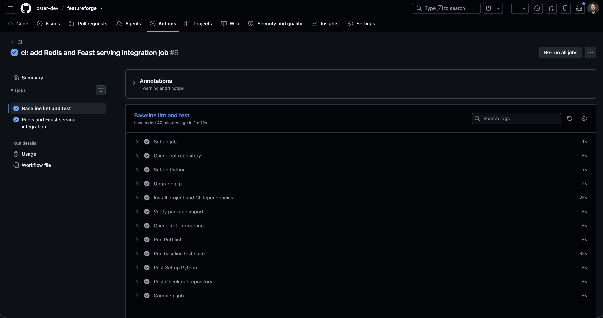
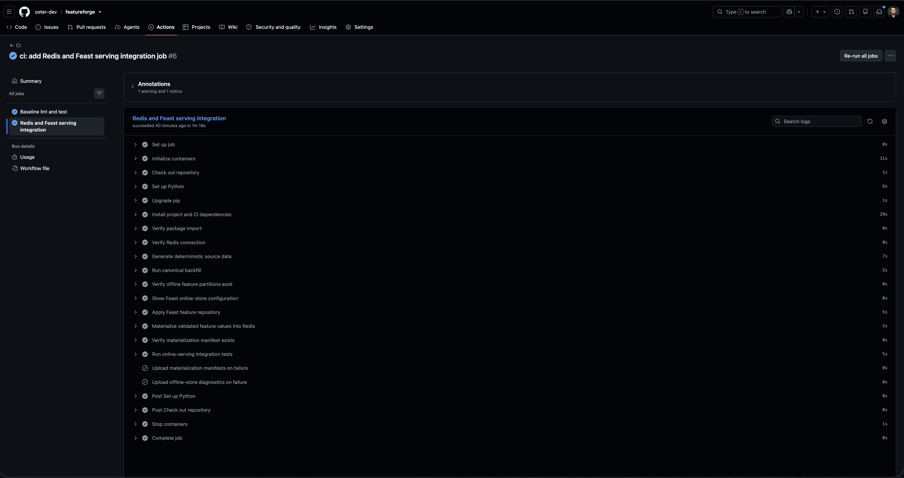
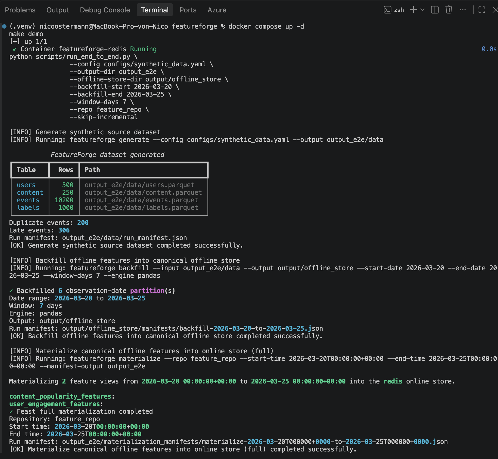
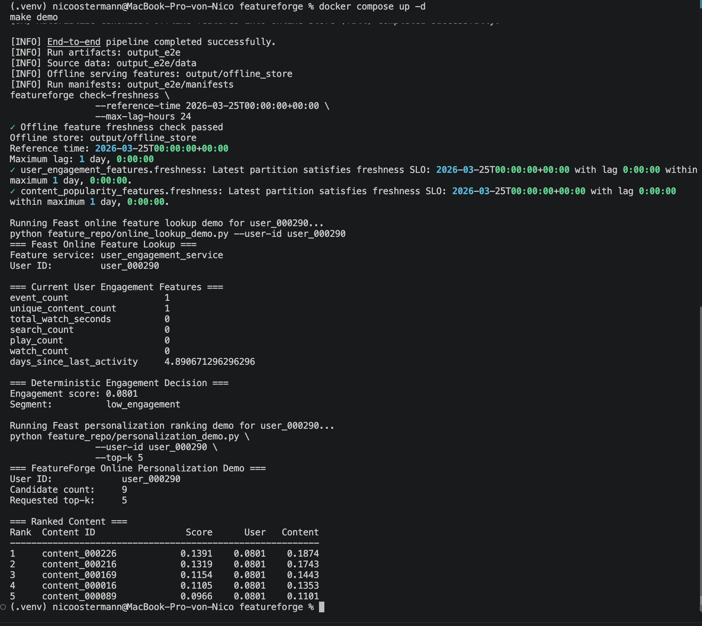

# FeatureForge

[](https://github.com/oster-dev/featureforge/actions/workflows/ci.yml)

FeatureForge is a production-inspired feature platform for reproducible offline
training data, low-latency online ML feature serving, and event-streaming
feature computation.

It is built as a portfolio project for Data Infrastructure, Feature
Infrastructure, and ML Platform Engineering. The project focuses on the hard
parts that make feature platforms trustworthy:

- deterministic data generation in independent and behavioral modes
- executable data contracts
- event-time correctness with right-closed windows
- point-in-time feature computation
- partitioned offline feature datasets
- reproducible backfills
- idempotency and duplicate-delivery handling
- audit manifests
- pre-materialization feature-correctness gates
- feature freshness SLO checks
- canonical offline-store contracts
- visible failure handling and operational runbooks
- offline/online feature parity validation
- unit, integration, and controlled failure-simulation tests
- engine-independent feature correctness through Pandas and PySpark parity
- Feast integration for historical retrieval and online serving
- Kafka event ingestion with Flink validation and routing
- streaming feature computation with sliding event-time windows
- Kafka-to-Redis online materialization
- guarded Redis online-store writes with WATCH/MULTI concurrency control
- joined Kafka-to-Flink-to-Redis end-to-end verification
- ML-ready training pipelines with time-based evaluation
- three-layer GitHub Actions validation
- documented AWS production operating profile
- one-command end-to-end platform demonstration

## Project Goal

The long-term goal is to provide trusted, versioned, point-in-time-correct
features for both offline model training and online inference — fed by both a
batch path and a streaming path.

The target architecture uses:

- PySpark for scalable batch feature computation
- PyFlink for streaming validation, routing, and feature computation
- Kafka for event ingestion and feature transport
- S3-backed Parquet for the offline feature store
- Feast for feature definitions, historical retrieval, and online serving
- Redis for local online serving
- DynamoDB as the documented AWS online-store profile
- GitHub Actions for continuous integration
- sklearn / XGBoost for baseline and advanced models

The current implementation establishes the local reference foundation needed to
build those components correctly. It includes a parity-tested PySpark execution
engine alongside the Pandas reference, a complete ML training pipeline with
historical retrieval and online serving, a canonical local offline-store
contract shared by backfill, validation, Feast, materialization, and
serving-parity tests, a verified Kafka-to-Flink-to-Redis streaming path,
explicit freshness and failure-handling contracts, three-layer CI, and a
documented AWS production profile.

## Current Status

### Implemented

#### Offline and serving foundation

- Pydantic contracts for users, content, events, observation labels, feature
  records, feature batches, synthetic-data configuration, feature-quality
  checks, freshness reports, streaming interaction events, routed event
  results, and streaming feature records.
- YAML-backed synthetic-data configuration with validation for time ranges,
  event rates, late-arrival constraints, and event-generation mode.
- Deterministic synthetic user, content, event, duplicate-delivery, late-event,
  and observation-label generation.
- Behavioral mode with persistent per-user activity weights.
- Explicit event-time and ingestion-time modeling.
- Quality validation for referential integrity, temporal validity, event
  semantics, late-event semantics, label validity, and expected volumes.
- Source dataset persistence as Parquet (`users`, `content`, `events`,
  `labels`).
- User engagement and content popularity feature computation with explicit
  point-in-time lookback windows.
- Deterministic, partitioned offline feature datasets and date-parameterized,
  idempotent backfills.
- JSON run manifests for generation, backfill, and materialization
  auditability.
- A PySpark implementation of both feature views, parity-tested against the
  Pandas reference implementation.
- Feast integration: entities, batch sources, feature views with 7-day lookback
  windows, feature services, historical retrieval, full and incremental
  materialization into Redis, and online feature lookup.
- ML training pipeline: historical retrieval, time-based splits, sklearn
  `Pipeline` with `StandardScaler` and `LogisticRegression`, persisted model
  and metrics JSON, and a diagnostic analysis script.
- Online serving: Redis online store via Docker Compose, online feature
  lookup, deterministic content ranking with transparent scoring, and an
  end-to-end demo with `make demo`.
- Canonical offline-store contract: `output/offline_store/` is the shared local
  Feast source for backfill, correctness validation, freshness checks,
  materialization, and serving-parity tests.
- Pre-materialization persisted-feature correctness gate that blocks invalid
  partitions from reaching Redis.
- Offline feature freshness checks based on the newest `observation_date`
  partition, explicit UTC reference time, and a configurable maximum lag
  (24-hour local default).
- Controlled failure simulations and operational runbooks for stale features,
  failed backfills, and failed materialization.
- Offline/online serving parity integration tests.

#### Streaming path

- Streaming event contracts for validated interaction events
  (`interaction-events.v1`) and emitted features
  (`features.user-play-count-1h.v1`).
- Kafka-based event ingestion with an internal Docker listener for Flink and
  an external listener for host-side tools.
- A Flink validation and routing job:
  - validates raw events against the executable contracts;
  - routes valid events to `interaction-events.validated.v1`;
  - routes invalid events to a rejected topic without poisoning the valid
    stream;
  - deliberately catches only input-validation failures so real bugs fail
    loudly.
- A Flink `user_play_count_1h` feature job:
  - event-time timestamp assignment with a bounded watermark strategy;
  - deduplication by event ID with a 24-hour TTL state;
  - keying by user ID;
  - sliding one-hour event-time windows;
  - play-count aggregation with right-closed window semantics;
  - feature emission to the feature topic;
  - late-event side output to a dedicated late topic.
- A Kafka-to-Redis materializer that consumes feature topics and writes
  guarded feature records into the Redis online store.
- A guarded Redis streaming store with an explicit update policy:
  - newer windows replace older windows;
  - same-window counts may only increase;
  - identical deliveries return `unchanged`;
  - older windows and decreasing same-window counts are discarded as `stale`;
  - concurrent writes use `WATCH`/`MULTI` with bounded retries;
  - connection failures and exhausted retries are never swallowed.
- Real Redis integration tests for round trips, window ordering, idempotency,
  same-window corrections, replay protection, and concurrent `WATCH` retries.
- A joined Kafka-to-Flink-to-Redis integration test that produces a play
  event, runs both Flink jobs in bounded mode, materializes the feature topic
  into Redis, and reads the feature value back from the online store.
- Streaming migration provenance documenting the integration of the streaming
  layer into FeatureForge.

### Infrastructure

- Docker Compose stack with Kafka 3.9.1, Flink 1.20.3 (JobManager and
  TaskManager), and Redis 7.4.
- A Flink image with Python 3.11, PyFlink, and the SQL Kafka connector.
- The Flink image installs the project without transitive dependencies to
  avoid conflicting with the base image's Apache Beam installation; Pydantic
  is installed explicitly for the streaming contracts.
- Jobs are mounted into the Flink containers; host-side clients connect to
  Kafka on `127.0.0.1:9092` while Flink uses `kafka:29092`.

## Current Quality Gate

FeatureForge validates the platform through three GitHub Actions jobs.

```text
Baseline lint and test
        ↓
Fresh Python 3.13 installation
        ↓
Editable package installation
        ↓
FeatureForge package import
        ↓
Ruff format and lint checks
        ↓
Infrastructure-free pytest suite (pytest -m "not integration")
```

```text
Redis and Feast serving integration
        ↓
Fresh Redis service container
        ↓
Deterministic source-data generation
        ↓
Canonical offline backfill
        ↓
Feast apply
        ↓
Validated materialization into Redis
        ↓
Online-serving parity and ranking tests
        ↓
Streaming Redis store and concurrency tests
```

```text
Flink Kafka-to-Redis integration
        ↓
Docker Compose stack (Kafka, Flink, Redis)
        ↓
Health checks for Kafka, JobManager, and Redis
        ↓
Joined Kafka-to-Flink-to-Redis verification
        ↓
Diagnostics upload on failure
```

Current CI results:

| Validation layer | Scope | Result |
|---|---|---|
| Baseline CI | Fresh installation, package import, Ruff, and infrastructure-free tests | `254 passed, 5 skipped, 11 deselected, 0 failed` |
| Serving integration CI | Redis, data generation, canonical backfill, Feast apply, materialization, online-serving tests, and streaming Redis store tests | `15 passed, 0 skipped, 0 failed` |
| Flink Kafka-to-Redis CI | Full streaming stack and joined end-to-end test | `1 passed, 0 skipped, 0 failed` |
| Local full integration | Complete local test suite with Redis, Kafka, Flink, Feast, and materialized values | `265 passed, 5 skipped, 0 failed` |

The five skipped tests in the baseline job are online-serving integration tests
in `tests/integration/test_online_serving.py`. They require Redis, applied Feast
definitions, canonical offline feature snapshots, and materialized online
feature values. The serving-integration job provisions those prerequisites and
runs the same tests as real end-to-end contracts.

The eleven deselected tests in the baseline job are the ten streaming Redis
store/concurrency tests plus the joined Kafka-to-Redis test. They run in their
dedicated infrastructure jobs, where skips, failures, and errors fail the job.

See [CONTRIBUTING.md](CONTRIBUTING.md) for local execution prerequisites and
[ADR-004](docs/adr/ADR-004-github-actions-ci.md) for the CI decision.

## Demo Evidence

FeatureForge includes a documented local demo and committed evidence for the
CI layers and the local serving workflow.

### Baseline CI



### Redis and Feast serving integration



### Local pipeline and materialization



### Local freshness and ranking



Run the local end-to-end workflow:

```bash
docker compose up -d

cd feature_repo
feast apply
cd ..

make demo
```

Run the streaming verification:

```bash
docker compose up -d --build

pytest -v -m integration tests/integration/test_user_play_count_kafka_to_redis.py
```

See the [Demo Guide](docs/demo.md) for expected output, layer-level
verification, troubleshooting, and cleanup.

## Current Data Flow

### Batch path

```text
validated YAML configuration
        ↓
deterministic synthetic data generation
(independent or behavioral mode)
        ↓
duplicate and late-event injection
        ↓
observation-label generation
        ↓
source-data quality validation
        ↓
source Parquet datasets
        ↓
point-in-time feature computation
(Pandas reference, PySpark parity-tested)
        ↓
date-parameterized idempotent backfill
        ↓
canonical offline feature store
output/offline_store/
        ↓
persisted-feature correctness gate
        ↓
feature freshness SLO check
(for current serving workflows)
        ↓
Feast FileSource definitions
        ├── historical retrieval with point-in-time joins
        │       ↓
        │   time-based train/validation/test split
        │       ↓
        │   sklearn Pipeline training
        │       ↓
        │   persisted model and metrics JSON
        │
        └── Feast full or incremental materialization
                ↓
            Redis online store
                ↓
            online feature lookup
                ↓
            deterministic content ranking
                ↓
            offline/online parity validation
```

### Streaming path

```text
interaction-events.v1 (Kafka)
        ↓
Flink validation and routing job
        ├── valid events → interaction-events.validated.v1
        └── invalid events → rejected topic
        ↓
Flink user_play_count_1h job
        ├── event-time watermarking
        ├── deduplication by event ID (24h TTL state)
        ├── sliding 1-hour event-time windows (right-closed)
        ├── play-count aggregation
        ├── features → features.user-play-count-1h.v1
        └── late events → late-events topic (side output)
        ↓
Kafka-to-Redis materializer
        ↓
guarded Redis streaming store
(newer windows win, same-window counts only increase, identical deliveries unchanged)
        ↓
online feature read (RedisUserPlayCountStore.read)
```

Both paths converge on Redis as the online serving layer.

## Canonical Offline Store Contract

FeatureForge uses one canonical local offline feature-store root:

```text
output/offline_store/
```

It has the following Hive-partitioned layout:

```text
output/offline_store/
├── user_engagement_features/
│   └── observation_date=YYYY-MM-DD/
│       └── features.parquet
├── content_popularity_features/
│   └── observation_date=YYYY-MM-DD/
│       └── features.parquet
└── manifests/
    └── backfill-YYYY-MM-DD-to-YYYY-MM-DD.json
```

This location is the shared contract for:

| Component | Responsibility |
|---|---|
| Backfill | Writes idempotent, date-partitioned Parquet feature datasets |
| Offline correctness gate | Validates persisted feature-view partitions before Feast writes |
| Offline freshness check | Validates each view's latest `observation_date` partition against an explicit UTC reference time |
| Feast `FileSource` definitions | Reads feature partitions for historical retrieval and materialization |
| Materialization | Validates the canonical source before invoking Feast |
| Serving parity tests | Compare Redis values with the latest canonical offline partition |
| Makefile demo flow | Orchestrates the local end-to-end lifecycle |

The central invariant is:

```text
Backfill output
    =
Correctness-gate input
    =
Freshness-check input
    =
Feast source
    =
Materialization source
    =
Serving parity-test source
```

This prevents a split-brain failure mode in which one feature dataset is
validated while Feast reads or materializes another.

The application-level materialization API always validates
`output/offline_store/`. The generic correctness and freshness validation
libraries remain path-configurable for isolated testing and reusable validation
workflows.

The same invariant is documented for the AWS production profile, where the
resolved source becomes:

```text
s3://featureforge-<environment>/offline-store/
```

## Streaming Layer

### Stack

The streaming stack is defined in `docker-compose.yml`:

| Service | Image | Role |
|---|---|---|
| `kafka` | `apache/kafka:3.9.1` | Event and feature transport |
| `jobmanager` | `featureforge-stream-flink:1.20.3` | Flink job submission |
| `taskmanager` | `featureforge-stream-flink:1.20.3` | Flink task execution |
| `redis` | `redis:7.4-alpine` | Online feature store |

Start it:

```bash
docker compose up -d --build
```

### Flink Jobs

```text
jobs/
├── validate_and_route_events.py
└── user_play_count_1h.py
```

Both jobs support continuous and bounded (replay) execution modes. The bounded
mode drains configured topics and finishes, which is what the joined
integration test uses for deterministic verification.

Example bounded run inside the JobManager container:

```bash
docker compose exec jobmanager python /opt/flink/jobs/user_play_count_1h.py \
  --bootstrap-servers kafka:29092 \
  --input-topic interaction-events.validated.v1 \
  --feature-topic features.user-play-count-1h.v1 \
  --late-topic interaction-events.user-play-count-1h.late.v1 \
  --group-id user-play-count \
  --bounded
```

### Right-Closed Window Semantics

The streaming play-count feature uses minute-aligned, right-closed one-hour
windows:

```text
(window_start_exclusive, observation_time]
```

An event exactly at a window boundary belongs to the preceding window. An
event at exactly `11:30:00` is assigned to the window:

```text
window_start_exclusive = 11:29
observation_time       = 12:29
```

This mirrors the point-in-time semantics of the batch path, where the feature
window is `(observation_time - window_days, observation_time]`.

### Redis Streaming Store Policy

The `RedisUserPlayCountStore` implements a deliberate, narrow policy for
append-only counts without retractions:

| Incoming feature | Existing value | Result |
|---|---|---|
| Newer window | Any | Replace |
| Same window | Higher count | Replace (increasing correction) |
| Same window | Equal count | `unchanged` |
| Same window | Lower count | Discard (`stale`) |
| Older window | Any | Discard (`stale`) |

Concurrent modifications of a watched key trigger `WatchError` and are retried
with bounded attempts. Connection failures and exhausted retries raise instead
of being silently swallowed.

### Joined End-to-End Verification

```bash
pytest -v -m integration tests/integration/test_user_play_count_kafka_to_redis.py
```

The test:

1. creates unique Kafka topics per run;
2. produces one valid `play` event;
3. runs the validation job in bounded mode;
4. runs the play-count job in bounded mode;
5. runs the materializer in bounded mode;
6. reads the feature back from Redis;
7. asserts user ID, play count, and the exact right-closed window timestamps.

## Core Architecture

| Area | Current technology | Role |
|---|---|---|
| Platform language | Python | Pipeline orchestration, contracts, CLI, tests |
| Data contracts | Pydantic | Executable validation for source, feature, and streaming records |
| Local transformation reference | Pandas | Deterministic feature aggregation and Parquet inspection |
| Scalable transformation engine | PySpark | Parity-tested batch feature computation for future scale |
| Streaming engine | PyFlink 1.20.3 | Event validation, routing, and streaming feature computation |
| Event transport | Kafka 3.9.1 | Ingestion, validated events, features, late events |
| Streaming materializer | confluent-kafka + redis | Feature-topic to online-store writes |
| Streaming online store | Redis + WATCH/MULTI | Guarded, concurrency-safe feature writes |
| Source and offline format | Parquet with PyArrow | Typed, columnar offline datasets |
| Canonical local offline store | `output/offline_store/` | Shared source for validation, Feast, materialization, and parity checks |
| Correctness validation | FeatureForge validation layer | Blocks invalid persisted data before Feast writes |
| Freshness validation | `observation_date` partition SLO | Detects stale or missing canonical feature snapshots |
| Configuration | YAML | Reproducible synthetic-data generation |
| CLI display | Rich | Human-readable local command output |
| Testing | pytest | Unit, integration, and failure-simulation coverage |
| Code quality | Ruff | Formatting and linting |
| Baseline CI | GitHub Actions | Fresh installation, import, formatting, linting, and infrastructure-free tests |
| Serving integration CI | GitHub Actions + Redis | Fresh Redis, Feast apply, materialization, parity, ranking, and streaming store tests |
| Streaming integration CI | GitHub Actions + Docker Compose | Kafka, Flink, Redis stack and joined end-to-end verification |
| Local online store | Redis via Docker Compose | Low-latency feature serving |
| AWS online-store profile | DynamoDB | Managed production-oriented online feature serving |
| Feature platform | Feast | Feature definitions, historical retrieval, materialization, online serving |
| ML training | sklearn | Baseline model with pipeline persistence |
| AWS offline-store profile | S3-backed Parquet | Environment-owned canonical feature storage |

## Quick Start

### Prerequisites

- Python 3.11, 3.12, or 3.13
- Docker Desktop
- GNU Make

### Clone and Install

```bash
git clone https://github.com/oster-dev/featureforge.git
cd featureforge

python3 -m venv .venv
source .venv/bin/activate

python -m pip install --upgrade pip
python -m pip install -e ".[dev,feature-store,spark,streaming]"
```

Verify the package and CLI:

```bash
python -c "import featureforge; print(featureforge.__file__)"
featureforge --help
```

Expected commands:

```text
generate
compute-features
backfill
check-freshness
materialize
materialize-incremental
```

## Generate Source Data

Generate deterministic source data from the YAML configuration:

```bash
featureforge generate \
  --config configs/synthetic_data.yaml \
  --output output/source_data
```

The command writes:

```text
output/source_data/
├── users.parquet
├── content.parquet
├── events.parquet
├── labels.parquet
└── run_manifest.json
```

Generated artifacts are ignored by Git and can be recreated from configuration.

### Source Tables

| Table | Description |
|---|---|
| `users.parquet` | User entities and signup attributes |
| `content.parquet` | Content catalog entities and metadata |
| `events.parquet` | Behavioral events including duplicate and late-event flags |
| `labels.parquet` | Observation timestamps and future-activity labels |

### Behavioral Mode

The default configuration uses behavioral mode, which introduces persistent
latent activity propensity per user:

- Each user receives a fixed `activity_weight` sampled once at generation time.
- Event counts are drawn from `Poisson(activity_weight * base_rate)`.
- Users with higher weights generate more events consistently.
- This creates predictable engagement heterogeneity without label leakage.

Result: historical engagement features gain genuine predictive signal for
future activity.

## Compute Features

### Single User-Feature Snapshot

Compute user engagement features for one explicit observation timestamp:

```bash
featureforge compute-features \
  --input output/source_data \
  --output output/single_snapshot \
  --observation-time 2026-03-12T00:00:00+00:00 \
  --window-days 7
```

This writes:

```text
output/single_snapshot/
└── user_engagement_features.parquet
```

### Feature Views

FeatureForge currently provides two local reference feature views. Both are
implemented twice: once in Pandas (`features.py`, the correctness reference)
and once in PySpark (`spark_features.py`, parity-tested against it). The
streaming path adds `user_play_count_1h` as a Flink-computed feature.

#### User Engagement Features

Computed once per `user_id`:

| Feature | Description |
|---|---|
| `event_count` | Number of in-window events |
| `unique_content_count` | Number of distinct content items interacted with |
| `total_watch_seconds` | Sum of in-window watch seconds |
| `search_count` | Number of search events |
| `play_count` | Number of play events |
| `watch_count` | Number of watch events |
| `days_since_last_activity` | Recency of the latest in-window event |

#### Content Popularity Features

Computed once per `content_id`:

| Feature | Description |
|---|---|
| `view_count` | Number of in-window content events |
| `unique_viewer_count` | Number of distinct users interacting with content |
| `total_watch_seconds` | Sum of in-window watch seconds |
| `average_watch_seconds` | Total watch seconds divided by view count |
| `search_count` | Number of search events associated with content |
| `play_count` | Number of play events |
| `watch_count` | Number of watch events |
| `days_since_last_view` | Recency of the latest in-window content event |

## Run a Backfill

Backfills build user and content feature partitions for an inclusive date range.

For the local Feast workflow, write backfills to the canonical store:

```bash
featureforge backfill \
  --input output/source_data \
  --output output/offline_store \
  --start-date 2026-03-10 \
  --end-date 2026-03-12 \
  --window-days 7
```

Example command output:

```text
✓ Backfilled 3 observation-date partition(s)
Date range: 2026-03-10 to 2026-03-12
Window: 7 days
Engine: pandas
Output: output/offline_store
Run manifest: output/offline_store/manifests/backfill-2026-03-10-to-2026-03-12.json
```

### Offline Feature Dataset Layout

```text
output/offline_store/
├── user_engagement_features/
│   ├── observation_date=2026-03-10/
│   │   └── features.parquet
│   ├── observation_date=2026-03-11/
│   │   └── features.parquet
│   └── observation_date=2026-03-12/
│       └── features.parquet
├── content_popularity_features/
│   ├── observation_date=2026-03-10/
│   │   └── features.parquet
│   ├── observation_date=2026-03-11/
│   │   └── features.parquet
│   └── observation_date=2026-03-12/
│       └── features.parquet
└── manifests/
    └── backfill-2026-03-10-to-2026-03-12.json
```

Each partition represents a feature snapshot for one observation date. Re-running
the same backfill with the same source data, dates, window, and code overwrites
the same deterministic partition paths.

The backfill runner supports the Pandas reference engine and a parity-tested
PySpark engine.

## PySpark Parity Layer

`src/featureforge/spark_features.py` computes the same two feature views using
PySpark DataFrames instead of Pandas. It exists to prove that feature logic is
engine-independent before Spark becomes the production execution path.

Run the parity suite:

```bash
pytest tests/unit/test_spark_features.py -v
pytest tests/unit/test_spark_parquet_features.py -v
```

The parity tests assert that user and content feature computations return output
identical to their Pandas counterparts across empty datasets, exact window
boundaries, typed event counts, floating-point averages, and randomized
multi-entity datasets.

The Spark implementation avoids timezone ambiguity by encoding timestamps as
UTC epoch microseconds before Spark processing.

## Feast Integration

FeatureForge integrates with Feast for historical feature retrieval and online
feature serving.

### Setup

Ensure Feast is installed:

```bash
python -m pip install feast
```

Apply the feature repository after starting Redis:

```bash
docker compose up -d

cd feature_repo
feast apply
cd ..
```

### Feature Repository Structure

```text
feature_repo/
├── entities.py
├── sources.py
├── feature_views.py
├── feature_services.py
├── historical_retrieval_demo.py
├── online_lookup_demo.py
└── personalization_demo.py
```

`feature_repo/sources.py` defines `FileSource` objects rooted at the canonical
local offline store:

```text
../output/offline_store/user_engagement_features
../output/offline_store/content_popularity_features
```

### Historical Retrieval

Run the historical retrieval demo:

```bash
python feature_repo/historical_retrieval_demo.py
```

This produces:

```text
data/historical_features.parquet
```

Historical retrieval uses Feast point-in-time joins to ensure each training row
uses only feature values available at its observation timestamp.

### Materialization

Before calling Feast, FeatureForge validates canonical persisted offline
feature partitions in:

```text
output/offline_store/
```

The persisted-feature correctness gate runs before every Feast materialization.
If it fails, materialization is blocked, a blocked run manifest is written, and
Feast is not invoked.

Run full materialization with an explicit UTC time range:

```bash
featureforge materialize \
  --repo feature_repo \
  --start-time 2026-03-20T00:00:00+00:00 \
  --end-time 2026-03-25T00:00:00+00:00 \
  --manifest-output output
```

Run incremental materialization using Feast's stored watermark:

```bash
featureforge materialize-incremental \
  --repo feature_repo \
  --end-time 2026-03-25T00:00:00+00:00 \
  --manifest-output output
```

`materialize` and `materialize-incremental` intentionally do not accept an
`--offline-store-dir` flag. This prevents the correctness gate from validating
a different path than the one Feast reads.

### Materialization Manifests

Completed and blocked materialization attempts write JSON manifests under:

```text
output/materialization_manifests/
```

These manifests include:

- run type and status;
- full or incremental mode;
- Feast repository path;
- canonical offline-store path;
- requested time range;
- execution timestamps;
- correctness-report payload;
- failed correctness-check names for blocked runs.

## Freshness Checks

Feature correctness and feature freshness are separate platform concerns.

Correctness asks:

```text
Are persisted feature values structurally and semantically valid?
```

Freshness asks:

```text
Is the newest persisted feature snapshot recent enough for the intended
serving workflow?
```

Freshness is based on the newest Hive-style partition for each required feature
view:

```text
observation_date=YYYY-MM-DD
```

FeatureForge uses the business observation date rather than filesystem
modification time. File write time can reflect copying, restoration, or local
storage activity; it does not reliably describe the latest time through which
feature values are valid.

The V1 freshness contract is:

```text
latest canonical observation partition
        must be within
configured maximum lag
        of
explicit UTC reference time
```

The local default maximum lag is 24 hours.

Run the reproducible local check:

```bash
make check-freshness
```

The local Make target compares the latest canonical partitions with its
configured explicit reference time and 24-hour maximum lag.

Run the CLI directly with a chosen reference time:

```bash
featureforge check-freshness \
  --reference-time 2026-03-25T00:00:00+00:00 \
  --max-lag-hours 24
```

A stale or missing view produces a stable named failed check and a non-zero
exit code. Examples:

```text
user_engagement_features.freshness
content_popularity_features.freshness
```

Freshness is an explicit serving-safety and operational check. The
persisted-feature correctness gate remains mandatory before every Feast
materialization, including historical ranges.

A historical re-materialization can be correct even when the newest feature
partition is not current enough for a present-time serving workflow. For that
reason, freshness is not a blanket `datetime.now(UTC)` restriction on every
historical materialization request.

## ML Training Pipeline

FeatureForge includes a complete ML training pipeline for baseline model
development.

### Model Training

Train the baseline model:

```bash
python scripts/train_baseline.py
```

This produces:

```text
output/models/baseline_logreg_pipeline.joblib
output/models/baseline_logreg_metrics.json
```

### Training Results

Typical results in behavioral mode:

| Split | Rows | Positive Rate | AUC | Precision@25 | Recall@25 |
|---|---:|---:|---:|---:|---:|
| Train | 625 | 57.4% | 0.7725 | 1.00 | 0.0696 |
| Validation | 134 | 56.7% | 0.7688 | 0.88 | 0.2895 |
| Test | 134 | 50.0% | 0.6973 | 0.84 | 0.3134 |

### Diagnostic Analysis

Run diagnostic analysis:

```bash
python scripts/diagnose_baseline.py
```

This provides:

- feature-distribution analysis;
- train-versus-test drift detection;
- coefficient-stability checks;
- precision/recall curves;
- calibration analysis.

## Online Serving

FeatureForge provides online feature serving through Feast and Redis, plus a
streaming write path from Kafka.

### Start the Stack

```bash
docker compose up -d
```

Verify Redis:

```bash
docker exec featureforge-redis redis-cli ping
```

Expected output:

```text
PONG
```

### Online Feature Lookup

Run the online feature lookup demo for a specific user:

```bash
python feature_repo/online_lookup_demo.py --user-id user_000290
```

This retrieves current feature values from Feast and displays them.

### Personalization Ranking

Run the deterministic content-ranking demo:

```bash
python feature_repo/personalization_demo.py \
  --user-id user_000290 \
  --top-k 5
```

This retrieves user engagement features, evaluates candidate content, and
returns a ranked list.

### End-to-End Platform Demo

Run the complete local workflow:

```bash
docker compose up -d

cd feature_repo
feast apply
cd ..

make demo
```

This executes:

```text
generate
  → backfill into output/offline_store
  → persisted-feature correctness validation
  → Feast full materialization into Redis
  → freshness check for the serving workflow
  → online feature lookup
  → deterministic content ranking
```

The online-serving integration suite provides the separate parity validation:

```bash
pytest -v tests/integration/test_online_serving.py
```

Customize the demo:

```bash
make demo USER_ID=user_000290 TOP_K=5
make demo OUTPUT_DIR=output_demo
```

The canonical offline-store location remains:

```text
output/offline_store
```

`OUTPUT_DIR` is intended for run artifacts rather than replacing the Feast
source contract.

For the complete reviewer walkthrough, see the [Demo Guide](docs/demo.md).

## Temporal Semantics

### Event Time and Ingestion Time

FeatureForge models two different clocks:

| Field | Meaning |
|---|---|
| `event_time` | When the user action actually happened |
| `ingested_at` | When the platform received or processed the event |

Normal events satisfy:

```text
event_time == ingested_at
is_late == false
```

Late events satisfy:

```text
ingested_at > event_time
is_late == true
```

### Feature Window

Both batch feature views use this point-in-time event window:

```text
(observation_time - window_days, observation_time]
```

This means:

- events at the lower lookback boundary are excluded;
- events exactly at `observation_time` are included;
- events after `observation_time` are excluded.

For a daily backfill, every partition is computed at UTC midnight:

```text
observation_date=2026-03-12
observation_time=2026-03-12T00:00:00+00:00
```

The partition therefore represents the feature state available as of that
timestamp. This boundary is enforced identically in the Pandas and PySpark
implementations.

The streaming `user_play_count_1h` feature uses the same right-closed
convention with minute-aligned sliding windows:

```text
(window_start_exclusive, observation_time]
```

An event exactly on a boundary belongs to the preceding window.

### Label Window

Observation labels use event time:

```text
observation_time < event_time <= label_window_end
```

Labels represent future behavior and are deliberately separated from historical
feature windows.

## Idempotency and Auditability

Backfill feature outputs use deterministic paths:

```text
<offline-store-root>/<feature_view>/observation_date=YYYY-MM-DD/features.parquet
```

For the local Feast workflow, the offline-store root is:

```text
output/offline_store/
```

Running the same backfill again with the same source data, dates, window, and
code overwrites the same canonical files. It does not append duplicate part
files or create random output names.

On the streaming path, idempotency is enforced at two levels:

- Flink deduplicates events by event ID with a 24-hour TTL state, so repeated
  Kafka delivery does not emit a duplicate feature contribution.
- The Redis store treats an identical re-delivery of the same feature value as
  `unchanged` and discards stale or decreasing same-window values.

Every backfill writes a JSON manifest containing:

- run type;
- start and completion time;
- status;
- date range;
- lookback window;
- output directory;
- execution engine;
- per-date user and content feature counts;
- concrete output paths.

Example shape:

```json
{
  "run_type": "feature_backfill",
  "status": "completed",
  "start_date": "2026-03-10",
  "end_date": "2026-03-12",
  "window_days": 7,
  "partitions": [
    {
      "observation_date": "2026-03-10",
      "user_feature_count": 500,
      "content_feature_count": 250,
      "user_features_path": "...",
      "content_features_path": "..."
    }
  ]
}
```

## Quality Validation

### Source Data

Every source-generation run performs validation before persistence.

Current checks include:

- Referential integrity: all user and content references exist.
- Temporal validity: `ingested_at >= event_time`.
- Event semantics: search events have no content reference; play and watch
  events have positive watch duration.
- Late-event semantics: late events have an actual positive ingestion delay.
- Label validity: label windows end after their observation timestamps.
- Volume validation: event and label counts match configured expectations.

Generation results are included in `run_manifest.json`.

### Persisted Offline Features

Before Feast materialization, FeatureForge validates persisted feature-store
partitions in the canonical offline store.

The correctness gate checks persisted offline feature data before a write to the
Redis online store is attempted. Invalid partitions block materialization and
produce a blocked materialization manifest.

This prevents the FeatureForge materialization workflow from promoting known
invalid feature data into the online serving layer.

### Streaming Events

The Flink validation job applies the same executable contracts to live events.
Invalid events are routed to a rejected topic with structured failure reasons
instead of entering the feature pipeline.

## Failure Handling and Runbooks

Failure behavior is part of the FeatureForge platform contract.

The repository contains controlled simulations for:

- stale offline feature partitions failing freshness validation;
- fresh feature partitions passing freshness validation;
- invalid backfill window sizes;
- reversed backfill date ranges;
- empty event streams producing valid zero-count features;
- full materialization with a missing Feast repository;
- incremental materialization with a missing Feast repository.

The simulation suite is located under:

```text
tests/failure_simulations/
```

Run it directly:

```bash
pytest tests/failure_simulations/ -v
```

Operational runbooks are version-controlled under:

```text
docs/runbooks/
├── stale-features.md
├── failed-backfill.md
└── failed-materialization.md
```

Each runbook uses a common incident-response structure:

```text
Symptom
→ Detection
→ Likely causes
→ Diagnosis
→ Recovery
→ Verification
→ Prevention
```

The platform expectation is:

```text
Failure injection
        ↓
visible error
        ↓
no misleading successful run
        ↓
clear exception, manifest, or exit code
        ↓
documented recovery and verification
```

## Validation

Run the complete baseline test suite:

```bash
pytest -v -m "not integration"
```

Run format and lint checks:

```bash
ruff format --check .
ruff check .
```

Run the same baseline checks as GitHub Actions:

```bash
python -m pip install --upgrade pip
python -m pip install -e ".[dev,feature-store,spark,streaming]"
python -c "import featureforge; print(featureforge.__file__)"
ruff format --check .
ruff check .
pytest -v -m "not integration"
```

Run the serving integration checks locally:

```bash
docker compose up -d

cd feature_repo
feast apply
cd ..

featureforge generate \
  --config configs/synthetic_data.yaml \
  --output output/source_data

featureforge backfill \
  --input output/source_data \
  --output output/offline_store \
  --start-date 2026-03-10 \
  --end-date 2026-03-12 \
  --window-days 7

featureforge materialize \
  --repo feature_repo \
  --start-time 2026-03-10T00:00:00+00:00 \
  --end-time 2026-03-12T00:00:00+00:00 \
  --manifest-output output

pytest -v tests/integration/test_online_serving.py
pytest -v tests/integration/test_streaming_redis_online_store.py
pytest -v tests/integration/test_streaming_redis_online_store_concurrency.py
```

Run the streaming end-to-end verification:

```bash
docker compose up -d --build

pytest -v -m integration tests/integration/test_user_play_count_kafka_to_redis.py
```

Or use Make targets:

```bash
make validate
make lint
make test
make docker-config
make check-freshness
make demo
```

For focused checks:

```bash
pytest tests/unit/ -v
pytest tests/integration/ -v
pytest tests/failure_simulations/ -v
pytest tests/unit/test_feature_quality.py -v
pytest tests/unit/test_materialization.py -v
pytest tests/unit/test_streaming_user_play_count.py -v
pytest tests/integration/test_online_serving.py -v
```

## Local Infrastructure

FeatureForge includes the full local stack through Docker Compose:

| Service | Purpose |
|---|---|
| Kafka | Event ingestion and feature transport |
| JobManager / TaskManager | Flink streaming jobs |
| Redis | Online feature store |

Start the stack:

```bash
make docker-up
# or: docker compose up -d --build
```

Verify Redis:

```bash
docker exec featureforge-redis redis-cli ping
```

Expected output:

```text
PONG
```

Stop it:

```bash
make docker-down
```

Note: Kafka and the Flink containers only need to run for the streaming
verification and streaming development workflows. The Feast demo works with
Redis alone.

## Architecture Decisions

FeatureForge documents important architectural decisions as ADRs:

- [ADR-001: Offline/Online Feature Store Split](docs/adr/ADR-001-offline-online-feature-store-split.md)
- [ADR-002: Canonical Offline Store Contract](docs/adr/ADR-002-canonical-offline-store-contract.md)
- [ADR-003: Feature Freshness SLOs and Fail-Safe Serving](docs/adr/ADR-003-freshness-slos-and-fail-safe-serving.md)
- [ADR-004: GitHub Actions CI for Reproducible Validation](docs/adr/ADR-004-github-actions-ci.md)
- [ADR-005: AWS S3 Offline-Store Production Profile](docs/adr/ADR-005-aws-s3-offline-store-profile.md)

Streaming integration decisions and provenance are documented in
[docs/streaming-migration.md](docs/streaming-migration.md).

These decisions establish the local V1 model:

```text
canonical Parquet offline store
        ↓
correctness validation
        ↓
freshness validation for current serving workflows
        ↓
Feast definitions and materialization
        ↓
Redis online store
```

The streaming model adds:

```text
Kafka events
        ↓
Flink validation, routing, and feature computation
        ↓
Kafka feature topic
        ↓
guarded Redis materialization
```

The corresponding AWS production profile replaces the local canonical path with
one environment-owned object-store URI:

```text
s3://featureforge-<environment>/offline-store/
```

The resolved production location must be shared by the backfill writer,
correctness gate, freshness checks, Feast sources, manifests, lineage metadata,
and parity checks.

## AWS Production Profile

FeatureForge currently runs as a reproducible local reference platform using
Parquet, Docker Compose, Kafka, Flink, Redis, and Feast.

Its documented AWS production profile generalizes the same canonical-source
contract to:

```text
S3-backed partitioned Parquet
        ↓
persisted-feature correctness gate
        ↓
feature freshness SLO checks
        ↓
Feast Feature Views and Services
        ├── point-in-time historical retrieval
        └── materialization
                ↓
            DynamoDB online store
                ↓
            online feature lookup and ranking
```

The profile defines:

- one environment-owned bucket for each of `dev`, `staging`, and `prod`;
- a canonical offline-store URI:
  `s3://featureforge-<environment>/offline-store/`;
- Hive-style Parquet partitions using `observation_date=YYYY-MM-DD`;
- SSE-KMS encryption with a customer-managed KMS key per environment;
- bucket versioning and lifecycle transitions;
- least-privilege IAM roles for backfill writing, materialization, and serving;
- DynamoDB as the managed AWS online-store profile;
- manifest-based lineage for backfills, correctness, freshness, and
  materialization.

No AWS resources are provisioned by this documentation.

See [AWS Production Profile](docs/aws-production-profile.md) and
[ADR-005: AWS S3 Offline-Store Production Profile](docs/adr/ADR-005-aws-s3-offline-store-profile.md).

## Roadmap

### Completed Foundation

- Deterministic synthetic source-data generation.
- Executable source-data contracts.
- Source-data quality validation.
- Parquet source datasets.
- User engagement feature contract and computation.
- Content popularity feature contract and computation.
- Point-in-time feature windows.
- Partitioned feature datasets.
- Parameterized, idempotent local backfills.
- Generation, backfill, and materialization audit manifests.
- CLI and test foundation.
- PySpark implementation of both feature views.
- Parity tests between the Pandas reference implementation and Spark output.
- Feast integration with historical retrieval.
- ML training pipeline with time-based evaluation.
- Behavioral mode with persistent activity weights.
- Feast full and incremental materialization.
- Online feature lookup and deterministic ranking.
- End-to-end platform demo with `make demo`.
- Canonical offline-store contract for local V1.
- Pre-materialization persisted-feature correctness gate.
- Offline feature freshness SLO checks and `make check-freshness`.
- Controlled failure simulations.
- Operational runbooks for stale features, failed backfills, and failed
  materialization.
- Offline/online serving parity integration tests.
- Ruff formatting and linting.
- GitHub Actions baseline CI for reproducible validation.
- GitHub Actions Redis and Feast serving-integration CI.
- Committed CI and local demo evidence.
- ADR-001 through ADR-005 for local architecture, reliability, freshness,
  CI, and AWS production decisions.
- Documented AWS S3 and DynamoDB production profile.

### Completed Streaming Layer

- Streaming event and feature contracts.
- Kafka, Flink, and Redis runtime via Docker Compose.
- Flink validation and routing job with rejected-event handling.
- Flink `user_play_count_1h` job with deduplication, sliding event-time
  windows, and late-event side output.
- Kafka-to-Redis materializer with guarded writes.
- Redis streaming store with window ordering, idempotency, and WATCH/MULTI
  concurrency control.
- Real Redis integration tests for the streaming store.
- Joined Kafka-to-Flink-to-Redis end-to-end integration test.
- Dedicated Flink Kafka-to-Redis CI job.
- Streaming migration provenance.

### Next Steps

1. Verify replay idempotency end to end: send the same play event twice and
   prove the Redis value stays unchanged.
2. Add late-event behavior verification for the streaming path.
3. Extend the streaming path with additional features such as skip rate.
4. Extend materialization manifests with richer lineage and run metadata.
5. Add scheduled freshness checks, feature-view ownership, alerting, and SLO
   escalation.
6. Add controlled simulations for Redis, Kafka, Flink, and object-storage
   failures.
7. Convert the documented AWS profile into infrastructure as code.
8. Provision an AWS development environment with explicit cost limits and
   monitoring after the infrastructure design is reviewed.
9. Implement hyperparameter tuning and advanced models such as XGBoost or
   LightGBM.
10. Add MLflow experiment tracking and a model registry.
11. Publish `v0.1.0` with release notes and the documented demo evidence.
12. Write a technical article about canonical feature ownership, point-in-time
    correctness, streaming materialization, freshness, and CI design.
13. Make a focused external Feast, PyFlink, or MLflow documentation or test
    contribution.

## Project Scope

Version 1 focuses on:

- event-time-aware feature computation (batch and streaming);
- offline and online feature separation;
- point-in-time historical retrieval;
- reproducible backfills;
- canonical offline-store ownership;
- persisted-feature correctness validation;
- feature freshness SLO checks;
- fail-safe materialization and serving workflows;
- controlled failure simulations and operational runbooks;
- online materialization (batch Feast and streaming Kafka-to-Redis);
- offline/online parity validation;
- tests and operational documentation;
- ML-ready training pipelines;
- reproducible three-layer CI;
- documented AWS production architecture;
- reproducible demo evidence.

Kubernetes, Terraform-heavy infrastructure, and complex model training are
intentionally outside the initial version of FeatureForge.

## Contributing

See [CONTRIBUTING.md](CONTRIBUTING.md).

## Architecture

See [ARCHITECTURE.md](ARCHITECTURE.md).

## License

This project is licensed under the MIT License. See [LICENSE](LICENSE) for
details.
