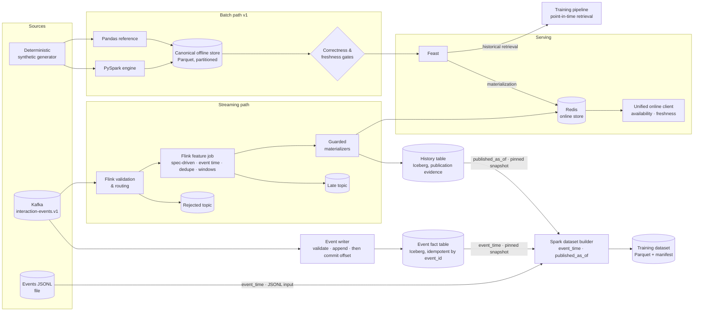

# FeatureForge

[](https://github.com/oster-dev/featureforge/actions/workflows/ci.yml)
[](https://github.com/oster-dev/featureforge/releases)
[](LICENSE)

**A production-inspired ML feature platform that keeps features correct between offline training and online reads, from batch and streaming sources.**

Proven today: point-in-time training datasets in two modes ([ADR-014](docs/adr/ADR-014-training-datasets.md)), event-time semantics ([ADR-010](docs/adr/ADR-010-time-and-availability-model.md)), idempotent writes into an Iceberg event fact store ([ADR-015](docs/adr/ADR-015-iceberg-event-fact-store.md)) and online/offline parity for one entity over two runs ([test](tests/integration/test_materialize_spec_kafka_to_history.py)). Measured on one laptop: the feature serving service answers 2,000 to 3,000 requests per second from one process with a p99 below 20 ms and saturates at about 4,000 requests per second ([benchmarks](docs/benchmarks.md)). [STATUS.md](STATUS.md) lists what is delivered and every known limit.

FeatureForge focuses on the parts that make feature platforms trustworthy:
point-in-time correctness, event-time semantics, idempotent writes, and
offline/online consistency. Every claimed guarantee below links to the test
that proves it.

The platform is the spec-driven path: one YAML spec drives the Flink job, the
Spark backfill for count specs, the Redis store, the publication history and the
training datasets. The Feast-based batch path is batch path v1. It serves the
original batch features, which are not yet defined as specs
([STATUS.md](STATUS.md)).

> **Scope, stated honestly:** FeatureForge is a local reference implementation.
> It runs on Docker Compose, uses synthetic data, and does not claim production
> scale. Its value is in the explicit contracts and the evidence behind them.

---

## Architecture



| Layer | Technology |
|---|---|
| Batch computation | Pandas (reference), PySpark (parity-tested) |
| Stream processing | Apache Kafka 3.9, Apache Flink 1.20 (PyFlink) |
| Offline store | Partitioned Parquet (local); S3 profile documented |
| Publication history and training datasets | Apache Iceberg (PyIceberg writes, Spark reads) with a SQLite or PostgreSQL catalog; Spark training datasets with a manifest |
| Batch path v1: feature definitions and retrieval | Feast |
| Declarative feature specs | YAML, validated by a Pydantic model |
| Online store | Redis 7.4 (local); DynamoDB profile documented |
| Contracts | Pydantic |
| Quality | pytest, Ruff, mypy, GitHub Actions (baseline, Python 3.11/3.12, serving integration, Flink integration) |

Full design: [ARCHITECTURE.md](ARCHITECTURE.md) ·
[Platform Blueprint](docs/PLATFORM_BLUEPRINT.md) ·
[ADRs](docs/adr/)

---

## Guarantees and the evidence behind them

### Offline and training data

| Guarantee | Evidence |
|---|---|
| Features use only events strictly before the observation time (no label leakage) | [`test_features.py`](tests/unit/test_features.py) |
| Spark and Pandas produce identical features | [`test_spark_parquet_features.py`](tests/unit/test_spark_parquet_features.py), [`test_backfill.py`](tests/unit/test_backfill.py) |
| Backfills are idempotent and auditable via run manifests | [`test_backfill.py`](tests/unit/test_backfill.py), [`test_cli_backfill.py`](tests/integration/test_cli_backfill.py) |
| Invalid feature partitions are blocked before they reach the online store | [`test_failed_materialization.py`](tests/failure_simulations/test_failed_materialization.py) |
| Stale features are detected against an explicit freshness SLO | [`test_stale_features.py`](tests/failure_simulations/test_stale_features.py) |
| Online values match the latest offline snapshot | [`test_online_serving.py`](tests/integration/test_online_serving.py) |

### Streaming

| Guarantee | Evidence |
|---|---|
| Invalid events are routed to a rejected topic without blocking valid events | [`test_streaming_validation_routing.py`](tests/integration/test_streaming_validation_routing.py) |
| Windows are event-time based and right-closed, including exact boundaries | [`test_user_skip_rate_job.py`](tests/integration/test_user_skip_rate_job.py), [`test_streaming_feature_time.py`](tests/unit/test_streaming_feature_time.py) |
| Late events correct already emitted windows; events too late for all windows are routed out | [`test_user_play_count_late_events.py`](tests/integration/test_user_play_count_late_events.py) |
| Replayed and duplicate events do not change results | [`test_user_play_count_replay_idempotency.py`](tests/integration/test_user_play_count_replay_idempotency.py) |
| Conflicting payloads for the same `event_id` fail loudly, for both streaming features | [`test_user_play_count_replay_idempotency.py`](tests/integration/test_user_play_count_replay_idempotency.py), [`test_user_skip_rate_event_identity.py`](tests/integration/test_user_skip_rate_event_identity.py) |
| The generic job resumes from a savepoint with its dedupe and window state intact (shown for play count) | [`test_generic_job_recovery.py`](tests/integration/test_generic_job_recovery.py) |
| The generic job recovers from a TaskManager crash with its dedupe and window state restored from a checkpoint (shown for play count) | [`test_generic_job_checkpoint_recovery.py`](tests/integration/test_generic_job_checkpoint_recovery.py) |
| The generic job's dedupe state expires after its TTL: a redelivery inside the TTL is ignored, one after it is counted again (shown for play count with a shortened TTL) | [`test_generic_job_dedupe_ttl.py`](tests/integration/test_generic_job_dedupe_ttl.py) |
| Online writes never regress: stale, older, and conflicting updates are rejected | [`test_streaming_redis_online_store.py`](tests/integration/test_streaming_redis_online_store.py), [`test_skip_rate_update_policy.py`](tests/unit/test_skip_rate_update_policy.py) |
| Concurrent writers are safe (Redis `WATCH`/`MULTI` with bounded retries) | [`test_streaming_redis_online_store_concurrency.py`](tests/integration/test_streaming_redis_online_store_concurrency.py) |
| Full Kafka → Flink → Kafka → Redis path produces the reference result | [`test_user_play_count_kafka_to_redis.py`](tests/integration/test_user_play_count_kafka_to_redis.py), [`test_skip_rate_flink_to_redis.py`](tests/integration/test_skip_rate_flink_to_redis.py) |

### Declarative feature specs

A feature can be defined as a YAML spec instead of new platform code. The spec
language is bounded on purpose, see [ADR-008](docs/adr/ADR-008-feature-spec-design.md).

| Guarantee | Evidence |
|---|---|
| Specs are validated before anything runs: bad windows, unsafe expressions, inconsistent dedupe or update policies and unknown event fields are rejected | [`test_spec_model.py`](tests/unit/test_spec_model.py) |
| One exact reference evaluates a spec and matches the Python references on randomized inputs at window boundaries | [`test_spec_reference.py`](tests/unit/test_spec_reference.py) |
| The skip-rate golden fixture has hand-calculated values that the Python reference and the spec reference both reproduce | [`test_streaming_user_skip_rate_golden.py`](tests/unit/test_streaming_user_skip_rate_golden.py), [`test_spec_golden_parity.py`](tests/unit/test_spec_golden_parity.py) |
| A generic Flink job built from a spec reproduces the golden fixtures of both features: every emitted window matches the spec reference and the Python reference | [`test_feature_from_spec_job.py`](tests/integration/test_feature_from_spec_job.py), [`test_spec_flink_plan.py`](tests/unit/test_spec_flink_plan.py) |
| A feature defined only by a YAML spec with another entity key (`content_id`) runs on the generic job and matches hand-calculated windows | [`test_generic_job_content_play_count.py`](tests/integration/test_generic_job_content_play_count.py) |
| A feature defined only by a YAML spec reaches Redis from events without a new Python file: the generic Flink job, the generic materializer and the spec-driven store give hand-calculated windows, ignore a redelivered event, apply the TTL and survive a replay | [`test_content_play_count_end_to_end.py`](tests/integration/test_content_play_count_end_to_end.py), [`test_materialize_spec_kafka_to_redis.py`](tests/integration/test_materialize_spec_kafka_to_redis.py) |
| The spec-driven store orders updates exactly like the hand-written skip-rate policy (compared on 768 combinations), refuses incomparable counts, and enforces `online.ttl` as a Redis expiry that only a written update refreshes | [`test_count_vector_update.py`](tests/unit/test_count_vector_update.py), [`test_spec_store.py`](tests/unit/test_spec_store.py), [`test_spec_store_redis.py`](tests/integration/test_spec_store_redis.py) |
| `validate-spec` and `test-spec` check and try a spec without Docker, with documented exit codes | [`test_cli_validate_spec.py`](tests/unit/test_cli_validate_spec.py), [`test_cli_test_spec.py`](tests/unit/test_cli_test_spec.py) |
| `backfill-spec` computes a spec for many entities and times with Spark, matches the spec reference, writes UTC timestamps and never overwrites an output | [`test_cli_backfill_spec.py`](tests/unit/test_cli_backfill_spec.py), [`test_spec_spark_backfill.py`](tests/unit/test_spec_spark_backfill.py) |

The generic job is the only implementation of both streaming features. It is
verified on the golden fixtures, late corrections, replay, the Redis path, a
savepoint stop and resume, and recovery from a TaskManager crash. The Redis
stores and materializers of the two original features are thin wrappers over the spec-driven store and materializer, which also serve a YAML-only feature end to end. See
[STATUS.md](STATUS.md) for what is not yet proven.

### Training datasets and history

A training dataset joins features and one label per observation, in one of two
explicit modes that never replace each other. See
[ADR-010](docs/adr/ADR-010-time-and-availability-model.md),
[ADR-011](docs/adr/ADR-011-history-table-layout.md),
[ADR-012](docs/adr/ADR-012-label-specs.md) and
[ADR-014](docs/adr/ADR-014-training-datasets.md).


| Guarantee | Evidence |
|---|---|
| Label specs are validated, evaluated by one exact reference and computed with Spark over the window `(t, t + horizon]` | [`test_label_spec.py`](tests/unit/test_label_spec.py), [`test_label_reference.py`](tests/unit/test_label_reference.py), [`test_label_spark.py`](tests/unit/test_label_spark.py) |
| The history table appends publication evidence idempotently, and `published_as_of` answers the rule of ADR-010 from it | [`test_history.py`](tests/unit/test_history.py), [`test_published_as_of.py`](tests/unit/test_published_as_of.py) |
| `materialize_spec` appends evidence next to the Redis write | [`test_materialize_spec_history.py`](tests/unit/test_materialize_spec_history.py), [`test_materialize_spec_kafka_to_history.py`](tests/integration/test_materialize_spec_kafka_to_history.py) |
| Spark reads the history table that PyIceberg wrote, with a SQLite and with a PostgreSQL catalog | [`test_history_spark_read.py`](tests/integration/test_history_spark_read.py), [`test_history_postgres_catalog.py`](tests/integration/test_history_postgres_catalog.py) |
| An event at the observation time is a feature and never the label, and an event just after it is the label | [`test_training_dataset.py`](tests/unit/test_training_dataset.py) |
| An observation whose label window is incomplete is excluded and counted, never written with a null label | [`test_training_dataset.py`](tests/unit/test_training_dataset.py) |
| Every dataset row matches the feature and label references on randomized observations | [`test_training_dataset.py`](tests/unit/test_training_dataset.py) |
| The Spark join of the history returns what `published_as_of` returns, at the publication and TTL boundaries and on randomized histories | [`test_published_spark.py`](tests/integration/test_published_spark.py) |
| In `published_as_of` mode, a feature that is not published or expired has null values and a status, never zero | [`test_published_spark.py`](tests/integration/test_published_spark.py), [`test_training_dataset_published.py`](tests/integration/test_training_dataset_published.py) |
| An observation before the latest history start is excluded and counted, one on the edge stays, and the manifest records the snapshot id and start of each feature | [`test_training_dataset_published.py`](tests/integration/test_training_dataset_published.py) |
| The two modes differ exactly where serving and the events differ, and a dataset run leaves the history unchanged | [`test_training_dataset_published.py`](tests/integration/test_training_dataset_published.py) |
| Redis and `published_as_of` agree on the value of an entity after each of two bounded runs, and `published_as_of` still returns the older version at an earlier time | [`test_materialize_spec_kafka_to_history.py`](tests/integration/test_materialize_spec_kafka_to_history.py) |
| `build-training-dataset` writes a dataset in both modes, pins the history snapshot and records it in the manifest, never creates a history table and never overwrites an output | [`test_cli_build_training_dataset.py`](tests/unit/test_cli_build_training_dataset.py), [`test_cli_training_dataset.py`](tests/integration/test_cli_training_dataset.py) |
| The event writer appends a validated event once per `event_id`, commits the offset only after the append, counts rejections without storing them and stops on an identity conflict | [`test_event_log_append.py`](tests/unit/test_event_log_append.py), [`test_event_writer_loop.py`](tests/unit/test_event_writer_loop.py), [`test_event_writer_kafka.py`](tests/integration/test_event_writer_kafka.py) |
| `build-training-dataset --events-root` reads the event table at a pinned snapshot and records it, rebuilds a dataset at the recorded snapshot after the table grew, a dataset from the table equals the dataset from the same JSONL, and a missing or empty table fails and creates nothing | [`test_cli_training_dataset.py`](tests/integration/test_cli_training_dataset.py), [`test_events_spark_read.py`](tests/integration/test_events_spark_read.py) |


Not yet proven: the parity for several entities and at TTL expiry. Not yet built: a mode that uses only events received by `t`. See [STATUS.md](STATUS.md).


### Online access

| Guarantee | Evidence |
|---|---|
| Batch and streaming features are read through one client with explicit availability and freshness, and missing values are never silently turned into `0` | [`test_unified_online.py`](tests/integration/test_unified_online.py), [`test_online.py`](tests/unit/test_online.py) |

All of the above run in CI on every pull request and push to `main`, plus a nightly run:

| CI layer | What it proves |
|---|---|
| Baseline lint and test | Fresh install, Ruff, mypy, all infrastructure-free tests |
| Python 3.11 and 3.12 compatibility | The infrastructure-free tests on the oldest and a middle supported version |
| Redis and Feast serving integration | Generation → backfill → Feast apply → materialization → online parity; the history table, the published-as-of join and the training datasets |
| Flink Kafka-to-Redis integration | Full Docker Compose streaming stack, joined end-to-end tests |

---

## Quick start

Prerequisites: Python 3.11–3.13, Docker, GNU Make.

```bash
git clone [https://github.com/oster-dev/featureforge.git](https://github.com/oster-dev/featureforge.git)
cd featureforge
python3 -m venv .venv && source .venv/bin/activate
python -m pip install -e ".[dev,feature-store,spark,streaming]"

# Batch path: generate → backfill → validate → materialize → serve
docker compose up -d redis
(cd feature_repo && feast apply)
make demo

# Streaming path: Kafka → Flink → Redis, verified end to end
docker compose up -d --build
pytest -v -m integration tests/integration/test_skip_rate_flink_to_redis.py

# Feature specs: validate the shipped specs
python -m featureforge.cli validate-spec

# Try a spec on an event file, no Docker needed
python -m featureforge.cli test-spec feature_repo/specs/user_play_count_1h.yaml \
  --events fixtures/streaming/user_play_count_1h_v1.jsonl \
  --entity user_id=user_000001 --at 2026-01-01T11:30:00+00:00 \
  --expect play_count=3
```

Read a feature through the unified online client:

```bash
python -m featureforge.online \
  --user-id user_000290 \
  --reference-time 2026-03-25T00:00:00+00:00 \
  --batch-max-age-seconds 172800 \
  --stream-max-age-seconds 7200
```

Expected output, troubleshooting, and cleanup: [Demo Guide](docs/demo.md).

---

## Features

| Feature | Path | Entity | Definition |
|---|---|---|---|
| `user_engagement` (7 values) | Batch | `user_id` | Event, play, watch, search counts, unique content, watch time, recency |
| `content_popularity` (8 values) | Batch | `content_id` | Views, unique viewers, watch time, recency |
| `user_play_count_1h` | Streaming | `user_id` | Play events in `(t − 1h, t]`, sliding |
| `user_skip_rate_24h` | Streaming | `user_id` | `skips / (plays + skips)` in `(t − 24h, t]`, 1-minute slide, explicit zero-denominator behavior |
| `content_play_count_1h` | Streaming (spec only) | `content_id` | Play events of a content item in `(t − 1h, t]`, sliding. Computed by the generic job from a YAML spec alone and served from Redis by the spec-driven store and materializer |

All three streaming features are defined as specs in
[`feature_repo/specs/`](feature_repo/specs/) and computed by one generic Flink job.
All three use the spec-driven store and materializer. The first two keep their typed models and command lines as thin wrappers over it.

---

## Status

The feature store foundation is released as
[v0.1.0](https://github.com/oster-dev/featureforge/releases/tag/v0.1.0).
Spec-driven streaming features, label specs and training datasets in two modes
(event time and published-as-of) are delivered. Work in progress, planned work
and known limitations are in **[STATUS.md](STATUS.md)**, the single source for
the current state.

---

## Documentation

| Document | Content |
|---|---|
| [STATUS.md](STATUS.md) | Delivered vs. in progress vs. planned, known limitations |
| [ARCHITECTURE.md](ARCHITECTURE.md) | Component design and data flow |
| [docs/PLATFORM_BLUEPRINT.md](docs/PLATFORM_BLUEPRINT.md) | Target platform design |
| [docs/adr/](docs/adr/) | Architecture decision records (ADR-001 to ADR-016) |
| [docs/streaming-migration.md](docs/streaming-migration.md) | Streaming provenance and verification boundaries |
| [docs/demo.md](docs/demo.md) | Reviewer walkthrough |
| [docs/runbooks/](docs/runbooks/) | Stale features, failed backfill, failed materialization |
| [docs/aws-production-profile.md](docs/aws-production-profile.md) | Documented AWS mapping (S3, DynamoDB) |
| [CONTRIBUTING.md](CONTRIBUTING.md) | Local setup and test execution |

---

## License

MIT, see [LICENSE](LICENSE).