  

# FeatureForge Status

**Last updated: 2026-11-27** &nbsp;·&nbsp; 

[At a glance](#at-a-glance) · [Delivered](#delivered) · [In progress](#in-progress) · [Next](#next) · [Known gaps](#known-gaps) · [Out of scope](#deliberately-out-of-scope) · [Reading the evidence](#how-to-read-the-evidence)

This file is the single place for what is **delivered**, **in progress**, and
**deliberately out of scope**. Other documents link here instead of repeating
status. Claims in the README link to the test or document that proves them.

> [!IMPORTANT]
> A guarantee counts as delivered only when a test, a benchmark or a drill report exists and is
> linked. Every limit that is known is listed under [Known gaps](#known-gaps), including the ones
> that are uncomfortable.

<b>Related documents and decisions</b>

 

[README](README.md) · [Architecture](ARCHITECTURE.md) · [Design](docs/DESIGN.md) · [Platform blueprint](docs/PLATFORM_BLUEPRINT.md) · [Streaming provenance](docs/streaming-migration.md) · [ADR-008](docs/adr/ADR-008-feature-spec-design.md) · [ADR-009](docs/adr/ADR-009-spec-driven-online-stores.md) · [ADR-010](docs/adr/ADR-010-time-and-availability-model.md) · [ADR-011](docs/adr/ADR-011-history-table-layout.md) · [ADR-012](docs/adr/ADR-012-label-specs.md) · [ADR-013](docs/adr/ADR-013-online-store-protocol.md) · [ADR-014](docs/adr/ADR-014-training-datasets.md) · [ADR-015](docs/adr/ADR-015-iceberg-event-fact-store.md) · [ADR-016](docs/adr/ADR-016-feature-serving.md)

---

## At a glance

| Topic | State | In one sentence |
|---|---|---|
| Batch path v1 |  | Deterministic data, a canonical Parquet store, gates, Feast and Redis, with a unified client. |
| Streaming correctness |  | Late data, replay, identity conflicts, savepoint resume and a TaskManager crash are tested. A JobManager failure is not. |
| Declarative feature specs |  | One generic Flink job runs all three streaming features from YAML. Count and ratio only, one entity key. |
| History, labels and training datasets |  | Two retrieval modes, label specs and a dataset command are delivered. Operators beyond count are open. |
| Event fact store |  | Immutable Iceberg facts, idempotent by `event_id`, read at a pinned snapshot. One writer, no retention. |
| Online stores |  | Redis and Cassandra behind one protocol and one contract suite. |
| Feature serving |  | A status per entry, a budget, metrics and measured latency on one laptop. |
| Operations |  | Service metrics, a dashboard and benchmark tooling exist. Alert rules, further drills and a soak run do not. |
| Catalog, embeddings, ML workflow |  | Not started. See [Next](#next). |

---

## Delivered

### Batch path v1 and online access

| Area | What exists | Evidence |
|---|---|---|
| **Offline path** | Deterministic source data, canonical Parquet backfill, persisted-feature correctness gate, freshness check | [demo.md](docs/demo.md) ADR-002 ADR-003 |
| **Online serving** | Feast materialization into Redis, online lookup, deterministic ranking | [`test_online_serving.py`](tests/integration/test_online_serving.py) |
| **Unified read access** | Batch features, streaming play count and skip rate through one client, explicit missing, freshness and non-atomic metadata | [`online.py`](src/featureforge/online.py) [`test_unified_online.py`](tests/integration/test_unified_online.py) |

### Streaming correctness

| Area | What exists | Evidence |
|---|---|---|
| **Streaming features** | `user_play_count_1h` and `user_skip_rate_24h`: Kafka, one generic spec-driven Flink job, guarded Redis writes. The joined validation, play-count and Redis flow runs on it. | [`tests/integration/`](tests/integration/) (see below) [`test_user_play_count_kafka_to_redis.py`](tests/integration/test_user_play_count_kafka_to_redis.py) |
| **Validation and routing** | Rejected events go to a separate topic, valid follow-up events keep flowing | [`test_streaming_validation_routing.py`](tests/integration/test_streaming_validation_routing.py) |
| **Late data** | Late correction of an emitted window and too-late routing for the play count, both skip-rate correction directions | [`test_user_play_count_late_events.py`](tests/integration/test_user_play_count_late_events.py) [`test_user_skip_rate_job.py`](tests/integration/test_user_skip_rate_job.py) |
| **Replay and conflicts** | Play count: replay idempotency including the Kafka-to-Redis materializer, and event-identity conflict detection that fails the job. Skip rate: corrections through the materializer, a replay that preserves the Redis value, and the same event-identity conflict failure. | [`test_user_play_count_replay_idempotency.py`](tests/integration/test_user_play_count_replay_idempotency.py) [`test_skip_rate_flink_to_redis.py`](tests/integration/test_skip_rate_flink_to_redis.py) [`test_user_skip_rate_event_identity.py`](tests/integration/test_user_skip_rate_event_identity.py) |
| **Savepoint resume** | The generic job stops with a savepoint and a new job resumes from it. A redelivered event does not count again, a correction lands in the restored window, and the late topic stays empty. The test checks that the new job really restored the savepoint. Shown for the play-count spec. It covers a planned stop, not a crash. | [`test_generic_job_recovery.py`](tests/integration/test_generic_job_recovery.py) [`docker-compose.yml`](docker-compose.yml) (shared savepoint volume) |
| **Crash recovery** | The TaskManager is killed while the generic job runs. The same job restarts on its own and restores a checkpoint that contains the earlier events and is not a savepoint. A redelivered event does not count again, a late correction lands in the restored window, and the late topic stays empty. Shown for the play-count spec. The JobManager keeps running and holds the checkpoints in memory. | [`test_generic_job_checkpoint_recovery.py`](tests/integration/test_generic_job_checkpoint_recovery.py) |
| **Skip-rate golden fixture** | Deterministic event file with hand-calculated expected values: both window edges, a duplicate delivery, ignored event types, a second user, expiry to a zero denominator. Matched by the Python reference, by the spec reference including a sweep over every event boundary, and by the generic Flink job. | [`user_skip_rate_24h_v1.jsonl`](fixtures/streaming/user_skip_rate_24h_v1.jsonl) [`test_streaming_user_skip_rate_golden.py`](tests/unit/test_streaming_user_skip_rate_golden.py) [`test_spec_golden_parity.py`](tests/unit/test_spec_golden_parity.py) [`test_feature_from_spec_job.py`](tests/integration/test_feature_from_spec_job.py) |

### Declarative feature specs

| Area | What exists | Evidence |
|---|---|---|
| **Feature spec model** | Validated declarative spec: windows, lateness, dedupe, update policies, safe expressions. The loader rejects fields that are not in the event contract. Both existing features expressed as specs. | [`src/featureforge/spec/`](src/featureforge/spec/) [`feature_repo/specs/`](feature_repo/specs/) [`test_spec_model.py`](tests/unit/test_spec_model.py) |
| **Spec validation command** | `featureforge.cli validate-spec` checks spec files against the spec model and the event contract. Without arguments it checks every spec in `feature_repo/specs`. Exit code 0 means valid, 1 means a spec is invalid and each violated field is listed, 2 means a file is missing or no spec was found. | [`cli.py`](src/featureforge/cli.py) [`test_cli_validate_spec.py`](tests/unit/test_cli_validate_spec.py) |
| **Spec test command** | `featureforge.cli test-spec` evaluates a spec on a JSONL event file for one entity and one observation time with the spec reference, prints every output and checks expected values with `--expect`. Exit code 0 means ok, 1 means invalid input or a failed expectation, 2 means a file is missing. It runs the reference, not the Flink job, and needs no Docker. | [`cli.py`](src/featureforge/cli.py) [`test_cli_test_spec.py`](tests/unit/test_cli_test_spec.py) |
| **Spec backfill command** | `featureforge.cli backfill-spec` evaluates a spec with Spark for many entities and observation times, from a JSONL event file and a JSONL observation file, and writes the values as a new Parquet directory with UTC timestamps in microseconds.

More detail
It covers count, sum, avg, min, max and last_k aggregations only, never overwrites an existing path, and never reads or writes `published_at`. Exit code 0 means ok, 1 means invalid input, an identity conflict, an unsupported operator or an existing output, 2 means a file is missing or PySpark is not installed.
 | [`spark_backfill.py`](src/featureforge/spec/spark_backfill.py) [`test_cli_backfill_spec.py`](tests/unit/test_cli_backfill_spec.py) |
| **Spec reference** | Exact event-time reference evaluated directly from a spec: all operators, composite keys, missing-value rules, event-field check. Matches both Python references on randomized inputs at window boundaries and the play-count golden fixture. | [`reference.py`](src/featureforge/spec/reference.py) [`test_spec_reference.py`](tests/unit/test_spec_reference.py) |
| **Generic Flink job** | A plan derived from a spec (window, lateness, dedupe horizon, counters with filters, derived value) drives one generic job, the only implementation of both streaming features. Supports count, sum, avg, min and max aggregations and one entity key, other operators are rejected with a clear error.

More detail
On the golden fixtures of `user_skip_rate_24h` (two counters and a ratio) and `user_play_count_1h` (a single counter) and `user_play_seconds_1h` (count, sum and average of the play seconds), every emitted window matches the spec reference and the Python reference, hand-calculated windows are present (five for skip rate, seven for play count, eight for play seconds), no window is emitted twice, each record has exactly the expected fields, and nothing reaches the late topic. The integration tests cover the eight skip-rate job scenarios (late corrections in both directions with duplicates, too-late routing, both window edges, zero denominator), the play-count late-event scenarios, play-count replay idempotency with the Redis materializer, the event-identity conflict failure, the skip-rate Flink-to-Redis flow and the joined play-count flow. The hand-written jobs were deleted after all of these passed on the generic job. The last version is the tag `hand-written-jobs-final`.
 | 

10 references
[`flink_plan.py`](src/featureforge/spec/flink_plan.py) [`feature_from_spec.py`](jobs/feature_from_spec.py) [`user_play_count_1h_v1.jsonl`](fixtures/streaming/user_play_count_1h_v1.jsonl) [`test_spec_flink_plan.py`](tests/unit/test_spec_flink_plan.py) [`test_feature_from_spec_job.py`](tests/integration/test_feature_from_spec_job.py) [`test_user_skip_rate_job.py`](tests/integration/test_user_skip_rate_job.py) [`test_user_play_count_late_events.py`](tests/integration/test_user_play_count_late_events.py) [`test_user_play_count_replay_idempotency.py`](tests/integration/test_user_play_count_replay_idempotency.py) [`test_skip_rate_flink_to_redis.py`](tests/integration/test_skip_rate_flink_to_redis.py) [`test_user_play_count_kafka_to_redis.py`](tests/integration/test_user_play_count_kafka_to_redis.py)
 |
| **Spec-driven online path** | A count, sum, min, max or ratio spec with one entity key reaches Redis without a new Python file. A `sum` is a component and an `avg` a derived value that is `null` for an empty window, proven from events to Redis for `user_play_seconds_derived_1h`. A `min` falls and a `max` rises with added events and both are `null` for an empty window, proven from events to Redis for `user_play_seconds_extremes_1h`. `parse_feature_record` validates the Flink record against the spec, including derived values.

More detail
`RedisSpecStore` writes it with window ordering and componentwise count ordering for `append_only` and `componentwise_monotonic`, the same `WATCH`/`MULTI` retries as the former hand-written stores, and enforces `online.ttl` as a Redis expiry that only a written update refreshes. `materialize_spec` moves a feature topic into Redis. `content_play_count_1h` runs from events through the validation job, the generic Flink job and this path, with hand-calculated windows, dedupe of a redelivered event, an idempotent rerun and a replay that cannot undo the stored state. Since PR #43 the stores and materializers of the two original features are thin wrappers over this path: they keep their typed models, constructors and command lines, and their keys now expire with `online.ttl`.
 | 

19 references
[`count_vector.py`](src/featureforge/streaming/contracts/count_vector.py) [`feature_record.py`](src/featureforge/streaming/contracts/feature_record.py) [`spec_store.py`](src/featureforge/streaming/spec_store.py) [`materialize_spec.py`](src/featureforge/streaming/materialize_spec.py) [`online_store.py`](src/featureforge/streaming/online_store.py) [`skip_rate_store.py`](src/featureforge/streaming/skip_rate_store.py) [`materialize.py`](src/featureforge/streaming/materialize.py) [`materialize_skip_rate.py`](src/featureforge/streaming/materialize_skip_rate.py) [`test_count_vector_update.py`](tests/unit/test_count_vector_update.py) [`test_feature_record.py`](tests/unit/test_feature_record.py) [`test_spec_store.py`](tests/unit/test_spec_store.py) [`test_materialize_spec.py`](tests/unit/test_materialize_spec.py) [`test_materialize_play_count.py`](tests/unit/test_materialize_play_count.py) [`test_materialize_skip_rate.py`](tests/unit/test_materialize_skip_rate.py) [`test_spec_store_redis.py`](tests/integration/test_spec_store_redis.py) [`test_redis_skip_rate_store.py`](tests/integration/test_redis_skip_rate_store.py) [`test_streaming_redis_online_store.py`](tests/integration/test_streaming_redis_online_store.py) [`test_materialize_spec_kafka_to_redis.py`](tests/integration/test_materialize_spec_kafka_to_redis.py) [`test_content_play_count_end_to_end.py`](tests/integration/test_content_play_count_end_to_end.py)
 |

### History, labels and training data

| Area | What exists | Evidence |
|---|---|---|
| **History and published-as-of retrieval** | One Iceberg history table per spec with an idempotent append by update identity, read by Spark through a SQLite or a PostgreSQL catalog. `materialize_spec` appends the evidence with `--history-root`. `published_as_of` answers the rule of ADR-010 in Python: the latest version with `published_at` at or before the time, missing past `online.ttl`, never zero. | 

9 references
[`history.py`](src/featureforge/streaming/history.py) [`published_as_of.py`](src/featureforge/streaming/published_as_of.py) [`test_history.py`](tests/unit/test_history.py) [`test_history_catalog_config.py`](tests/unit/test_history_catalog_config.py) [`test_published_as_of.py`](tests/unit/test_published_as_of.py) [`test_materialize_spec_history.py`](tests/unit/test_materialize_spec_history.py) [`test_history_spark_read.py`](tests/integration/test_history_spark_read.py) [`test_history_postgres_catalog.py`](tests/integration/test_history_postgres_catalog.py) [`test_materialize_spec_kafka_to_history.py`](tests/integration/test_materialize_spec_kafka_to_history.py)
 |
| **Label specs** | A validated label spec with a `validate-label-spec` command, an exact reference and a Spark evaluation with parity to it. The label window is `(t, t + horizon]`, an incomplete window is excluded and counted, and a label is never null ([ADR-012](docs/adr/ADR-012-label-specs.md)). | 

7 references
[`label_model.py`](src/featureforge/spec/label_model.py) [`label_reference.py`](src/featureforge/spec/label_reference.py) [`label_spark.py`](src/featureforge/spec/label_spark.py) [`test_label_spec.py`](tests/unit/test_label_spec.py) [`test_label_reference.py`](tests/unit/test_label_reference.py) [`test_label_spark.py`](tests/unit/test_label_spark.py) [`test_cli_validate_label_spec.py`](tests/unit/test_cli_validate_label_spec.py)
 |
| **Training datasets** | `build_training_dataset` writes Parquet partitioned by the UTC observation day and a manifest, in a required mode. `event_time` takes features from events over `(t − size, t]`.

More detail
`published_as_of` takes them from a pinned history snapshot through one Spark join, with status columns, null values when a feature is not published or expired, exclusion of observations before the latest history start, and the snapshot id and start of every history in the manifest. The label always comes from events. A dataset run never writes to the history. In `event_time` mode it supports count, sum and avg aggregations. In `published_as_of` mode it supports count aggregations and one entity key, because the history comes from the Flink job. `load_training_dataset` reads a dataset back with pandas, checks it against the manifest and holds it in memory. `open_training_batches` makes the same checks from the Parquet metadata and yields Arrow batches in partition order, without a sort by key ([ADR-014](docs/adr/ADR-014-training-datasets.md)).
 | 

10 references
[`training_dataset.py`](src/featureforge/spec/training_dataset.py) [`published_spark.py`](src/featureforge/streaming/published_spark.py) [`test_training_dataset.py`](tests/unit/test_training_dataset.py) [`test_published_spark.py`](tests/integration/test_published_spark.py) [`test_training_dataset_published.py`](tests/integration/test_training_dataset_published.py) [`training_loader.py`](src/featureforge/spec/training_loader.py) [`test_training_loader.py`](tests/unit/test_training_loader.py) [`training_batches.py`](src/featureforge/spec/training_batches.py) [`test_training_batches.py`](tests/unit/test_training_batches.py) [`benchmark_training_loaders.py`](scripts/benchmark_training_loaders.py)
 |
| **Event fact store** | Validated events are kept as immutable Iceberg facts in `facts.interaction_events`, partitioned by `day(event_time)` and with `ingested_at` ([ADR-015](docs/adr/ADR-015-iceberg-event-fact-store.md)).

More detail
`EventLog.append` is idempotent by `event_id`: the first row wins and keeps its `ingested_at`, and the same id with another payload fails and writes nothing. The event writer reads a raw topic in its own consumer group, validates with `route_event_json`, appends before it commits the offset and counts rejections without storing them. `build-training-dataset --mode event_time --events-root` reads the table at the snapshot that is current at the start, or at the one given by `--events-snapshot-id`, and records it in the manifest under `events`.
 | 

6 references
[`event_log.py`](src/featureforge/streaming/event_log.py) [`event_writer.py`](src/featureforge/streaming/event_writer.py) [`events_spark.py`](src/featureforge/streaming/events_spark.py) [`test_event_log_append.py`](tests/unit/test_event_log_append.py) [`test_event_writer_kafka.py`](tests/integration/test_event_writer_kafka.py) [`test_cli_training_dataset.py`](tests/integration/test_cli_training_dataset.py)
 |

### Online stores and feature serving

| Area | What exists | Evidence |
|---|---|---|
| **Online store protocol and Cassandra** | The `OnlineStore` protocol with a store factory that follows `online.store`, and a contract suite that runs for Redis and Cassandra ([ADR-013](docs/adr/ADR-013-online-store-protocol.md)).

More detail
A local Cassandra node (Compose profile `cassandra`), the table schema and `CassandraSpecStore` are in place, and `materialize_spec` writes to the backend the spec names, shown from Kafka to Cassandra. The service reads Cassandra through `CassandraServingReader`, chosen by `online.store`. One end-to-end test runs `content_play_count_1h` from events through the validation job, the generic Flink job, the materializer and the service on Cassandra, with only `online.store` changed.
 | 

13 references
[`online_store.py`](src/featureforge/streaming/online_store.py) [`cassandra_connection.py`](src/featureforge/streaming/cassandra_connection.py) [`cassandra_schema.py`](src/featureforge/streaming/cassandra_schema.py) [`cassandra_store.py`](src/featureforge/streaming/cassandra_store.py) [`test_cassandra_schema.py`](tests/unit/test_cassandra_schema.py) [`test_cassandra_store.py`](tests/unit/test_cassandra_store.py) [`test_online_store_contract.py`](tests/integration/test_online_store_contract.py) [`test_cassandra_node.py`](tests/integration/test_cassandra_node.py) [`test_materialize_spec_kafka_to_cassandra.py`](tests/integration/test_materialize_spec_kafka_to_cassandra.py) [`cassandra_serving_reader.py`](src/featureforge/cassandra_serving_reader.py) [`test_cassandra_serving_reader.py`](tests/unit/test_cassandra_serving_reader.py) [`test_serving_reader_cassandra.py`](tests/integration/test_serving_reader_cassandra.py) [`test_cassandra_end_to_end.py`](tests/integration/test_cassandra_end_to_end.py)
 |
| **Serving contract** | The feature-serving service (`featureforge-serve`, FastAPI, [ADR-016](docs/adr/ADR-016-feature-serving.md)). A request names several entities and features and gets a value with a status per entry: `ok`, `missing`, `stale` or `backend_error`, never a silent zero. The service reads through a `ServingReader`.

More detail
The Redis reader makes one `MGET` per request (PR #104) and reads on the event loop with `redis.asyncio` (change 6, PR #127). The Cassandra reader runs in the thread pool. A stopped and a slow Redis (Toxiproxy) give `backend_error` within the budget and the service recovers. The service runs as a container in the Compose stack and is checked with `scripts/smoke_feature_service.py`.
 | 

11 references
[`feature_service.py`](src/featureforge/feature_service.py) [`serving_reader.py`](src/featureforge/serving_reader.py) [`redis_serving_reader.py`](src/featureforge/redis_serving_reader.py) [`cassandra_serving_reader.py`](src/featureforge/cassandra_serving_reader.py) [`service_api.py`](src/featureforge/service_api.py) [`test_feature_service.py`](tests/unit/test_feature_service.py) [`test_serving_readers.py`](tests/unit/test_serving_readers.py) [`test_async_serving.py`](tests/unit/test_async_serving.py) [`test_feature_service_redis.py`](tests/integration/test_feature_service_redis.py) [`test_feature_service_faults.py`](tests/integration/test_feature_service_faults.py) [`smoke_feature_service.py`](scripts/smoke_feature_service.py)
 |
| **Serving measurements** | An open-load benchmark measures latency percentiles and the saturation point of one process on one laptop. Redis holds 4,000 req/s with a p99 of 5.1 to 7.3 ms and saturates at about 4,600 to 4,900 req/s. Cassandra holds 1,500 req/s with a p99 of 14.2 to 14.8 ms and saturates at about 2,100 req/s (about 1,660 before plain tuple rows).

More detail
Reading on the event loop raised the Redis saturation by 21 percent in an A/B of two rounds ([Change 6](docs/benchmarks.md)). Moving the read behind the reader changed the saturation point by -1.1 percent against an acceptance limit of 3 percent ([Change 4](docs/benchmarks.md)). At saturation the mean event loop lag was 1.0 to 1.7 ms in one run. These are local measurements, not production numbers.
 | [docs/benchmarks.md](docs/benchmarks.md) [`docs/benchmarks/`](docs/benchmarks/) [`benchmark_feature_serving.py`](scripts/benchmark_feature_serving.py) |
| **Metrics and benchmark tooling** | Prometheus metrics for lookup latency, entries by status and requests by outcome, and `featureforge_event_loop_lag_seconds`, which shows how late the event loop runs (PR #133). Prometheus and Grafana run next to the service with a dashboard of five panels ([docs/observability.md](docs/observability.md)).

More detail
Benchmark reports record the status and the error type of failed entries (PR #117). `scripts/compare_benchmarks.py` compares two reports and marks a change only when it exceeds the noise of the repeats. `scripts/run_serving_benchmark.py` runs the benchmark with presets and safety checks (`make bench-smoke`, `make bench-record`), and a CI job runs the smoke preset against Redis.
 | 

9 references
[`service_metrics.py`](src/featureforge/service_metrics.py) [`test_service_metrics.py`](tests/unit/test_service_metrics.py) [`test_event_loop_lag.py`](tests/unit/test_event_loop_lag.py) [`compare_benchmarks.py`](scripts/compare_benchmarks.py) [`test_compare_benchmarks.py`](tests/unit/test_compare_benchmarks.py) [`run_serving_benchmark.py`](scripts/run_serving_benchmark.py) [`test_run_serving_benchmark.py`](tests/unit/test_run_serving_benchmark.py) [`test_benchmark_git_state.py`](tests/unit/test_benchmark_git_state.py) [`prometheus.yml`](docker/prometheus/prometheus.yml)
 |

### Developer experience, CI and documentation

| Area | What exists | Evidence |
|---|---|---|
| **Quickstart and dev container** | `make quickstart` writes demo values for two users to Redis and reads three users through the feature service: `ok`, `stale` and `missing`. Without a running Redis the entries come back as `backend_error` and the command does not crash.

More detail
A dev container (Python 3.13, Docker-in-Docker, port 8080 forwarded) builds a Codespace on a base image pinned to `bookworm`, and a test rejects floating image tags. One fresh Codespace without a prebuild was ready after 4 minutes 22 seconds, and the quickstart took 1 minute 15 seconds (one measurement, 2026-11-24).
 | [`quickstart.py`](scripts/quickstart.py) [`test_quickstart.py`](tests/unit/test_quickstart.py) [`devcontainer.json`](.devcontainer/devcontainer.json) [`test_devcontainer.py`](tests/unit/test_devcontainer.py) |
| **CI** | Six jobs on every push and pull request to `main` and on a nightly run: baseline (Ruff, mypy, infrastructure-free tests), Python 3.11/3.12 compatibility, serving integration (including the history, published-as-of and training dataset tests), the Cassandra schema, store and contract suite, streaming Flink integration with a fresh TaskManager per module, and a benchmark smoke run against Redis. Concurrency and timeouts are set, and Dependabot updates the Actions. The serving and the Cassandra job fail on a skipped test. | [`ci.yml`](.github/workflows/ci.yml) [`run_flink_integration.sh`](scripts/ci/run_flink_integration.sh) |
| **Documentation** | Architecture, blueprint, design document with the time model, store contract and comparison with Feast and Chronon, demo guide with batch, streaming and feature-spec walkthroughs, ADRs, three runbooks (stale features, failed backfill, failed materialization), a tour notebook that runs without Docker, AWS production profile (design only) | [`docs/`](docs/) [`DESIGN.md`](docs/DESIGN.md) [`featureforge-tour.ipynb`](notebooks/featureforge-tour.ipynb) [`test_tour_notebook.py`](tests/unit/test_tour_notebook.py) |

<a href="#top">Back to top</a>

---

## In progress

| Item | State |
|---|---|
| **Declarative spec and generic engine** | The spec model, validation, spec reference and generic Flink job are delivered for both features. The streaming checks are delivered except JobManager failure: every integration test runs on the generic job, the hand-written jobs are deleted, and the stores and materializers of the two original features are thin wrappers over the spec-driven code. Spark backfill and the YAML-only features are listed below. |
| **Streaming history and published-as-of retrieval** | In progress: the history table and an idempotent append exist ([ADR-011](docs/adr/ADR-011-history-table-layout.md)), `materialize_spec` writes evidence with `--history-root`, and `published_as_of` reads it (Python, and one Spark join for datasets).

More detail
The time model is decided in [ADR-010](docs/adr/ADR-010-time-and-availability-model.md) (Accepted): availability is `published_at` of the online sink, assigned by the materializer after a `written` result. A spec-driven Spark backfill computes values at explicit observation times, never reads or writes `published_at`, and leaves recorded evidence unchanged (tested). Training datasets exist in both modes ([ADR-014](docs/adr/ADR-014-training-datasets.md)). The parity between Redis and `published_as_of` is tested over two bounded runs of one entity (`tests/integration/test_materialize_spec_kafka_to_history.py`). The `build-training-dataset` command writes a dataset in either mode (`tests/unit/test_cli_build_training_dataset.py`, `tests/integration/test_cli_training_dataset.py`). Open: operators beyond count.
 |

### Generic engine parts

| Part | Content | State |
|---|---|---|
| **Spec model** | ADR-008, spec model, validation, two specs |  |
| **Spec reference** | Generic reference from a spec, parity with the Python references and the play-count golden fixture |  |
| **Generic Flink job** | Generic Flink job (`count`, `ratio`): golden fixtures, spec-reference parity, job plan from a spec, generic job verified against the fixtures of both features |  |
| **Streaming checks and online path** | Done: the skip-rate scenarios, the play-count golden fixture, the late-event scenarios, replay and identity conflict, the skip-rate Flink-to-Redis flow and the joined play-count flow all ran on both the hand-written and the generic job.

More detail
The hand-written jobs are deleted, the generic job is the only implementation. Stop with a savepoint and resume on the generic job. Recovery from a TaskManager crash with checkpoint state. The dedupe state expires after its TTL, shown with a shortened TTL for the play-count spec. Spec-driven online path with one decision function, one store with `online.ttl` expiry and one materializer, proven by the end-to-end test of `content_play_count_1h`. The stores and materializers of the two original features are thin wrappers over the spec-driven code (ADR-009, decisions 1 and 10), and their keys expire with `online.ttl`. Open: JobManager failure
 |  |
| **Spark backfill and operators** | Further operators in Flink, composite keys, Spark backfill. Done: a spec-driven Spark backfill for count, sum, avg, min, max and last_k specs (`featureforge.spec.spark_backfill`) is equal to the spec reference on both golden fixtures, at every window boundary and on identity conflicts. Done: `featureforge.cli backfill-spec` writes the values for many entities and times as Parquet. Open: approx_distinct in Spark, composite keys |  |
| **YAML-only features** | Two new features by YAML only. Done: `content_play_count_1h` (entity `content_id`) runs on the generic job from a spec alone and matches hand-calculated windows. Done: `content_play_count_1h` reaches Redis from events through the generic Flink job, `materialize_spec` and `RedisSpecStore` without a new Python file. Open: `user_content_affinity_7d` with a composite key |  |

---

## Next

Order follows the [platform blueprint](docs/PLATFORM_BLUEPRINT.md):

1. **Generic engine:** the open parts above.
2. **History and datasets:** stream history, label specs and training datasets are delivered. The parity test between Redis and published-as-of, the `build-training-dataset` command, the dataset loader and the Arrow batch loader with its read benchmark are delivered too. Open: an Iceberg offline store.
3. **Online store:** the `OnlineStore` protocol, a store factory and a contract
   suite are delivered ([ADR-013](docs/adr/ADR-013-online-store-protocol.md)).
   A local Cassandra node (Compose profile `cassandra`), the table schema and a
   Cassandra store are in place, and the contract suite runs for both backends. The
   materializer writes to the backend that the spec names, and the service reads either backend, chosen by `online.store` ([ADR-016](docs/adr/ADR-016-feature-serving.md)).
4. **Serving:** the feature-serving service (ADR-016) is delivered for Redis and Cassandra, with unit tests, integration tests against a real Redis and Cassandra, load measurements, metrics and a Grafana dashboard (see the table above and [docs/benchmarks.md](docs/benchmarks.md), which holds the history of every change and the baselines). The service also runs as a container in the Compose stack (`docker compose up -d --build feature-service`, checked with `scripts/smoke_feature_service.py`), and Prometheus and Grafana run next to it ([docs/observability.md](docs/observability.md)). Open: an asynchronous Cassandra reader, a Cassandra-backed service in Compose (the image installs the driver, Compose does not run it yet), a deadline over the whole request, more than one service process, and the cause of the rare timeouts at saturation.
5. **Operations:** observability beyond the service metrics and the dashboard, recovery drills, soak run.

Later: catalog and discovery, embeddings, a repeatable profiling script (the
profiles of change 6 used throwaway scripts), end-to-end ML workflow (Metaflow,
MLflow, registry, rollback).

---

## Known gaps

> [!WARNING]
> Nothing in this section is proven. Each row names a limit of the current implementation and what
> it means for a reader who relies on it.

### Streaming and recovery

| Gap | Impact |
|---|---|
| **Recovery is tested for a TaskManager crash only** | JobManager failure is **not** proven, and the checkpoints live in JobManager memory, so losing it loses them. Checkpoints on a shared volume are not tested. Both recovery tests cover the play-count spec only. |
| **Dedupe expiry is shown with a shortened TTL (30 s) for the play-count spec, not at 24 h or 48 h** | The production values are configuration. A redelivery after expiry is counted again, so replay protection is bounded by the TTL. |
| **Single-partition Kafka topics only** | Partition scaling is not demonstrated. |
| **Flink Kafka sinks are `AT_LEAST_ONCE`** | No exactly-once claim. |
| **TaskManager failure in long CI runs is isolated, not explained** | A fresh TaskManager per module isolates it. The metaspace is logged per module to test a class-loading-leak hypothesis. Root cause open. |
| **Older joined and replay tests lack topic cleanup and subprocess timeouts** | Tracked in [streaming provenance](docs/streaming-migration.md#open-test-maintenance-items). |

### Spec engine and online stores

| Gap | Impact |
|---|---|
| **The two original Spark features are hand-written** | They mirror the pandas reference. The spec-driven Spark backfill supports count, sum, avg, min, max and last_k aggregations only: `approx_distinct` fails with `NotImplementedError`, and no composite-key spec has run on it. |
| **The spec-driven store is proven end to end from events to Redis by its own test for `content_play_count_1h` only** | `user_play_count_1h` and `user_skip_rate_24h` run on the same code through their wrappers and are covered by their joined tests and Redis integration tests, which include a real concurrent writer (`test_real_watch_conflict_rechecks_same_window_counts`, `test_streaming_redis_online_store_concurrency.py`). The `content_play_count_1h` path has no separate concurrent-writer test, the code is the same. |
| **The wrappers locate their spec relative to the source tree** | `RedisUserPlayCountStore`, `RedisUserSkipRateStore` and the two materializer entry points load `feature_repo/specs/*.yaml` from the repository checkout. An installed package without the repository raises `FileNotFoundError`. |
| **The Flink image installs `pydantic` and `PyYAML` explicitly** | Any new runtime dependency of the job path must be added to `docker/flink/Dockerfile`. The image build checks the project imports. |
| **`online.ttl` expires keys in wall-clock time from the last accepted write** | All three streaming features expire (2 h for the play counts, 25 h for the skip rate). A replayed historical value lives for `online.ttl` from the time of the write. Keys written before PR #43 have no expiry until their next written update. |
| **`window_replace` update policy has no store** | `last_k` and `approx_distinct` cannot be served online yet. |
| **`min` and `max` online need an integer field** | Under `componentwise_monotonic` the loader rejects a minimum or maximum over a field that is not an integer in the event contract, and a sum over a field that is not a non-negative integer. Float components need their own decision (ADR-017). |
| **`approx_distinct` is exact in the reference** | The accepted error bound of an engine implementation is not defined yet. |

### History and training data

| Gap | Impact |
|---|---|
| **`computed_at` is not stored** | The pipeline delay can be derived end to end as `published_at` minus `observation_time`, but not split between Flink and the materializer. ADR-010 rejects `computed_at` as a retrieval axis and leaves open adding it for lag diagnosis, excluded from update identity. |
| **Published-as-of retrieval has no CLI** | ADR-010 and ADR-011 are Accepted. The history table, an idempotent append and the evidence append of `materialize_spec` (with `--history-root`) exist, and `published_as_of` answers the rule of ADR-010 in Python. The `build-training-dataset` command reads the history for datasets and pins one snapshot per feature. There is no command that answers `published_as_of` for single entities. All three streaming features run through the spec-driven store, so the evidence can be added in one place. |
| **The `published_as_of` dataset mode needs one entity key** | The history has one entity column, so composite keys fail before any data is read (ADR-014). |
| **`history_start` marks only the beginning of the evidence** | A later gap, for example a materializer run without a history root, reads as `not_published`. The rule cannot detect it. |
| **Redis and published-as-of are compared on one entity only** | The parity test covers two bounded runs of one entity with the play-count spec. Several entities and the TTL expiry are not compared. |
| **A crash between Redis and the history append makes `published_at` later than the real publication** | Training sees such a value later than serving did, never earlier (ADR-010). |
| **The history join is not measured at scale** | The Spark join ranks the versions per entity and observation. There are no throughput numbers. |

### Event fact store

| Gap | Impact |
|---|---|
| **The event table has one writer and no retention** | The check and the append are not atomic, so one writer per table is the rule. Compaction, retention and several partitions are open (ADR-015). |
| **The writer and the Flink job read the topic independently** | An event can be online before it is in the table or the other way round, so a dataset from a snapshot can miss an event that serving used. The writer lag is not observable yet. One input with a duplicate and two invalid payloads is compared end to end (ADR-015). |
| **Event ids are deduplicated without expiry** | The table drops a repeated `event_id` at any age, the online path only within the TTL (ADR-015). |
| **`published_as_of` reads events from JSONL only** | `--events-root` is rejected in that mode. |
| **The event append slows down with the number of data files** | `EventLog.append` reads every data file to look up the event ids. One MacBook, 1,000 new events: 0.14 s at 30 files, 0.40 s at 100 and 1.18 s at 300, about 4 ms per file. The row count does not matter: 100,000 and 1 million rows in 30 files take the same time. Nothing is measured beyond 300 files. Compaction is open (ADR-015).

More detail
By the code, the writer flushes a partial batch at the first idle poll, so every pause of a second writes its own file. `--max-batch-seconds` lets a partial batch wait, so a low rate writes fewer, larger files, and its default of 0 keeps the old behaviour. A filter on `event_time` would hide an event id that comes back with another time.
 |

### Serving and measurements

| Gap | Impact |
|---|---|
| **Few latency or throughput numbers** | Dataset reads (ADR-014, `scripts/benchmark_training_loaders.py`) and the event append (ADR-015, `scripts/benchmark_event_append.py`) are measured. Serving is measured on one laptop only, for Redis and for Cassandra (ADR-016, `scripts/benchmark_feature_serving.py`, [docs/benchmarks.md](docs/benchmarks.md)). The Spark join is not. |
| **Some calls hit the socket timeout of the 50 ms budget** | In the serving record runs, 3 of 42 Redis runs had bursts of `backend_error` (1,200 entries at 2,000 req/s, 400 at 6,000 req/s and 340 at 5,000 req/s), all `TimeoutError`. 3 of 15 Cassandra runs had them too (80, 700 and 90 entries, `OperationTimedOut`). The budget is a socket timeout per operation, not an end-to-end deadline. A Redis latency monitor at 20 ms showed no stall over the budget during one Redis run.

More detail
At saturation the event loop lag was 1.0 to 1.7 ms in a run without a burst. The cause is open ([docs/benchmarks.md](docs/benchmarks.md)).
 |
| **One serving benchmark run had 1,850 entries that were not `ok`** | In Change 4 one run at 2000 req/s had 1,850 not-ok entries and a p99 of 65 ms. The report of that run did not record which status they had (reports now count them in `entry_statuses` and `entry_error_types`), the cause is open, and a second full run did not repeat it ([docs/benchmarks.md](docs/benchmarks.md)). |
| **The Cassandra reader runs in the thread pool** | Only the Redis reader reads on the event loop. An asynchronous Cassandra reader was not built, and its effect on the saturation is not measured (ADR-016). |
| **The saturation of one process varies between runs on one laptop** | Two Redis record runs of the same code saturated at 4,824 to 4,871 and at 4,611 to 4,744 req/s, about 4 percent apart, more than the 1 to 2 percent seen before. The service saturates at about 0.92 cores, and the reason is not known ([docs/benchmarks.md](docs/benchmarks.md)). |
| **The reports of the base in the A/B of change 6 name the wrong commit** | The script read the git state of the working directory, and the base ran from a git worktree. The reports say `5793a15`, the code was `514f735`, and the file names carry the commit of the code. The script reads its own tree since PR #128, and the raw files are unchanged. |
| **The event loop lag was measured in one run** | One run of 60 s at 3,000 and at 5,000 req/s, without a timeout burst. The lag during a burst is not measured. The cost of the metric (about 50 wakeups per second) is estimated and not measured with an A/B. |

### Operations

| Gap | Impact |
|---|---|
| **No alert rules and no drill beyond a TaskManager crash** | The service exports metrics and a dashboard shows them, but Prometheus has no alert rules. The three runbooks cover the batch path only. A soak run does not exist. |

<a href="#top">Back to top</a>

---

## Deliberately out of scope

- **AWS deployment.** Only the [production profile](docs/aws-production-profile.md) as design documentation.
- **Kubernetes.**
- **A universal SQL-to-Flink compiler.** The spec language stays bounded (ADR-008).
- **Further hand-written single features** without the spec engine.
- **Production-scale claims.** Local soak and load tests are production-inspired, not production experience.
- **Cross-region disaster recovery.**

---

## How to read the evidence

A guarantee counts as delivered only when a test, benchmark or drill report
exists and is linked. Mechanisms present in job code (watermarks, state TTL,
checkpointing) are not treated as proven recovery behavior unless a test
exercises them. The dedupe state TTL is the example: the configured Flink state
TTL did not expire the state until a test showed it.

---

[README](README.md) · [Architecture](ARCHITECTURE.md) · [Design](docs/DESIGN.md) · [Platform blueprint](docs/PLATFORM_BLUEPRINT.md) · [Benchmarks](docs/benchmarks.md)

<a href="#top">Back to top</a>

