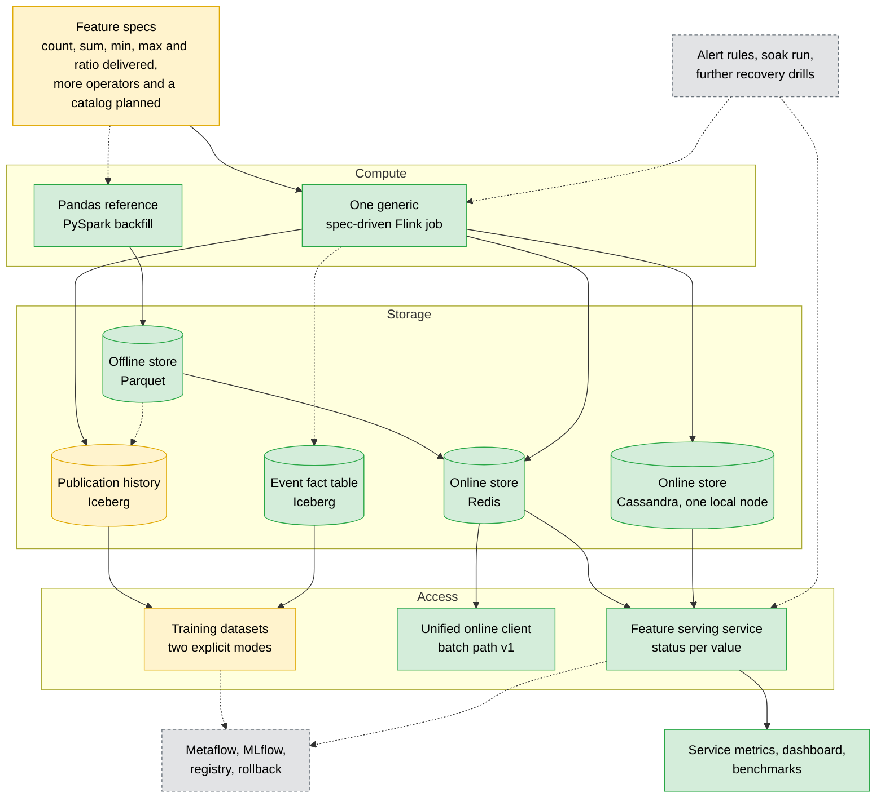
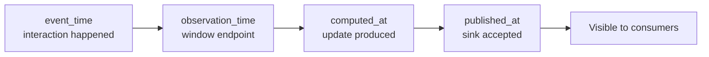
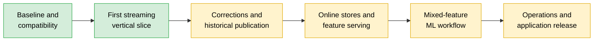

  

# FeatureForge Platform Blueprint

[Target architecture](#3-target-architecture) · [Component ownership](#5-component-ownership) · [Time contract](#6-time-and-availability-contract) · [Corrections](#7-online-correction-contract) · [Consumer experience](#9-consumer-experience) · [Delivery by topic](#12-delivery-by-topic) · [Acceptance demonstration](#13-acceptance-demonstration)

**Status:** target design, updated 2026-11-25.

> [!IMPORTANT]
> This document describes the **target** system. Implemented behavior is in
> [ARCHITECTURE.md](../ARCHITECTURE.md). Delivery status is in [STATUS.md](../STATUS.md).
> Nothing marked *planned* here is claimed as complete.

**Baseline.** v0.1.0 is released and the streaming core is delivered. One generic Flink job
runs the two original streaming features and a third feature that is defined by a YAML spec
alone. A spec-driven store and materializer serve count, sum, min, max and ratio features on Redis or
Cassandra behind one protocol (ADR-009, ADR-013). Publication evidence, label specs, training
datasets in two explicit modes and an event fact table are delivered (ADR-010 to ADR-012,
ADR-014, ADR-015). A feature serving service returns a status for every value, with metrics, a
dashboard and latency measurements on one laptop (ADR-016).

---

## 1. Product

FeatureForge is a production-shaped ML feature platform: batch and streaming
feature computation, versioned historical storage, low-latency online serving,
and an end-to-end ML workflow.

The primary user is an ML practitioner who needs to discover, validate and
retrieve features for training and inference without writing
infrastructure-specific access code.

Synthetic-data results demonstrate engineering behavior, not real-world
recommendation quality.

## 2. Repository decision

FeatureForge is the single platform repository. FeatureForge Stream v0.1.0 is a
frozen reference implementation whose capabilities were integrated
incrementally with their provenance and tests (see
[streaming-migration.md](streaming-migration.md)). The ML workflow work extends
this repository and does not create a separate platform.

One repository does not imply one process, container, Python environment or
deployment lifecycle.

---

## 3. Target architecture

| Color | Meaning |
|---|---|
| Green | Implemented and tested |
| Yellow | Partly delivered, the open part is named in [STATUS.md](../STATUS.md#known-gaps) |
| Gray, dashed | Planned |

A dashed arrow is a connection that does not exist yet, or one that is not the same code path.
The event fact table is filled by its own writer from the raw topic and not by the Flink job, and
batch features are not recorded in the publication history.

---

## 4. Foundation and first use case

Retained from v0.1.0 unless a tested replacement exists: deterministic data,
Pandas/PySpark parity, canonical partitioned offline store, backfills,
correctness and freshness gates, Feast retrieval and Redis materialization,
time-based evaluation, online lookup and CI.

Delivered since: Kafka/Flink validation and routing, `user_play_count_1h`,
`user_skip_rate_24h`, late-event handling, replay idempotency, guarded Redis
stores, unified online client, a validated declarative feature spec with an exact
Python reference (ADR-008), hand-calculated golden fixtures for both streaming
features, and one generic Flink job that is the only implementation of both
streaming features. It is verified on the golden fixtures, late corrections,
replay and the Redis path. A spec-driven Redis store and materializer (ADR-009)
serve count and ratio features. `content_play_count_1h`, a feature defined by a
YAML spec alone, is proven from events to Redis without a new Python file. A history table
records publication evidence (ADR-010, ADR-011), `published_as_of` answers what
serving held, label specs fix the label window (ADR-012), and training datasets
run in two explicit modes (ADR-014).

Delivered after that: validated events as immutable Iceberg facts with an idempotent writer
(ADR-015), the `OnlineStore` protocol with a Cassandra implementation that passes the same
contract suite as Redis (ADR-013), and a feature serving service with a status per value, fault
drills, Prometheus metrics and measured latency on one laptop (ADR-016).

**First integrated feature set:** seven-day user engagement, seven-day content
popularity, `user_play_count_1h`, `user_skip_rate_24h`. Prove this slice before
adding more features.

Before building the mixed dataset, audit and document the existing label:
the prediction made, prediction timestamp, outcome horizon, when the label
becomes observable, how incomplete outcomes are excluded, and which event types
the source actually generates.

> [!WARNING]
> Never fabricate `skip` or `complete` events from unsupported source fields.
> The current replay adapter supports `play` and `impression`. Meaningful
> skip-rate training needs a versioned source extension or a compatible
> declared dataset.

---

## 5. Component ownership

| Component | Owns | Rule |
|---|---|---|
| Contracts and catalog | Feature identity, entity, schema, version, window semantics, quality and freshness rules | Small typed spec with a **bounded operator set**. No universal SQL-to-Flink compiler. Today: spec model, validation, an exact reference and a generic Flink job for count and ratio features, running all streaming features, plus a spec-driven store and materializer for count and ratio features on Redis or Cassandra. No catalog. The stores and materializers of the two original features are thin wrappers over the spec-driven ones |
| Batch computation | Pandas references, PySpark, backfills, offline publication | A later backfill must not rewrite the recorded availability of an earlier online value |
| Streaming computation | Validation, Flink jobs, late routing, finite-horizon dedupe, output contracts | Correction policies are declared per feature in the spec. Append-only and componentwise ordering are not general revision support |
| Storage | Offline tables, online stores, publication history, event facts | Online stores hold current accepted values behind one protocol, and a second backend must pass the same contract suite. History retains the versions needed for declared retrieval. Event facts are immutable and idempotent by `event_id`. None of them is assumed to update atomically with another |
| Access | Discovery, training retrieval, online retrieval, freshness status | Features defined by specs are read through the feature serving service, which returns a status for every value and never a silent zero. The batch features of v1 are read through the unified client and Feast. Never write into Feast's internal Redis encoding. Discovery is planned |
| ML workflow | Dataset identity, feature versions, label, splits, code revision, model, metrics | Inference loads the trained model with the same declared input schema. The deterministic ranking stays a separate baseline |

A shared definition does not mean Spark and Flink run one implementation.
Matching semantics require independent tests.

<a href="#top">Back to top</a>

---

## 6. Time and availability contract

| Concept | Meaning |
|---|---|
| `event_time` | When an interaction occurred |
| `observation_time` | The feature window endpoint |
| `computed_at` | When a computation produced an update |
| `published_at` | When a particular sink accepted an update |
| `definition_version` | Meaning and schema of the feature |
| `run_id` / `generation_id` | The computation that owns the update |
| Update identity | Identifies delivery or replay of one update |

Rules:

- An ingestion timestamp is not an availability timestamp. A historical export
  timestamp is not proof of earlier online visibility.
- A revision number exists only if a producer can assign it consistently. Kafka
  offsets are scoped to a topic partition.
- Exact reconstruction of what a prediction consumed comes from **logged
  feature vectors**, not from eventual agreement between stores.

Historical retrieval has two explicit modes that are never silently interchanged:

1. **Event-time reconstruction** from a declared source dataset.
2. **Published-as-of retrieval** using only versions with recorded publication
   evidence before the prediction timestamp.

Since ADR-014 a dataset call names the mode, there is no default, and the
manifest records it.

---

## 7. Online correction contract

Preserved and tested:

- Older observation windows never replace newer ones.
- Same-window play counts advance under append-only assumptions.
- Same-window skip-rate updates compare the underlying counts. A decreasing
  rate can be a valid correction.
- Incomparable count vectors fail explicitly.
- Independent computations use separate generations or namespaces. A new spec
  version opens a new key namespace.
- The spec-driven store applies the same ordering to any count vector. It is
  checked against the hand-written skip-rate policy on 768 combinations.
- `online.ttl` is enforced by the spec-driven store as an expiry from the
  last accepted write, on Redis and on Cassandra, for all three streaming features (the wrappers of the two
  original features delegate to it). Unchanged and stale updates do not extend
  it, and an expired key reads as missing, never as zero.

Feast 0.66.0's default Redis path was observed to skip equal-timestamp writes,
so an unchanged Feast push is not assumed to support provisional same-window
corrections. Do not disable deduplication globally and do not alter observation
timestamps to force updates through. Any replacement store must pass the
existing correction, concurrency and replay tests first. The Cassandra store did that through the
contract suite of ADR-013 before the materializer was allowed to write to it.

---

## 8. Historical publication and recovery

The first streaming-history integration must declare: update identity and
ordering scope, durable source retention, snapshot or commit boundaries,
publication failure behavior, replay and dedupe behavior, and which timestamp
publication evidence supports.

- Do not claim atomic publication to Kafka, the online store and the history.
- If a sink succeeds but recording its publication fails, the discrepancy must
  be observable and reconciled. Earlier availability is never invented
  retroactively.
- A completed historical dataset is immutable and referenced by a manifest. An incomplete output directory is not an accepted dataset.

Status: ADR-010 and ADR-011 settle these points for the first integration. The
history table, the evidence append and published-as-of retrieval exist. A
dataset is written once, never overwritten, and its manifest is written last,
so a directory without `_manifest.json` is not a dataset. The event fact table (ADR-015) keeps the validated events themselves, so an event-time dataset can
read a pinned snapshot instead of a file. Open: gap detection inside the history and several appender processes. The parity between a Redis value and the published-as-of value is tested over two bounded runs of one entity.

---

## 9. Consumer experience

- Training requests provide entity keys and prediction timestamps. Results
  include selected feature versions and dataset provenance.
- Online responses include value, observation time, freshness status and
  diagnostic identifiers. Missing, stale and backend-error stay distinct. Never
  substitute zero for missing.
- Mixed batch and stream reads are **not** atomic cross-store snapshots. The
  consumer gets per-feature timestamps and an explicit staleness policy.
- Training output is partitioned and batch-readable, never one giant Pandas frame.
- One notebook demonstrates discovery, dataset construction, evaluation and
  online lookup.

Status: the feature serving service returns `ok`, `missing`, `stale` or `backend_error` for every
value with its observation time, and `atomic: false` for a combined read. Training datasets are
partitioned by UTC day and readable in Arrow batches. The tour notebook
(`notebooks/featureforge-tour.ipynb`) covers a spec, its reference evaluation, the serving contract
and the measurements. Discovery and dataset construction in a notebook are planned.

<a href="#top">Back to top</a>

---

## 10. Runtime compatibility

The main CI jobs run Python 3.13. A separate compatibility job runs the
infrastructure-free suite on Python 3.11 and 3.12. The demonstrated Flink runtime
uses Python 3.11 and Flink 1.20.3. Keep separate runtime environments until
compatibility is tested, do not install the full dependency set into every
container, and pin tested combinations. A broad version range is not
compatibility evidence.

The Flink image installs only what the job path imports (`pydantic` and
`PyYAML` besides Flink) and checks the project imports at build time. A new
runtime dependency of that path must be added to the image deliberately.

---

## 11. Operational evidence

Measure rather than assume: input rate and consumer lag, invalid, duplicate
and too-late events, update latency and observation age, Redis write outcomes
and conflicts, publication failures, checkpoint and recovery behavior, online
lookup p50/p95/p99, and dataset read throughput.

Observation age, pipeline lag and publication latency are different metrics.
Watermark-dependent output does not guarantee wall-clock refresh after input
goes idle, so stale values must become visibly stale or expire under an explicit
serving policy. Benchmarks record hardware, versions, workload, concurrency,
errors and resource usage. Initial measurements set targets. They do not
retroactively prove an SLO.

Status: measured today are the online lookup of the feature serving service (p50 to p99.9,
saturation and CPU per request for Redis and Cassandra, [benchmarks.md](benchmarks.md)), the read
throughput of the dataset loaders (ADR-014) and the append of the event writer (ADR-015). The
service exports the lookup duration, entries by status, requests by outcome and the event loop lag
([observability.md](observability.md)). Not measured: input rate and consumer lag, update latency,
store write outcomes as metrics, and any behavior under sustained load.

---

## 12. Delivery by topic

| Topic | Delivered | Open | Status |
|---|---|---|---|
| Baseline and compatibility | Released batch behavior preserved, dependencies inventoried, import provenance recorded | Nothing | Done |
| First streaming vertical slice | Play-count slice, validation-to-online behavior, common read interface | Nothing | Done |
| Corrections and historical publication | Skip rate and late corrections. Spec model, exact reference and one generic Flink job for all features, hand-written jobs removed. Spec-driven store and materializer, proven end to end for a YAML-only feature. History, evidence append, published-as-of retrieval and its parity with Redis over a bounded replay (ADR-010, ADR-011). Event fact table (ADR-015) | JobManager-failure recovery evidence, gap detection inside the history | In progress |
| Online stores and feature serving | `OnlineStore` protocol with one contract suite for Redis and Cassandra (ADR-013). Feature serving service with a status per value, a reader per backend, and drills for a stopped and a slow Redis (ADR-016) | Several Cassandra nodes, a deadline over the whole request, an asynchronous Cassandra reader | In progress |
| Mixed-feature ML workflow | Label specs (ADR-012), training datasets in two modes (ADR-014), the `build-training-dataset` command, the dataset loader and the Arrow batch loader | Label audit of the source, batch-only against batch-plus-stream comparison, model-backed inference | In progress |
| Operations and application release | Service metrics and dashboard, benchmarks with a runner and a compare script, clean-clone quickstart, dev container, tour notebook | Alert rules, further recovery drills, a soak run, a reproducible release | In progress |

Bounded later extensions: cloud staging deployment, Metaflow orchestration,
MLflow tracking, embedding retrieval. Metaflow and MLflow are later additions to the
platform. They do not block the first integrated vertical slice.

---

## 13. Acceptance demonstration

```mermaid
flowchart LR
    G[Versioned<br/>event dataset] --> BF[Batch store<br/>built and validated]
    BF --> ST[Validation and<br/>stream job]
    ST --> ON[Online values<br/>published]
    ON --> LC[Late correction<br/>and duplicates]
    LC --> HI[Accepted history<br/>persisted]
    HI --> DS[Immutable mixed<br/>training dataset]
    DS --> TR[Train and evaluate<br/>time-based split]
    TR --> IN[Model-backed<br/>online prediction]
    IN --> LOG[Consumed feature<br/>vector logged]
    LOG --> REP[Machine-readable<br/>evidence report]
```

Start from a documented clean environment. A separate failure demonstration
verifies a declared recovery boundary and reconciles the resulting state. The
happy-path demo is not an end-to-end exactly-once proof.

---

[README](../README.md) · [Architecture](../ARCHITECTURE.md) · [Status](../STATUS.md) · [Design](DESIGN.md) · [Streaming provenance](streaming-migration.md)

<a href="#top">Back to top</a>

