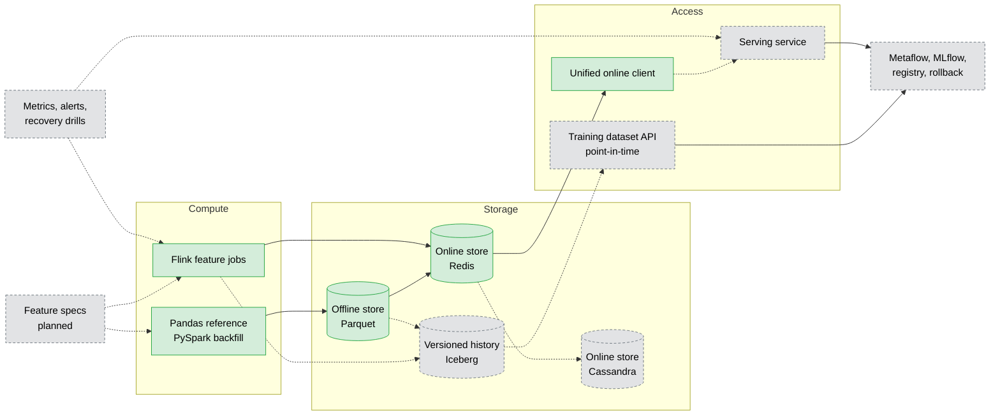
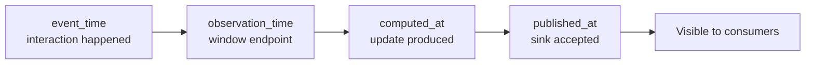
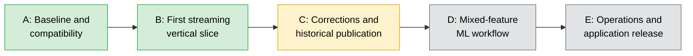

# FeatureForge Platform Blueprint

**Status:** target design, updated 2026-11-12.
**Baseline:** v0.1.0 released. Streaming core delivered.

This document describes the **target** system. Implemented behavior is in
[ARCHITECTURE.md](../ARCHITECTURE.md). Delivery status is in [STATUS.md](../STATUS.md).
Nothing marked *planned* here is claimed as complete.

---

## 1. Product

FeatureForge is a production-shaped ML feature platform: batch and streaming
feature computation, versioned historical storage, low-latency online serving,
and an end-to-end ML workflow.

The primary user is an ML practitioner who needs to discover, validate and
retrieve features for training and inference without writing
infrastructure-specific access code.

Synthetic-data results demonstrate engineering behavior, not real-world
recommendation quality.

## 2. Repository decision

FeatureForge is the single platform repository. FeatureForge Stream v0.1.0 is a
frozen reference implementation whose capabilities were integrated
incrementally with their provenance and tests (see
[streaming-migration.md](streaming-migration.md)). The ML-workflow phase extends
this repository and does not create a separate platform.

One repository does not imply one process, container, Python environment or
deployment lifecycle.

---

## 3. Target architecture

Green is implemented and tested. Gray dashed is planned.

---

## 4. Foundation and first use case

Retained from v0.1.0 unless a tested replacement exists: deterministic data,
Pandas/PySpark parity, canonical partitioned offline store, backfills,
correctness and freshness gates, Feast retrieval and Redis materialization,
time-based evaluation, online lookup and CI.

Delivered since: Kafka/Flink validation and routing, `user_play_count_1h`,
`user_skip_rate_24h`, late-event handling, replay idempotency, guarded Redis
stores, unified online client.

**First integrated feature set:** seven-day user engagement, seven-day content
popularity, `user_play_count_1h`, `user_skip_rate_24h`. Prove this slice before
adding more features.

Before building the mixed dataset, audit and document the existing label:
the prediction made, prediction timestamp, outcome horizon, when the label
becomes observable, how incomplete outcomes are excluded, and which event types
the source actually generates.

> Never fabricate `skip` or `complete` events from unsupported source fields.
> The current replay adapter supports `play` and `impression`. Meaningful
> skip-rate training needs a versioned source extension or a compatible
> declared dataset.

---

## 5. Component ownership

| Component | Owns | Rule |
|---|---|---|
| Contracts and catalog | Feature identity, entity, schema, version, window semantics, quality and freshness rules | Small typed spec with a **bounded operator set**. No universal SQL-to-Flink compiler |
| Batch computation | Pandas references, PySpark, backfills, offline publication | A later backfill must not rewrite the recorded availability of an earlier online value |
| Streaming computation | Validation, Flink jobs, late routing, finite-horizon dedupe, output contracts | Keep feature-specific correction policies. Append-only ordering is not general revision support |
| Storage | Offline tables, versioned streaming history | Online stores hold current accepted values. History retains the versions needed for declared retrieval. Neither is assumed to update atomically with the other |
| Access | Discovery, training retrieval, online retrieval, freshness status | Python API and CLI first, serving service later. Use Feast for supported batch operations. Never write into Feast's internal Redis encoding |
| ML workflow | Dataset identity, feature versions, label, splits, code revision, model, metrics | Inference loads the trained model with the same declared input schema. The deterministic ranking stays a separate baseline |

A shared definition does not mean Spark and Flink run one implementation.
Matching semantics require independent tests.

---

## 6. Time and availability contract

| Concept | Meaning |
|---|---|
| `event_time` | When an interaction occurred |
| `observation_time` | The feature window endpoint |
| `computed_at` | When a computation produced an update |
| `published_at` | When a particular sink accepted an update |
| `definition_version` | Meaning and schema of the feature |
| `run_id` / `generation_id` | The computation that owns the update |
| Update identity | Identifies delivery or replay of one update |

Rules:

- An ingestion timestamp is not an availability timestamp. A historical export
  timestamp is not proof of earlier online visibility.
- A revision number exists only if a producer can assign it consistently. Kafka
  offsets are scoped to a topic partition.
- Exact reconstruction of what a prediction consumed comes from **logged
  feature vectors**, not from eventual agreement between stores.

Historical retrieval has two explicit modes that are never silently interchanged:

1. **Event-time reconstruction** from a declared source dataset.
2. **Published-as-of retrieval** using only versions with recorded publication
   evidence before the prediction timestamp.

---

## 7. Online correction contract

Preserved and tested:

- Older observation windows never replace newer ones.
- Same-window play counts advance under append-only assumptions.
- Same-window skip-rate updates compare the underlying counts. A decreasing
  rate can be a valid correction.
- Incomparable count vectors fail explicitly.
- Independent computations use separate generations or namespaces.

Feast 0.66.0's default Redis path was observed to skip equal-timestamp writes,
so an unchanged Feast push is not assumed to support provisional same-window
corrections. Do not disable deduplication globally and do not alter observation
timestamps to force updates through. Any replacement store must pass the
existing correction, concurrency and replay tests first.

---

## 8. Historical publication and recovery

The first streaming-history integration must declare: update identity and
ordering scope, durable source retention, snapshot or commit boundaries,
publication failure behavior, replay and dedupe behavior, and which timestamp
publication evidence supports.

- Do not claim atomic Kafka, Redis and history publication.
- If a sink succeeds but recording its publication fails, the discrepancy must
  be observable and reconciled. Earlier availability is never invented
  retroactively.
- A completed historical dataset is immutable and referenced by a manifest. An
  incomplete output directory is not an accepted dataset.

---

## 9. Consumer experience

- Training requests provide entity keys and prediction timestamps. Results
  include selected feature versions and dataset provenance.
- Online responses include value, observation time, freshness status and
  diagnostic identifiers. Missing, stale and backend-error stay distinct. Never
  substitute zero for missing.
- Mixed batch and stream reads are **not** atomic cross-store snapshots. The
  consumer gets per-feature timestamps and an explicit staleness policy.
- Training output is partitioned and batch-readable, never one giant Pandas frame.
- One notebook demonstrates discovery, dataset construction, evaluation and
  online lookup.

---

## 10. Runtime compatibility

Batch CI runs Python 3.13. The demonstrated Flink runtime uses Python 3.11 and
Flink 1.20.3. Keep separate runtime environments until compatibility is tested,
do not install the full dependency set into every container, and pin tested
combinations. A broad version range is not compatibility evidence.

---

## 11. Operational evidence

Measure rather than assume: input rate and consumer lag, invalid, duplicate
and too-late events, update latency and observation age, Redis write outcomes
and conflicts, publication failures, checkpoint and recovery behavior, online
lookup p50/p95/p99, and dataset read throughput.

Observation age, pipeline lag and publication latency are different metrics.
Watermark-dependent output does not guarantee wall-clock refresh after input
goes idle, so stale values must become visibly stale or expire under an explicit
serving policy. Benchmarks record hardware, versions, workload, concurrency,
errors and resource usage. Initial measurements set targets. They do not
retroactively prove an SLO.

---

## 12. Delivery stages

| Stage | Content | Status |
|---|---|---|
| A | Preserve released batch behavior, inventory dependencies, record import provenance | Done |
| B | Integrate play-count slice, validation-to-online behavior, common read interface | Done |
| C | Skip-rate and late corrections done. Streaming history, published-as-of retrieval, availability boundaries open | In progress |
| D | Label audit, mixed datasets, batch-only vs batch-plus-stream comparison, model-backed inference | Planned |
| E | Metrics, recovery drills, benchmarks, clean-clone demo, notebook, reproducible release | Planned |

Bounded later extensions: cloud staging deployment, Metaflow orchestration,
MLflow tracking, embedding retrieval. Metaflow and MLflow form Phase 3 of the
platform. They do not block the first integrated vertical slice.

---

## 13. Acceptance demonstration

```mermaid
flowchart LR
    G[Versioned<br/>event dataset] --> BF[Batch store<br/>built and validated]
    BF --> ST[Validation and<br/>stream job]
    ST --> ON[Online values<br/>published]
    ON --> LC[Late correction<br/>and duplicates]
    LC --> HI[Accepted history<br/>persisted]
    HI --> DS[Immutable mixed<br/>training dataset]
    DS --> TR[Train and evaluate<br/>time-based split]
    TR --> IN[Model-backed<br/>online prediction]
    IN --> LOG[Consumed feature<br/>vector logged]
    LOG --> REP[Machine-readable<br/>evidence report]
```

Start from a documented clean environment. A separate failure demonstration
verifies a declared recovery boundary and reconciles the resulting state. The
happy-path demo is not an end-to-end exactly-once proof.