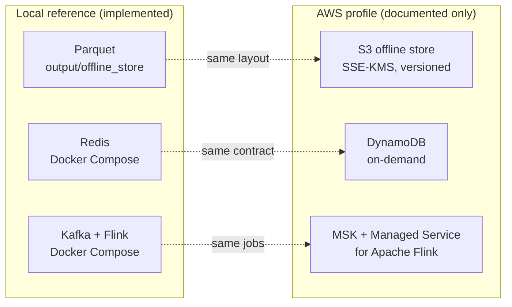

# FeatureForge AWS Production Profile

An architecture and planning artifact, **not a deployment record**. No AWS
resources are provisioned as a result of this document. It lets a reviewer judge
the credibility, cost awareness and security posture of the intended production
system without requiring a cloud deployment.

Related: [ARCHITECTURE.md](../ARCHITECTURE.md) ·
[ADR-002](adr/ADR-002-canonical-offline-store-contract.md) ·
[ADR-005](adr/ADR-005-aws-s3-offline-store-profile.md)

---

## 1. Relationship to the local platform

The local platform is implemented and tested. The AWS profile **generalizes the
same contracts** instead of replacing them.



| Concern | Local | AWS profile |
|---|---|---|
| Offline store | `output/offline_store/` | `s3://featureforge-<environment>/offline-store/` |
| Partitioning | `observation_date=YYYY-MM-DD` | Same |
| Format | Parquet | Parquet |
| Feature source | Feast `FileSource` | Feast `FileSource` pointed at S3 |
| Gates | Correctness and freshness vs. local source | Same logic vs. S3 source |
| Manifests | Local JSON | Versioned S3 objects |
| Online store | Redis | DynamoDB |
| Streaming transport | Kafka (Compose) | Managed Kafka (MSK) |
| Streaming compute | Flink (Compose) | Managed Flink |

The canonical-source invariant is preserved:

```text
Backfill writer
    = Correctness-gate input
    = Freshness-check input
    = Feast FileSource
    = Materialization source
    = Serving parity-test source
```

No component may read a different resolved offline-store URI than the one the
backfill wrote for that environment.

---

## 2. Environments

Three isolated environments: `dev`, `staging`, `prod`. Each has its own bucket,
KMS key, IAM roles and DynamoDB tables. Nothing is shared across environments.
A role in `dev` therefore structurally cannot reach `prod` resources.

## 3. S3 layout

```text
s3://featureforge-<environment>/
├── raw/events/ingestion_date=YYYY-MM-DD/
├── source/{users,content,events,labels}/
├── offline-store/
│   ├── user_engagement_features/observation_date=YYYY-MM-DD/features.parquet
│   ├── content_popularity_features/observation_date=YYYY-MM-DD/features.parquet
│   └── manifests/{backfill,correctness,freshness,materialization}/
├── training/historical-features/
└── models/baseline/
```

- `raw/` keeps the original ingestion-time record, independent of reprocessing.
- `source/` holds validated, typed tables equal to the local Parquet outputs.
- `offline-store/` is structurally identical to the local canonical store.
- Manifests are split by type to keep lineage queries and lifecycle rules specific.
- `training/` and `models/` are separate because retention and access differ:
  training data is regenerable, models are versioned artifacts.
- Raw events partition by `ingestion_date`. Features partition by
  `observation_date`, which enables partition pruning and reuses the existing
  point-in-time logic and freshness checks (ADR-003).

## 4. Encryption

All S3 objects use **SSE-KMS** with one customer-managed key per environment
(`alias/featureforge-<environment>-key`).

- Per-environment rotation and revocation without affecting other environments.
- Bucket policies deny `PutObject` requests that do not name the environment's key.
- CloudTrail records every KMS `Encrypt` and `Decrypt` call, giving an audit trail.
- SSE-S3 was rejected because it offers no per-environment key isolation.

DynamoDB uses AWS-managed encryption at rest. IAM already scopes table access per
environment and role.

## 5. IAM roles

| Role | Can | Cannot |
|---|---|---|
| `featureforge-backfill-writer` | Write `raw/`, `source/`, `offline-store/`, backfill and correctness manifests | Write DynamoDB, change IAM or KMS policies |
| `featureforge-materialization-writer` | Read `offline-store/`, write materialization manifests, write the DynamoDB table | Modify `raw/` or `source/`, change Feast definitions |
| `featureforge-serving-reader` | Read the DynamoDB table | Write S3 or DynamoDB, trigger materialization, change Feast definitions |

The component that validates and promotes data is distinct from the one that
consumes it. A compromised serving credential cannot corrupt feature data.

Illustrative policy for the serving reader (not deployed):

```json
{
  "Version": "2012-10-17",
  "Statement": [{
    "Effect": "Allow",
    "Action": ["dynamodb:GetItem", "dynamodb:BatchGetItem", "dynamodb:Query"],
    "Resource": "arn:aws:dynamodb:*:*:table/featureforge-<environment>-online-store"
  }]
}
```

## 6. Lifecycle and cost

| Prefix | Transition | Rationale |
|---|---|---|
| `raw/`, `source/` | Standard, then IA at 90 days, then Glacier Instant Retrieval at 365 days | Rarely re-read after processing, kept for reprocessing and audit |
| `offline-store/` | Standard, then IA at 180 days | Stays in Standard through the freshness window, then serves historical retrieval |
| `manifests/` | Stay in Standard | Small objects. Lifecycle transitions skip objects under 128 KB by default and per-object transition costs can exceed the savings |
| `training/` | Standard, then IA at 90 days | Regenerable, kept for reproducibility |
| `models/` | Standard, versioned | Small artifacts, versioning matters more than class |

- Buckets have **versioning** enabled. A faulty backfill that overwrites a
  partition leaves the previous good version recoverable, consistent with the
  idempotent-overwrite contract in ADR-002.
- Cost is controlled by transitions, not deletion, because point-in-time
  retrieval needs old partitions to stay queryable.
- Objects under 128 KB do not transition by default. At demo scale most feature
  files are small, so lifecycle savings only matter at real data volumes.
  Validate with actual object sizes before relying on a rule.

## 7. Online store: DynamoDB

DynamoDB with on-demand capacity replaces Redis for production serving. It is
multi-AZ by default and avoids capacity planning at this scale. Redis stays the
local and CI online store.

> **Contract caveat.** The local streaming stores enforce their write policies
> with Redis `WATCH`/`MULTI`. That mechanism does not carry over. A DynamoDB
> implementation needs its own guarded writes, for example conditional writes,
> and **must pass the same contract tests** (older windows rejected, identical
> deliveries unchanged, same-window corrections, incomparable vectors raising an
> error, concurrent writers). Until then the Redis guarantees do not apply to
> DynamoDB.

## 8. Streaming profile

Managed Kafka (Amazon MSK) and Managed Service for Apache Flink are the
documented execution profile for the streaming path. MSK integrates with IAM and
AWS Glue Schema Registry, and Flink applications can read from MSK through the
standard `KafkaSource`
([MSK docs](https://docs.aws.amazon.com/msk/),
[Managed Flink sources](https://docs.aws.amazon.com/managed-flink/latest/java/how-sources.html)).

What stays unverified:

- Supported Flink and Python versions on the managed service versus the local
  runtime (Flink 1.20.3, Python 3.11). Pin and test before committing to it.
- Checkpoint and recovery behavior of the managed runtime. The local suite does
  not yet verify checkpoint recovery at all (see
  [ARCHITECTURE.md](../ARCHITECTURE.md#known-limits)).
- Whether to adopt Glue Schema Registry. The current contracts are Pydantic
  models, not registry-backed schemas.

## 9. Resilience

- S3 provides multi-AZ durability within a region. Versioning protects against
  overwrite and deletion.
- Cross-region replication is **not** included at this stage.
- DynamoDB on-demand capacity provides multi-AZ durability by default.
- Local failure simulations do not cover Redis, Kafka, object-store or network
  faults. Cloud resilience claims are therefore design intent, not tested behavior.

## 10. Lineage

Every backfill, correctness check, freshness check and materialization run writes
a manifest under `offline-store/manifests/<type>/` recording run type and status,
Git SHA, resolved input and output URIs, timestamps, row and partition counts,
duration and the correctness report where applicable. Any online value can be
traced to the backfill, check and materialization that produced it.

## 11. Non-goals for this stage

- Provisioning any AWS resources (buckets, keys, roles, tables, MSK, Flink).
- Terraform or other infrastructure as code.
- An AWS deployment or migration of the running platform.
- Cross-region replication or multi-region disaster recovery.
- DynamoDB autoscaling beyond on-demand mode.
- A CI/CD pipeline that deploys to AWS.

These remain future work. FeatureForge deliberately completes local
correctness, reliability and documentation before adding cloud complexity.