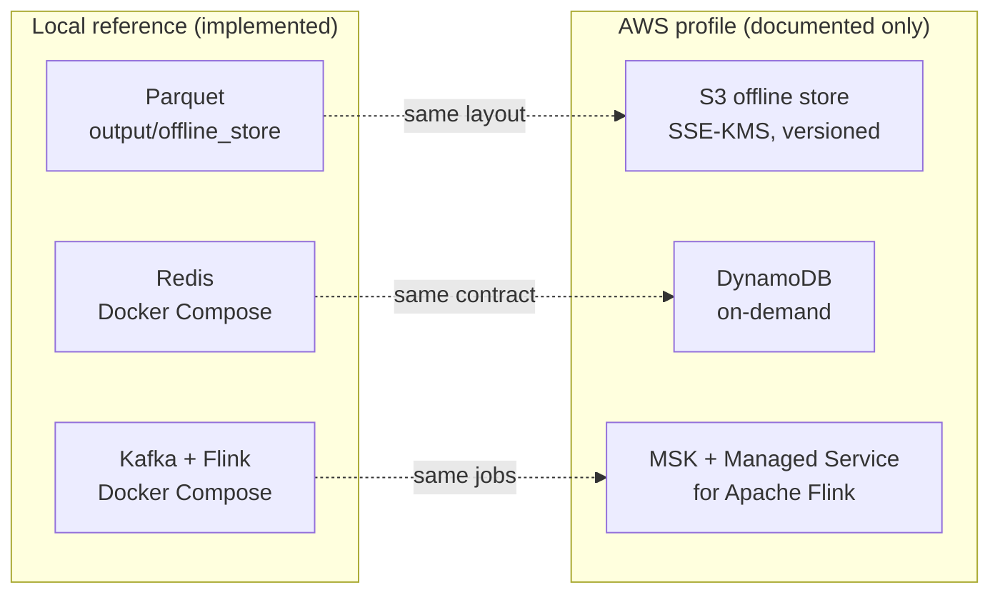

# FeatureForge AWS Production Profile

An architecture and planning artifact, **not a deployment record**. No AWS
resources are provisioned as a result of this document. It lets a reviewer judge
the credibility, cost awareness and security posture of the intended production
system without requiring a cloud deployment.

Related: [ARCHITECTURE.md](../ARCHITECTURE.md) ·
[ADR-002](adr/ADR-002-canonical-offline-store-contract.md) ·
[ADR-005](adr/ADR-005-aws-s3-offline-store-profile.md) ·
[ADR-009](adr/ADR-009-spec-driven-online-stores.md) ·
[ADR-010](adr/ADR-010-time-and-availability-model.md) ·
[ADR-011](adr/ADR-011-history-table-layout.md) ·
[ADR-014](adr/ADR-014-training-datasets.md)

---

## 1. Relationship to the local platform

The local platform is implemented and tested. The AWS profile **generalizes the
same contracts** instead of replacing them.



| Concern | Local | AWS profile |
|---|---|---|
| Offline store | `output/offline_store/` | `s3://featureforge-<environment>/offline-store/` |
| Partitioning | `observation_date=YYYY-MM-DD` | Same |
| Format | Parquet | Parquet |
| Feature source | Feast `FileSource` | Feast `FileSource` pointed at S3 |
| Gates | Correctness and freshness vs. local source | Same logic vs. S3 source |
| Manifests | Local JSON | Versioned S3 objects |
| Online store | Redis | DynamoDB |
| Streaming transport | Kafka (Compose) | Managed Kafka (MSK) |
| Streaming compute | Flink (Compose) | Managed Flink |
| Publication history | Iceberg (PyIceberg writes, Spark reads), SQLite or PostgreSQL JDBC catalog | Iceberg warehouse on S3. The catalog service is not decided |
| Training datasets | Parquet by UTC day and a manifest, written by Spark | Same layout under `training/datasets/` |

The canonical-source invariant is preserved:

```text
Backfill writer
    = Correctness-gate input
    = Freshness-check input
    = Feast FileSource
    = Materialization source
    = Serving parity-test source
```

No component may read a different resolved offline-store URI than the one the
backfill wrote for that environment.

---

## 2. Environments

Three isolated environments: `dev`, `staging`, `prod`. Each has its own bucket,
KMS key, IAM roles and DynamoDB tables. Nothing is shared across environments.
A role in `dev` therefore structurally cannot reach `prod` resources.

## 3. S3 layout

```text
s3://featureforge-<environment>/
├── raw/events/ingestion_date=YYYY-MM-DD/
├── source/{users,content,events,labels}/
├── offline-store/
│   ├── user_engagement_features/observation_date=YYYY-MM-DD/features.parquet
│   ├── content_popularity_features/observation_date=YYYY-MM-DD/features.parquet
│   └── manifests/{backfill,correctness,freshness,materialization}/
├── history/
├── training/historical-features/
├── training/datasets/<dataset-run>/
└── models/baseline/
```

- `raw/` keeps the original ingestion-time record, independent of reprocessing.
- `source/` holds validated, typed tables equal to the local Parquet outputs.
- `offline-store/` is structurally identical to the local canonical store.
- Manifests are split by type to keep lineage queries and lifecycle rules specific.
- `training/` and `models/` are separate because retention and access differ:
  training data is regenerable, models are versioned artifacts.
- Raw events partition by `ingestion_date`. Features partition by
  `observation_date`, which enables partition pruning and reuses the existing
  point-in-time logic and freshness checks (ADR-003).
- `history/` holds the Iceberg warehouse of the publication history (ADR-011).
  `training/datasets/` holds the datasets of ADR-014: Parquet partitioned by the
  UTC observation day and a `_manifest.json` that is written last, so a
  directory without it is not a dataset. Locally the builder refuses an existing
  output path. On S3 that check is not atomic between concurrent runs, so the
  design intent is a unique prefix per run. Not built.

## 4. Encryption

All S3 objects use **SSE-KMS** with one customer-managed key per environment
(`alias/featureforge-<environment>-key`).

- Per-environment rotation and revocation without affecting other environments.
- Bucket policies deny `PutObject` requests that do not name the environment's key.
- CloudTrail records every KMS `Encrypt` and `Decrypt` call, giving an audit trail.
- SSE-S3 was rejected because it offers no per-environment key isolation.

DynamoDB uses AWS-managed encryption at rest. IAM already scopes table access per
environment and role.

## 5. IAM roles

| Role | Can | Cannot |
|---|---|---|
| `featureforge-backfill-writer` | Write `raw/`, `source/`, `offline-store/`, backfill and correctness manifests | Write DynamoDB, change IAM or KMS policies |
| `featureforge-materialization-writer` | Read `offline-store/`, write materialization manifests, write the DynamoDB table | Modify `raw/` or `source/`, change Feast definitions |
| `featureforge-serving-reader` | Read the DynamoDB table | Write S3 or DynamoDB, trigger materialization, change Feast definitions |
| `featureforge-stream-materializer` | Write the DynamoDB table and the `history/` prefix | Write `training/`, change IAM or KMS policies |
| `featureforge-dataset-builder` | Read `history/` and `source/`, write `training/datasets/` | Write `history/` or DynamoDB |

The component that validates and promotes data is distinct from the one that
consumes it. A compromised serving credential cannot corrupt feature data.

Illustrative policy for the serving reader (not deployed):

```json
{
  "Version": "2012-10-17",
  "Statement": [{
    "Effect": "Allow",
    "Action": ["dynamodb:GetItem", "dynamodb:BatchGetItem", "dynamodb:Query"],
    "Resource": "arn:aws:dynamodb:*:*:table/featureforge-<environment>-online-store"
  }]
}
```

## 6. Lifecycle and cost

| Prefix | Transition | Rationale |
|---|---|---|
| `raw/`, `source/` | Standard, then IA at 90 days, then Glacier Instant Retrieval at 365 days | Rarely re-read after processing, kept for reprocessing and audit |
| `offline-store/` | Standard, then IA at 180 days | Stays in Standard through the freshness window, then serves historical retrieval |
| `manifests/` | Stay in Standard | Small objects. Lifecycle transitions skip objects under 128 KB by default and per-object transition costs can exceed the savings |
| `training/` | Standard, then IA at 90 days | Regenerable, kept for reproducibility |
| `models/` | Standard, versioned | Small artifacts, versioning matters more than class |
| `history/`, `training/datasets/` | No rule yet | Table files reference each other and a dataset is read as a whole. Test any rule against real reads before adding it |

- Buckets have **versioning** enabled. A faulty backfill that overwrites a
  partition leaves the previous good version recoverable, consistent with the
  idempotent-overwrite contract in ADR-002.
- Cost is controlled by transitions, not deletion, because point-in-time
  retrieval needs old partitions to stay queryable.
- Objects under 128 KB do not transition by default. At demo scale most feature
  files are small, so lifecycle savings only matter at real data volumes.
  Validate with actual object sizes before relying on a rule.

## 7. Online store: DynamoDB

DynamoDB with on-demand capacity replaces Redis for production serving. It is
multi-AZ by default and avoids capacity planning at this scale. Redis stays the
local and CI online store.

> **Contract caveat.** The ordering rules (older windows rejected, identical
> deliveries unchanged, same-window corrections, incomparable vectors raising an
> error) live in one store-independent decision function,
> `decide_count_vector_update`, which a DynamoDB store can reuse unchanged. What
> does not carry over is the guarded write: the local stores use Redis
> `WATCH`/`MULTI`. DynamoDB offers conditional writes, where a condition
> expression fails the write with a `ConditionalCheckFailedException` if the
> stored item changed
> ([DynamoDB conditional operations](https://docs.aws.amazon.com/amazondynamodb/latest/developerguide/example_dynamodb_Scenario_ConditionalOperations_section.html)).
> A DynamoDB implementation **must pass the same contract tests**: the unit
> tests of the decision function, the Redis integration tests of the
> spec-driven store (correction policy, TTL) and a concurrent-writer test. A
> real concurrent-writer test runs against Redis through the stores of the two
> original features today (they delegate to the spec-driven store).
> Until a DynamoDB store passes them, the Redis guarantees do not apply to it.

> **TTL caveat.** `online.ttl` is a Redis expiry: an expired key reads as
> missing. DynamoDB's TTL deletes expired items in the background, typically
> within a few days of expiry, and expired items keep appearing in reads until
> then ([TTL](https://docs.aws.amazon.com/amazondynamodb/latest/developerguide/TTL.html),
> [expired items](https://docs.aws.amazon.com/amazondynamodb/latest/developerguide/ttl-expired-items.html)).
> A DynamoDB store must therefore compare the expiry attribute with the current
> time on every read and treat an expired item as missing, and it must use a
> condition expression when it updates an item that may be expired. An item past
> its TTL is never served as live and never replaced by zero.

> **TTL details.** The expiry attribute must be a Number in Unix epoch seconds,
> otherwise TTL ignores the item
> ([TTL](https://docs.aws.amazon.com/amazondynamodb/latest/developerguide/TTL.html)).
> Expired items pending deletion still count toward storage and read costs. The
> documentation names filter expressions for reads and condition expressions
> for writes to expired items
> ([expired items](https://docs.aws.amazon.com/amazondynamodb/latest/developerguide/ttl-expired-items.html)).


## 8. Streaming profile

Managed Kafka (Amazon MSK) and Managed Service for Apache Flink are the
documented execution profile for the streaming path. MSK integrates with IAM and
AWS Glue Schema Registry, and Flink applications can read from MSK through the
standard `KafkaSource`
([MSK docs](https://docs.aws.amazon.com/msk/),
[Managed Flink sources](https://docs.aws.amazon.com/managed-flink/latest/java/how-sources.html)).

What stays unverified:

- Supported Flink and Python versions on the managed service versus the local
  runtime (Flink 1.20.3, Python 3.11). Pin and test before committing to it.
- Checkpoint and recovery behavior of the managed runtime. The service enables
  checkpointing by default (every 60 s), stores checkpoints and savepoints in a
  service-owned S3 bucket, keeps one checkpoint and retains it on failure, and
  creates a system snapshot when an application is stopped or updated
  ([fault tolerance](https://docs.aws.amazon.com/managed-flink/latest/java/how-fault.html),
  [settings](https://docs.aws.amazon.com/managed-flink/latest/java/reference-flink-settings.title.html)).
  The local suite verifies a savepoint stop and resume and recovery from a
  TaskManager crash for the play-count spec, but not JobManager failure and not
  checkpoints on shared storage (see
  [ARCHITECTURE.md](../ARCHITECTURE.md#known-limits)). The managed runtime itself
  is not tested.
- Whether to adopt Glue Schema Registry. The current contracts are Pydantic
  models, not registry-backed schemas.
- The catalog of the history. Locally PyIceberg writes and Spark reads through a
  SQLite or PostgreSQL JDBC catalog. Which catalog service backs it on AWS, and
  whether PyIceberg and Spark agree on it there, is not decided or tested.
- The Spark runtime of the dataset builder and its Iceberg packages. Not decided.
- The no-overwrite and manifest-last rules of a dataset on S3 under concurrent
  runs.

## 9. Resilience

- S3 provides multi-AZ durability within a region. Versioning protects against
  overwrite and deletion.
- Cross-region replication is **not** included at this stage.
- DynamoDB on-demand capacity provides multi-AZ durability by default.
- Local failure simulations cover a Flink TaskManager crash and a planned stop
  with resume, but not Redis, Kafka, object-store or network faults. Cloud
  resilience claims are therefore design intent, not tested behavior.

## 10. Lineage

Every backfill, correctness check, freshness check and materialization run writes
a manifest under `offline-store/manifests/<type>/` recording run type and status,
Git SHA, resolved input and output URIs, timestamps, row and partition counts,
duration and the correctness report where applicable. Any online value can be
traced to the backfill, check and materialization that produced it.

## 11. Non-goals for this stage

- Provisioning any AWS resources (buckets, keys, roles, tables, MSK, Flink).
- Terraform or other infrastructure as code.
- An AWS deployment or migration of the running platform.
- Cross-region replication or multi-region disaster recovery.
- DynamoDB autoscaling beyond on-demand mode.
- A CI/CD pipeline that deploys to AWS.
- A history catalog, a dataset job or a Spark runtime on AWS.

These remain future work. FeatureForge deliberately completes local
correctness, reliability and documentation before adding cloud complexity.