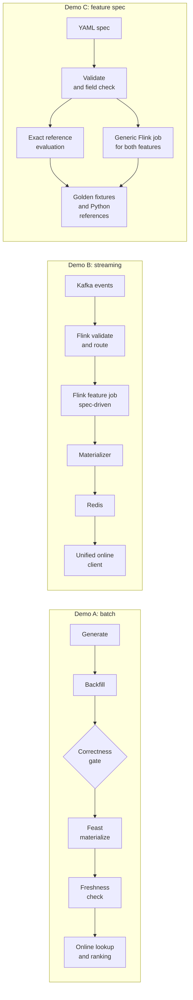
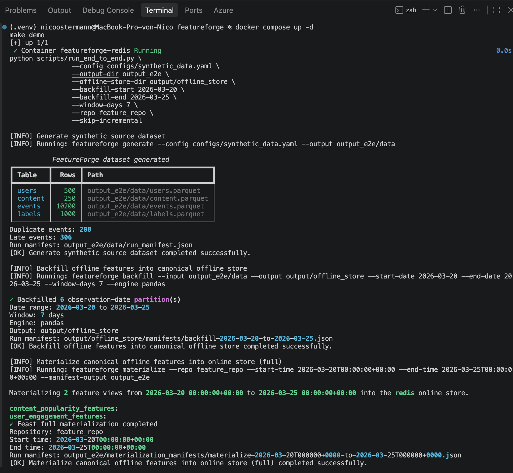
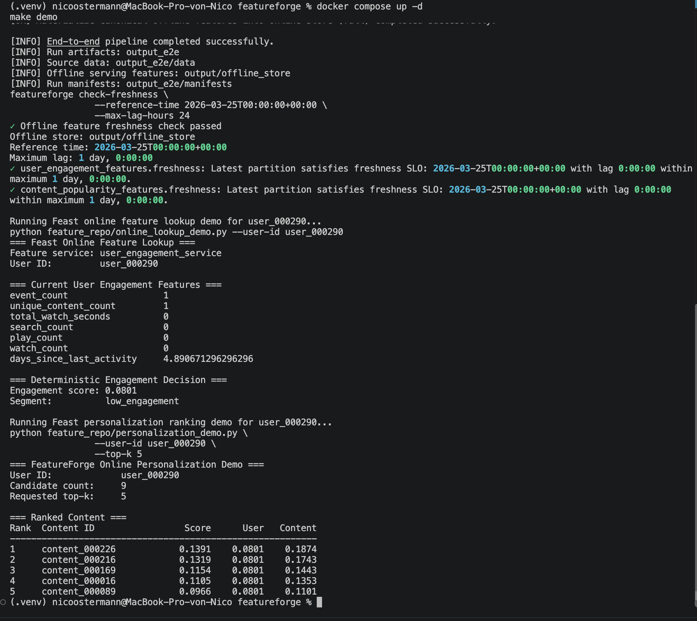
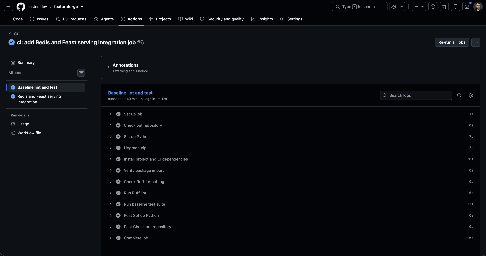
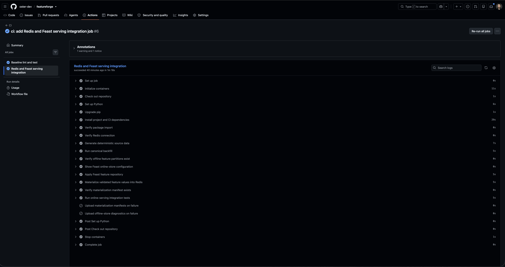

# FeatureForge Demo Guide

Three reviewer walkthroughs, each runnable from a clean checkout:

1. **Batch path:** synthetic data to Feast-materialized online features.
2. **Streaming path:** Kafka to Flink to Redis, verified end to end.
3. **Feature spec:** a declarative spec validated, evaluated against golden fixtures and run as a generic Flink job.

Expected local runtime: batch about 2 minutes, the spec evaluation a few seconds,
the generic job about a minute, streaming several minutes. In CI each Flink test
module starts from a fresh TaskManager, and the skip-rate suites recreate it per test.



## Prerequisites

- Python 3.11, 3.12 or 3.13
- Docker Desktop running
- GNU Make

```bash
git clone [https://github.com/oster-dev/featureforge.git](https://github.com/oster-dev/featureforge.git)
cd featureforge
python3 -m venv .venv && source .venv/bin/activate
python -m pip install --upgrade pip
python -m pip install -e ".[dev,feature-store,spark,streaming]"
```

---

## Demo A: batch path

Local profile: Parquet under `output/offline_store/` as the canonical offline
store, Redis via Docker Compose as the online store, Feast for definitions,
materialization and lookup.

```bash
docker compose up -d redis

cd feature_repo
feast apply
cd ..

make demo
```

`make demo` generates deterministic data, backfills canonical partitions,
validates them **before** materialization, materializes into Redis, checks
freshness, retrieves online features and produces a deterministic ranking. Run
artifacts go to `output_e2e/`, canonical features to `output/offline_store/`.
Nothing generated is committed.

### Expected signals

```text
FeatureForge dataset generated
✓ Backfilled 6 observation-date partition(s)
✓ Feast full materialization completed
✓ Offline feature freshness check passed
=== Feast Online Feature Lookup ===
=== Deterministic Engagement Decision ===
=== FeatureForge Online Personalization Demo ===
=== Ranked Content ===
```

Default data: 500 users, 250 content items, 10,200 events, 1,000 observation
labels, 6 canonical partitions. Scores are deterministic for the current
configuration and may change intentionally when feature definitions or
generation contracts evolve.





### Verify the layers

```bash
docker compose exec -T redis redis-cli ping            # PONG
find output/offline_store -name features.parquet       # six partitions per view
pytest -v tests/integration/test_online_serving.py     # 5 passed
```

The serving suite checks user and content parity against the latest offline
partition, unknown entities, batch candidates and deterministic ranking.

---

## Demo B: streaming path

```bash
docker compose up -d --build
docker compose ps            # kafka, jobmanager, taskmanager, redis healthy
```

Run the joined end-to-end tests:

```bash
pytest -v -m integration \
  tests/integration/test_user_play_count_kafka_to_redis.py \
  tests/integration/test_skip_rate_flink_to_redis.py
```

Each test creates isolated Kafka topics, produces events, runs the Flink jobs,
materializes the feature topic into Redis and reads the final online value
against the reference result.

### What the streaming tests show

| Behavior | Test |
|---|---|
| Invalid events go to a rejected topic without blocking valid ones | `test_streaming_validation_routing.py` |
| Late events correct an already emitted window | `test_user_play_count_late_events.py` |
| Events too late for all windows are routed out | `test_user_play_count_late_events.py`, `test_user_skip_rate_job.py` |
| Replay and duplicates do not change results | `test_user_play_count_replay_idempotency.py` |
| A job resumed from a savepoint keeps its dedupe and window state | `test_generic_job_recovery.py` |
| A job recovers from a TaskManager crash with its dedupe and window state | `test_generic_job_checkpoint_recovery.py` |
| Exact window boundaries are respected | `test_user_skip_rate_job.py` |
| Stale and conflicting online writes are rejected | `test_redis_skip_rate_store.py` |

Run any of them with `pytest -v -m integration tests/integration/<file>`.

### Read a feature through the unified client

```bash
python -m featureforge.online \
  --user-id user_000290 \
  --reference-time 2026-03-25T00:00:00+00:00 \
  --batch-max-age-seconds 172800 \
  --stream-max-age-seconds 7200
```

Every value reports its backend, availability, observation time and freshness.
A missing value is shown as missing, never as `0`. Exit codes: `0` success,
`1` feature errors, `2` invalid request.

### What this demo does not prove

- Dedupe after TTL expiry and JobManager failure are not covered. Resuming from
  a savepoint and recovering from a TaskManager crash are covered by
  `test_generic_job_recovery.py` and `test_generic_job_checkpoint_recovery.py`.
- The Flink Kafka sinks are at-least-once. The path is idempotent, not exactly-once.
- Multi-partition Kafka and streaming history are not implemented.

See [Known limits](../ARCHITECTURE.md#known-limits).

---

## Demo C: feature spec

Features can be described declaratively (see
[ADR-008](adr/ADR-008-feature-spec-design.md)). Parts 1 to 3 need no
infrastructure. Parts 4 to 6 need the streaming stack from Demo B.

### 1. Validate the specs

Validate the shipped specs, including a check that every referenced event field
exists in the event contract:

```bash
python -m featureforge.spec.loader feature_repo/specs/*.yaml
```

Expected output:

```text
✓ feature_repo/specs/user_play_count_1h.yaml: user_play_count_1h v1
✓ feature_repo/specs/user_skip_rate_24h.yaml: user_skip_rate_24h v1
```

### 2. Evaluate the play-count spec on its golden fixture

Evaluate the play-count spec on the golden fixture at `2026-01-01T12:00Z`:

```bash
python - <<'PY'
from datetime import UTC, datetime
from pathlib import Path

from featureforge.spec.loader import load_spec
from featureforge.spec.reference import evaluate_spec
from featureforge.streaming.contracts.events import InteractionEventV1

spec = load_spec("feature_repo/specs/user_play_count_1h.yaml")
lines = Path("fixtures/streaming/user_play_count_1h_v1.jsonl").read_text().splitlines()
events = [InteractionEventV1.model_validate_json(line) for line in lines if line.strip()]
at = datetime(2026, 1, 1, 12, tzinfo=UTC)
for user in ("user_000001", "user_000002", "user_unknown"):
    result = evaluate_spec(spec, events, entity={"user_id": user}, observation_time=at)
    print(user, result.values)
PY
```

Expected output:

```text
user_000001 {'play_count': 3}
user_000002 {'play_count': 1}
user_unknown {'play_count': 0}
```

The same values come from the Python reference. The test suite checks
that agreement on randomized inputs placed exactly on window boundaries:

```bash
pytest -v tests/unit/test_spec_reference.py
```

### 3. Evaluate the skip-rate spec on its golden fixture

The skip-rate fixture holds ten events with hand-calculated expected values:
events exactly on both window edges, a duplicate delivery, `impression` and
`complete` events that count toward nothing, a second user, and expiry down to
an empty window.

```bash
python - <<'PY'
from datetime import UTC, datetime
from pathlib import Path

from featureforge.spec.loader import load_spec
from featureforge.spec.reference import evaluate_spec
from featureforge.streaming.contracts.events import InteractionEventV1

spec = load_spec("feature_repo/specs/user_skip_rate_24h.yaml")
lines = Path("fixtures/streaming/user_skip_rate_24h_v1.jsonl").read_text().splitlines()
events = [InteractionEventV1.model_validate_json(line) for line in lines if line.strip()]
cases = [
    ("user000001", datetime(2026, 1, 2, 12, 0, 0, tzinfo=UTC)),
    ("user000001", datetime(2026, 1, 2, 12, 0, 1, tzinfo=UTC)),
    ("user000001", datetime(2026, 1, 2, 18, 0, 0, tzinfo=UTC)),
    ("user000001", datetime(2026, 1, 3, 12, 0, 1, tzinfo=UTC)),
    ("user000002", datetime(2026, 1, 2, 12, 0, 0, tzinfo=UTC)),
]
for user, at in cases:
    result = evaluate_spec(spec, events, entity={"user_id": user}, observation_time=at)
    print(user, at.isoformat(), result.values)
PY
```

Expected output:

```text
user000001 2026-01-02T12:00:00+00:00 {'play_count': 2, 'skip_count': 2, 'skip_rate': 0.5}
user000001 2026-01-02T12:00:01+00:00 {'play_count': 1, 'skip_count': 3, 'skip_rate': 0.75}
user000001 2026-01-02T18:00:00+00:00 {'play_count': 1, 'skip_count': 2, 'skip_rate': 0.6666666666666666}
user000001 2026-01-03T12:00:01+00:00 {'play_count': 0, 'skip_count': 0, 'skip_rate': 0.0}
user000002 2026-01-02T12:00:00+00:00 {'play_count': 0, 'skip_count': 1, 'skip_rate': 1.0}
```

Between the first and second line, one event leaves the window on its lower
edge and one enters on its upper edge, and the rate moves from `0.5` to `0.75`.
The tests that hold these values, including a sweep over every event boundary
against the Python reference:

```bash
pytest -v tests/unit/test_streaming_user_skip_rate_golden.py tests/unit/test_spec_golden_parity.py   # 14 passed
```

### 4. Run the generic Flink job on the fixtures

The generic job reads a spec and builds the windowed computation from it. The
test sends the golden fixture of each feature through the job and compares
**every** emitted window with the spec reference and the Python reference:

```bash
docker compose up -d --build
pytest -v -m integration tests/integration/test_feature_from_spec_job.py   # 2 passed
```

The test also requires hand-calculated windows (five for skip rate, seven for
play count), no window emitted twice, and an empty late topic. A spec outside
what the job supports, such as an `avg` aggregation or a composite key, is
rejected with a clear error before the job starts:

```bash
pytest -v tests/unit/test_spec_flink_plan.py   # 13 passed
```

### 5. Stop the job with a savepoint and resume it

The generic job for the play-count spec is stopped with a savepoint. A new job
resumes from that savepoint. The test shows that the new job restored the
savepoint, that a redelivered event is not counted again, that a late
correction lands in the restored window, and that the late topic stays empty:

```bash
docker compose up -d --build
pytest -v -m integration tests/integration/test_generic_job_recovery.py   # 1 passed
```

Both the JobManager and the TaskManager mount the `flink-savepoints` volume,
so the savepoint written by one is readable by the other.

### 6. Kill the TaskManager and let the job recover

The test kills the TaskManager while the generic job runs for the play-count
spec. The same job restarts on its own and restores a checkpoint that is not a
savepoint. A redelivered event is not counted again, a late correction lands in
the restored window, and the late topic stays empty:

```bash
docker compose up -d --build
pytest -v -m integration tests/integration/test_generic_job_checkpoint_recovery.py   # 1 passed
```

The test restarts the TaskManager in its cleanup. The JobManager keeps running
and holds the checkpoints in memory, so this does not show recovery from a
JobManager failure.

### What this demo does not prove

- The generic job is verified on the golden fixtures, late corrections, replay
  and the Redis path for both features, and resumes from a savepoint and
  recovers from a TaskManager crash for the play-count spec. JobManager failure
  and dedupe state after TTL expiry are not proven for it.
- The Redis stores and the materializers are still written by hand per feature.
  No Spark feature or store is driven by a spec.
- `online.ttl` in a spec is declarative. The current stores write without expiry.

---

## CI evidence

Four GitHub Actions jobs run on every push and pull request to `main`. A
scheduled nightly run on `main` repeats them.

| Job | Proves |
|---|---|
| Baseline lint and test | Clean install, Ruff, all infrastructure-free tests |
| Python compatibility | The infrastructure-free suite on Python 3.11 and 3.12 |
| Serving integration | Redis, Feast, materialization, online parity and ranking |
| Streaming integration | Full Compose stack, joined Kafka, Flink and Redis tests including the generic spec-driven job, each Flink test module on a fresh TaskManager |

Current status: see the badge in the [README](../README.md) and the
[Actions page](https://github.com/oster-dev/featureforge/actions).





The baseline job skips the five online-serving tests on purpose, because they
need Redis, applied Feast definitions and materialized values. The serving job
runs them with zero skips.

---

## Troubleshooting

| Symptom | Fix |
|---|---|
| Redis unavailable | `docker compose down && docker compose up -d`, then `docker compose exec -T redis redis-cli ping` |
| Serving tests skipped | Redis reachable, `feast apply` run, canonical partitions present, features materialized (see below) |
| Materialization blocked | Inspect `find output -path "*materialization_manifests*" -name "*.json"`, then the [runbook](runbooks/failed-materialization.md) |
| Streaming tests cannot connect | `docker compose ps`, Redis published on `127.0.0.1:6379`, nothing else on port 6379 |
| Flink job fails or hangs | `docker compose logs jobmanager --tail 100` and `docker compose logs taskmanager --tail 100` |
| TaskManager missing after an interrupted recovery test | `docker compose up -d taskmanager`, then `curl -s http://127.0.0.1:8081/overview` shows one TaskManager and a free slot |
| Generic job fails with `ModuleNotFoundError` | A dependency is missing in `docker/flink/Dockerfile`. Rebuild with `docker compose up -d --build` |
| Changed code under `src/` not picked up by Flink | `jobs/` and `feature_repo/specs/` are mounted, `src/` is copied into the image. Rebuild with `docker compose up -d --build` |
| Savepoint cannot be written or read | JobManager and TaskManager must both mount the `flink-savepoints` volume. A volume with old permissions: `docker compose down`, `docker volume rm featureforge-stream_flink-savepoints`, `docker compose up -d --build` |
| Spec validation fails | Read the printed field path and message. An unknown event field is reported with the available fields |

Prepare serving explicitly if tests skip:

```bash
docker compose up -d redis
(cd feature_repo && feast apply)
featureforge materialize \
  --repo feature_repo \
  --start-time 2026-03-20T00:00:00+00:00 \
  --end-time 2026-03-25T00:00:00+00:00 \
  --manifest-output output
pytest -v tests/integration/test_online_serving.py
```

A blocked materialization means the correctness gate found invalid persisted
data. Fix the data, do not bypass the gate.

---

## Cleanup

```bash
make docker-down                 # stop services
rm -rf output_e2e output/source_data output/offline_store \
  output/materialization_manifests
```

Do not remove `feature_repo/data/registry.db` while Redis or Feast commands
are running. For a complete reset, stop Redis first, then use a fresh checkout
or re-apply the Feast repository.