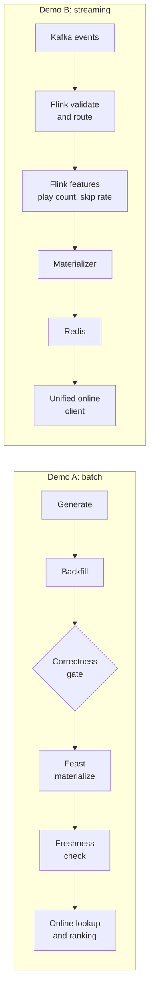

# FeatureForge Demo Guide

Two reviewer walkthroughs, each runnable from a clean checkout:

1. **Batch path:** synthetic data to Feast-materialized online features.
2. **Streaming path:** Kafka to Flink to Redis, verified end to end.

Expected local runtime: batch about 2 minutes, streaming several minutes
(each Flink test starts from a fresh TaskManager).



## Prerequisites

- Python 3.11, 3.12 or 3.13
- Docker Desktop running
- GNU Make

```bash
git clone [https://github.com/oster-dev/featureforge.git](https://github.com/oster-dev/featureforge.git)
cd featureforge
python3 -m venv .venv && source .venv/bin/activate
python -m pip install --upgrade pip
python -m pip install -e ".[dev,feature-store,spark,streaming]"
```

---

## Demo A: batch path

Local profile: Parquet under `output/offline_store/` as the canonical offline
store, Redis via Docker Compose as the online store, Feast for definitions,
materialization and lookup.

```bash
docker compose up -d redis

cd feature_repo
feast apply
cd ..

make demo
```

`make demo` generates deterministic data, backfills canonical partitions,
validates them **before** materialization, materializes into Redis, checks
freshness, retrieves online features and produces a deterministic ranking. Run
artifacts go to `output_e2e/`, canonical features to `output/offline_store/`.
Nothing generated is committed.

### Expected signals

```text
FeatureForge dataset generated
✓ Backfilled 6 observation-date partition(s)
✓ Feast full materialization completed
✓ Offline feature freshness check passed
=== Feast Online Feature Lookup ===
=== Deterministic Engagement Decision ===
=== FeatureForge Online Personalization Demo ===
=== Ranked Content ===
```

Default data: 500 users, 250 content items, 10,200 events, 1,000 observation
labels, 6 canonical partitions. Scores are deterministic for the current
configuration and may change intentionally when feature definitions or
generation contracts evolve.


### Verify the layers

```bash
docker exec featureforge-redis redis-cli ping          # PONG
find output/offline_store -name features.parquet       # six partitions per view
pytest -v tests/integration/test_online_serving.py     # 5 passed
```

The serving suite checks user and content parity against the latest offline
partition, unknown entities, batch candidates and deterministic ranking.

---

## Demo B: streaming path

```bash
docker compose up -d --build
docker compose ps            # kafka, jobmanager, taskmanager, redis healthy
```

Run the joined end-to-end tests:

```bash
pytest -v -m integration \
  tests/integration/test_user_play_count_kafka_to_redis.py \
  tests/integration/test_skip_rate_flink_to_redis.py
```

Each test creates isolated Kafka topics, produces events, runs the Flink jobs,
materializes the feature topic into Redis and reads the final online value
against the reference result.

### What the streaming tests show

| Behavior | Test |
|---|---|
| Invalid events go to a rejected topic without blocking valid ones | `test_streaming_validation_routing.py` |
| Late events correct an already emitted window | `test_user_play_count_late_events.py` |
| Events too late for all windows are routed out | `test_user_play_count_late_events.py`, `test_user_skip_rate_job.py` |
| Replay and duplicates do not change results | `test_user_play_count_replay_idempotency.py` |
| Exact window boundaries are respected | `test_user_skip_rate_job.py` |
| Stale and conflicting online writes are rejected | `test_redis_skip_rate_store.py` |

Run any of them with `pytest -v -m integration tests/integration/<file>`.

### Read a feature through the unified client

```bash
python -m featureforge.online \
  --user-id user_000290 \
  --reference-time 2026-03-25T00:00:00+00:00 \
  --batch-max-age-seconds 172800 \
  --stream-max-age-seconds 7200
```

Every value reports its backend, availability, observation time and freshness.
A missing value is shown as missing, never as `0`. Exit codes: `0` success,
`1` feature errors, `2` invalid request.

### What this demo does not prove

- Checkpoint or savepoint recovery and dedupe after TTL expiry are not covered.
- The Flink Kafka sinks are at-least-once. The path is idempotent, not exactly-once.
- Multi-partition Kafka and streaming history are not implemented.

See [Known limits](../ARCHITECTURE.md#known-limits).

---

## CI evidence

Three independent GitHub Actions jobs run on every push to `main`:

| Job | Proves |
|---|---|
| Baseline lint and test | Clean install, Ruff, all infrastructure-free tests |
| Serving integration | Redis, Feast, materialization, online parity and ranking |
| Streaming integration | Full Compose stack, joined Kafka, Flink and Redis tests |

Current status: see the badge in the [README](../README.md) and the
[Actions page](https://github.com/oster-dev/featureforge/actions).


The baseline job skips the five online-serving tests on purpose, because they
need Redis, applied Feast definitions and materialized values. The serving job
runs them with zero skips.

---

## Troubleshooting

| Symptom | Fix |
|---|---|
| Redis unavailable | `docker compose down && docker compose up -d`, then `docker exec featureforge-redis redis-cli ping` |
| Serving tests skipped | Redis reachable, `feast apply` run, canonical partitions present, features materialized (see below) |
| Materialization blocked | Inspect `find output -path "*materialization_manifests*" -name "*.json"`, then the [runbook](runbooks/failed-materialization.md) |
| Streaming tests cannot connect | `docker compose ps`, Redis published on `127.0.0.1:6379`, nothing else on port 6379 |
| Flink job fails or hangs | `docker compose logs jobmanager --tail 100` and `docker compose logs taskmanager --tail 100` |

Prepare serving explicitly if tests skip:

```bash
docker compose up -d redis
(cd feature_repo && feast apply)
featureforge materialize \
  --repo feature_repo \
  --start-time 2026-03-20T00:00:00+00:00 \
  --end-time 2026-03-25T00:00:00+00:00 \
  --manifest-output output
pytest -v tests/integration/test_online_serving.py
```

A blocked materialization means the correctness gate found invalid persisted
data. Fix the data, do not bypass the gate.

---

## Cleanup

```bash
make docker-down                 # stop services
rm -rf output_e2e output/source_data output/offline_store \
  output/materialization_manifests
```

Do not remove `feature_repo/data/registry.db` while Redis or Feast commands
are running. For a complete reset, stop Redis first, then use a fresh checkout
or re-apply the Feast repository.