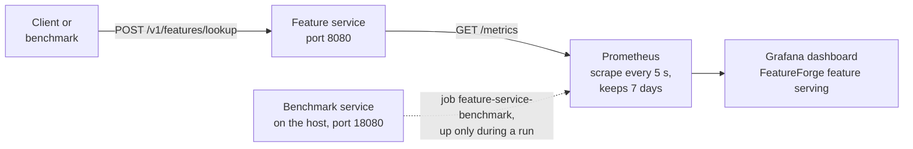
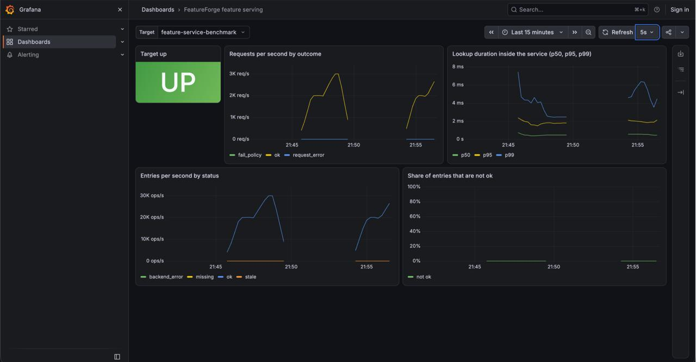

<a id="top"></a>

<div align="center">
  
</div>

# Observability of the feature service

<div align="center">

[Start](#start) · [Metrics](#metrics) · [Dashboard](#dashboard) · [Watching a benchmark](#watching-a-benchmark) · [Latency panel](#what-the-latency-panel-measures) · [Event loop lag](#event-loop-lag) · [Limits](#limits)

</div>

Prometheus and Grafana run in the Compose stack next to the feature service.

> [!NOTE]
> The metrics cover the serving path only. Prometheus has no alert rules, and the three runbooks
> cover the batch path. The Flink job, the materializer and the stores export no metrics yet.



## Start

```bash
docker compose up -d --build feature-service prometheus grafana
python scripts/smoke_feature_service.py
```

| Component | Address | Notes |
|---|---|---|
| Feature service | http://127.0.0.1:8080 | `/metrics`, `/readyz`, `/healthz` |
| Prometheus v3.16.0 | http://127.0.0.1:9090 | scrapes every 5 s, keeps 7 days |
| Grafana 13.3.1 | http://127.0.0.1:3000 | anonymous viewers, admin password from `GRAFANA_ADMIN_PASSWORD` (default `admin`, local only) |

All ports are bound to 127.0.0.1. The dashboard "FeatureForge feature serving"
and the Prometheus data source are provisioned from files in `docker/grafana`.

## Metrics

| Metric | Type | Labels | Meaning |
|---|---|---|---|
| `featureforge_lookup_duration_seconds` | histogram | `backend` | time inside one lookup |
| `featureforge_lookup_entries_total` | counter | `backend`, `status` | entries returned, by `ok`, `missing`, `stale`, `backend_error` |
| `featureforge_lookup_requests_total` | counter | `outcome` | requests by `ok`, `request_error`, `fail_policy` |
| `featureforge_event_loop_lag_seconds` | histogram | none | how late the event loop wakes a task that sleeps for 20 ms |

Every label has a small, fixed set of values. An entity id or a feature name is never a label.

## Dashboard

Five panels: whether the target is up, requests per second by outcome, the
lookup duration (p50, p95, p99), entries per second by status and the share of
entries that are not ok. The variable "Target" selects the scrape job. The event loop lag has no
panel yet. Query it in Prometheus.

## Watching a benchmark

`scripts/benchmark_feature_serving.py` starts its own service on the host
(port 18080). Prometheus scrapes it as the job `feature-service-benchmark`.
Select that target in the dashboard before a run. The target is DOWN outside of
a run, which is expected.

## What the latency panel measures

The histogram measures the time inside `FeatureServer.lookup`: the call to the store and
the assembly of the entries. It does not include HTTP parsing, validation of the
request body or the serialization of the response. For Cassandra it also leaves out the wait for a
thread of the pool. The Redis reader runs on the event loop and has no such wait. The benchmark reports two other numbers. Its service time counts from
the actual send until the response, and its latency counts from the time a
request was due. The three numbers differ by design, and the histogram is the
lowest of them.

| Number | Starts | Ends | Where |
|---|---|---|---|
| Lookup duration | Entry into `FeatureServer.lookup` | The entries are assembled | Histogram of the service |
| Service time | The request is actually sent | The response has arrived | Benchmark report |
| Latency | The request was due | The response has arrived | Benchmark report |

The buckets are 0.5, 1, 2.5, 5, 10, 25, 50, 100 and 250 ms. Prometheus
interpolates a quantile inside a bucket, so a p99 between 2.5 and 5 ms is an
estimate.

## Event loop lag

`featureforge_event_loop_lag_seconds` is a histogram of how late the event loop wakes a task that
sleeps for 20 ms. The service reads Redis on the event loop, so work that keeps the loop busy delays
every request behind it, and the socket timeout of the asynchronous client counts that delay too.
The lag measures the loop and not Redis. The task wakes about 50 times per second. That cost is
estimated as very small and was not measured with an A/B. A lag that stays near zero while requests
fail with a timeout points away from the loop.

One run measured the lag with Redis (commit `5b11811`, 60 s per rate, one uvicorn process,
1,000,000 users, `/metrics` read every 5 s):

| Offered rate | Wakeups per 5 s | Mean lag | Wakeups late by 25 ms or more |
|---|---|---|---|
| 3,000 req/s | 250 to 251 | 0.00 to 0.06 ms | 0 |
| 5,000 req/s, at saturation | 232 to 239 | 1.01 to 1.68 ms | 0 |

A loop that is late by 1 to 2 ms does not explain a call that takes more than the 50 ms budget. The
run contained no timeout burst, so the lag during a burst is not measured. The method, the raw data
and the limits are in [benchmarks.md](benchmarks.md), "Event loop lag at saturation".

## Limits

- No alert rules, and no runbook for the serving path. The three runbooks cover the batch path.
- No metrics of the Flink job, the materializer or the event writer.
- The 422 that FastAPI returns for a body that fails validation is not counted,
  because it happens before the handler.
- No metrics of Redis or Cassandra themselves.
- The metrics cost about 3 percent of the saturation (see
  [benchmarks.md](benchmarks.md), "Change 3").
- The screenshot was taken during a benchmark run with the stack and a browser
  open, on a laptop. The left curve is an earlier run. Such a run is a
  demonstration and not a measurement: Prometheus, Grafana and the browser
  compete for the same CPU. The tail of the two runs with the stack open was
  worse than in the clean runs at 3000 req/s (p99 6.88 and 20.44 ms against
  5.80 to 9.16 ms, p99.9 21.03 and 115.56 ms against 11.82 to 15.19 ms, see
  [benchmarks.md](benchmarks.md)). These numbers are from the runs of that day, before the
  Redis read moved to the event loop. Stop the stack before a benchmark that is
  meant to be recorded: `docker compose stop prometheus grafana`.



---

<div align="center">

[README](../README.md) · [Architecture](../ARCHITECTURE.md) · [Status](../STATUS.md) · [Benchmarks](benchmarks.md) · [ADR-016](adr/ADR-016-feature-serving.md)

<a href="#top">Back to top</a>

</div>
