# Streaming integration provenance

FeatureForge incorporates streaming functionality into the same platform as its
offline feature engineering and online serving paths. The source repository
records the origin of imported components. It is not a separate platform.

| | |
|---|---|
| Source repository | `oster-dev/featureforge-stream` |
| Source tag | `v0.1.0` |
| Source commit | `a681c281806af492a05b2b4a141f2683f752e1a9` |

Exclusions listed for an early import stage apply to that stage only, not to the
current repository.

---

## Timeline

```mermaid
flowchart LR
    I1[Import 1<br/>contracts, time,<br/>reference]:::imp --> I2[Import 2<br/>routing, store,<br/>materializer]:::imp
    I2 --> I3[Import 3<br/>Redis integration,<br/>WATCH retry]:::imp
    I3 --> I4[Import 4<br/>Flink runtime,<br/>joined test]:::imp
    I4 --> D1[PR 6<br/>replay and<br/>identity conflict]:::dev
    D1 --> D2[PR 7<br/>unified online<br/>access]:::dev
    D2 --> D3[PR 8<br/>routing and<br/>late events]:::dev
    D3 --> D4[PR 9<br/>skip-rate<br/>feature]:::dev
    D4 --> D5[CI stabilization<br/>fresh TaskManager<br/>per skip-rate test]:::dev
    D5 --> D6[PR 11<br/>feature spec<br/>model]:::dev
    D6 --> D7[PR 12<br/>CI hardening,<br/>TaskManager per module]:::dev

    classDef imp fill:#cfe2ff,stroke:#0d6efd,color:#000
    classDef dev fill:#d4edda,stroke:#28a745,color:#000
```



Blue stages were imported from the source commit. Green stages are development
inside FeatureForge.

| Stage | Merge commit | Content |
|---|---|---|
| Import 1 | n/a | Event validation, right-closed timestamp mapping, play-count reference, unit tests, golden fixture |
| Import 2 | n/a | Event routing, guarded Redis play-count store, Kafka-to-Redis materializer, unit tests, `streaming` dependency group |
| Import 3 | n/a | Live Redis integration tests including a controlled `WATCH` conflict |
| Import 4 | n/a | Flink runtime configuration, validation and play-count jobs, joined Kafka-to-Redis test |
| PR #6 | `fdbbfe8` | Bounded replay idempotency, event-identity conflict test, `--no-restart` option |
| PR #7 | `c8df9a8` | Unified batch and streaming online access |
| PR #8 | `7a9851f` | Rejected-event routing, continuous late correction, too-late routing |
| PR #9 | `94cad8a` | `user_skip_rate_24h` feature |
| CI fixes | up to `1ba2b93` | Fresh TaskManager per skip-rate test. Last recorded state of `1ba2b93`: all three CI jobs green |
| PR #11 | `1c1a8ac` | Declarative feature spec model and validation (ADR-008) |
| PR #12 | `1281d2c` | CI hardening, fresh TaskManager per Flink test module, TaskManager metaspace logging |

---

## Imported components

Computation and validation semantics, Redis key names, store semantics and
assertions were preserved in every import. Adaptions were limited to package
imports, test filenames, fixture locations, Kafka topic names, the `integration`
pytest marker, and the new `streaming` optional dependency group.

### Import 4 specifics

The Flink image installs the project without transitive dependencies to avoid
conflicting with the Apache Beam installation in the base image. Pydantic is
installed explicitly for the streaming contracts.

The joined test established the first end-to-end proof for one play event:
publish to Kafka, validate in Flink, compute `user_play_count_1h`, materialize
into Redis, read the stored feature and assert entity, count and window
metadata. It did not establish checkpoint recovery, sustained operation or all
late-event behaviors.

### Skip-rate import (PR #9)

Imported from the source tag and adapted from `featureforge_stream` to
`featureforge.streaming`:

- `src/featureforge/streaming/contracts/user_skip_rate.py`
- `src/featureforge/streaming/reference/user_skip_rate.py`
- `src/featureforge/streaming/skip_rate_store.py`
- `src/featureforge/streaming/materialize_skip_rate.py`
- `jobs/user_skip_rate_24h.py`
- `tests/unit/test_skip_rate_update_policy.py`, `tests/unit/test_user_skip_rate.py`
- `tests/integration/test_redis_skip_rate_store.py`
- `tests/integration/test_skip_rate_materialization.py`
- `tests/integration/test_skip_rate_flink_to_redis.py`
- `tests/integration/test_user_skip_rate_job.py`

---

## Development inside FeatureForge

### Replay and identity conflicts (PR #6)

The replay test publishes repeated deliveries of the same logical play event
with different `ingested_at` values, reprocesses through fresh bounded
executions, and requires the stored feature and its serialized Redis value to be
identical before and after replay. The materializer resumes with its existing
consumer group and reports the repeated updates as stale or unchanged.

The conflict test publishes two events with the same `event_id` and different
`content_id`. It requires a non-zero exit code, `EventIdentityConflictError`
in the output and a message naming the event ID. A subprocess timeout is a test
failure, not an accepted conflict result. The job option `--no-restart` disables
automatic restarts for this diagnostic run and changes neither computation nor
Redis write policies.

Replay executions reconstruct results from Kafka input. They do not restore Flink
state from a checkpoint or savepoint.

### Unified online access (PR #7)

`OnlineFeatureClient` reads user engagement and content popularity through Feast
and `user_play_count_1h` through the Redis streaming store. Each value carries
backend, availability, observation time, age, freshness class, schema version
and error type where applicable.

- Availability and freshness are separate dimensions.
- A valid zero stays present. A missing value is never replaced by zero. A
  backend error is not reported as missing.
- Combined reads report `atomic: false`.
- Batch observation timestamps come from the Feast online response
  (`to_dict(include_event_timestamps=True)`, checked with Feast 0.66.0,
  epoch seconds), never from the latest offline partition.
- A feature event timestamp is not evidence of publication time or of
  availability to an earlier prediction.
- Freshness classes: `fresh`, `stale`, `unknown`, `future`. A feature without a
  usable timestamp is not classified as fresh. Freshness against a historical
  demo reference time says nothing about the current wall clock.
- `python -m featureforge.online` exits `0` for successful reads including
  explicit missing values, `1` for feature errors, `2` for invalid requests.

### Routing and late events (PR #8)

The routing test publishes invalid JSON, a valid play event, a contract-invalid
event and a second valid event. It requires exactly two validated and two
rejected records with reasons `INVALID_JSON` and `EVENT_CONTRACT_VIOLATION`,
proving that rejected records do not block valid follow-up processing.

The late-event test runs the play-count job in detached continuous mode and
verifies that a distinct late event corrects an already emitted window from one
to two, and that an event too late for all windows reaches the late topic with
schema `v1`, reason `TOO_LATE_FOR_ALL_ASSIGNED_WINDOWS`, the feature name and
the original payload. It waits for observable outputs rather than fixed sleeps,
cancels its own resolved job ID and cleans up its isolated topics.

This test verifies Flink's Kafka outputs. It does not run corrections through the
Redis materializer. The Redis policy is covered separately by Redis integration
tests.

Test topics are created with `message.timestamp.type=LogAppendTime`, because
historical record timestamps interfered with broker retention. The payload
`event_time` is preserved.

### Skip-rate feature (PR #9)

```text
skip_rate = skip_count / (play_count + skip_count)
window    = (observation_time - 24 hours, observation_time]
```

The reference deduplicates by `event_id`, validates identity conflicts across the
complete input and excludes `ingested_at` from identity. Impression and complete
events count toward neither value.

The Flink job uses 24-hour sliding windows with a one-minute slide, a 10-minute
bounded-out-of-orderness watermark, 30 minutes of allowed lateness and a 48-hour
deduplication TTL. The Redis store compares `(play_count, skip_count)`
componentwise within one observation window and never compares rates by
magnitude. A newer window replaces an older one. Incomparable vectors raise
`SkipRateUpdateConflictError`.

### CI stabilization

Running many PyFlink jobs against one long-lived TaskManager became unstable in
GitHub Actions after roughly 7 to 8 jobs: jobs delivered no output, then failed
with exhausted restart attempts. Raising timeouts and metaspace only delayed the
failure.

The skip-rate suite recreates the TaskManager before every test, starts jobs with
`--parallelism 1`, waits for a terminal job state after cancelling, and reports
the root cause from the Flink REST API. Since PR #12 the CI job additionally
recreates the TaskManager before every Flink test module through
`scripts/ci/run_flink_integration.sh`, runs all modules even if one fails, and
logs the TaskManager metaspace after each module to test a class-loading-leak
hypothesis. This **isolates** the tests. The underlying TaskManager failure is
not yet explained.

### Declarative feature spec (PR #11)

`src/featureforge/spec/` defines a validated YAML specification for streaming
features (ADR-008). `feature_repo/specs/` contains specs for `user_play_count_1h`
and `user_skip_rate_24h`. The specs are validated and can be evaluated by an
exact reference, but **no Flink job, store or Spark feature is spec-driven yet**.
The hand-written jobs remain the executed implementation. `online.ttl` in a spec
is declarative; the current Redis stores write without expiry.

---

## Current implementation

| Component | Location | Behavior |
|---|---|---|
| Validation and routing | `jobs/validate_and_route_events.py` | Valid and rejected outputs, continuous or bounded |
| Play count 1h | `jobs/user_play_count_1h.py` | 1 h windows, 1 min slide, 24 h dedupe TTL |
| Skip rate 24h | `jobs/user_skip_rate_24h.py` | 24 h windows, 1 min slide, 48 h dedupe TTL |
| Materializers | `src/featureforge/streaming/materialize.py`, `materialize_skip_rate.py` | Single-partition topics, reject empty ranges and tombstones, commit offsets only after Redis succeeds |
| Online stores | `online_store.py`, `skip_rate_store.py` | Feature-specific guarded Redis writes |
| Unified access | `src/featureforge/online.py` | Batch features and streaming play count |
| Feature specs | `src/featureforge/spec/`, `feature_repo/specs/` | Validation only at runtime; not executed by any job |

Both feature jobs share watermark delay (10 min), allowed lateness (30 min),
checkpointing (10 s), too-late side outputs, event-ID dedupe and explicit failure
for conflicting payloads. Identical duplicates neither emit nor refresh the
dedupe retention.

The play-count store accepts newer windows (including zero), rejects older
windows, leaves identical values unchanged, accepts increasing same-window
corrections and rejects decreasing ones. These rules apply to the append-only
play-count contract and are not a general policy. The write result `stale`
describes rejection under an ordering policy and is distinct from the read
interface's freshness class.

Skip-rate access through the unified interface is not yet implemented.

---

## Verification boundaries

| Claim | Status |
|---|---|
| Rejected-event routing, late correction, too-late routing, skip-rate corrections, duplicates, replay of retained output | Verified locally and in CI |
| Checkpoint or savepoint restoration | **Not verified.** Checkpointing in code is not a recovery proof |
| Dedupe behavior after TTL expiry (24 h and 48 h) | **Not verified.** Not unlimited replay protection |
| Multiple Kafka partitions | **Not verified.** Topics are single-partition |
| Sustained operation and performance targets | **Not verified** |
| Exactly-once delivery | **Not claimed.** Flink Kafka sinks use `AT_LEAST_ONCE` |
| Zero emission for inactive users | **Not established.** A newer window can replace a value with zero, but no window job emits zero merely because time advances |
| Historical streaming publication and published-as-of retrieval | **Not implemented.** No `published_at` is fabricated |
| Atomic mixed batch and stream reads | **Not provided** (`atomic: false`) |
| Spec-driven execution in Flink or Spark | **Not implemented.** Only the Python reference evaluates specs |

Fresh bounded reprocessing is not recovery. Cancelling a test job during cleanup
is not a recovery test. Passing replay, routing and correction tests must not be
described as end-to-end exactly-once.

Event types in the contract that are not produced by a Flink job (for example
impression or complete) do not imply separate streaming features for them.

### Test-environment notes

The online-serving tests are not marked `integration`. They can run under
`-m "not integration"` when their availability check passes, which verifies
offline files and Redis connectivity but not that expected online values are
materialized. The unified, routing, late-event and skip-rate tests are marked
`integration`.

### Open test-maintenance items

- Add subprocess timeouts to the original joined Kafka-to-Redis test.
- Clean up the Redis key and topics created by older joined and replay tests.
- Use separate rejected and too-late topics in the original joined test.
- Align the online-serving tests with the `integration` marker boundary.

These are maintenance items and not failures of passing tests.

---

## Milestone statement

FeatureForge has an integrated, tested streaming path with event validation,
event-time windows, bounded replay idempotency, identity-conflict detection,
guarded Redis materialization, rejected-event routing, continuous late
correction and two streaming features. Unified batch and stream online access
covers the play count. A validated declarative spec exists for both features but
is not yet executed by a job.

Remaining before the streaming phase can be called complete: recovery
verification, TTL-boundary verification, versioned streaming history, skip-rate
access through the unified client and a reproducible completion demonstration.
These must be completed or explicitly scoped. For current test and CI results see
the README badge and the Actions page, not this document.