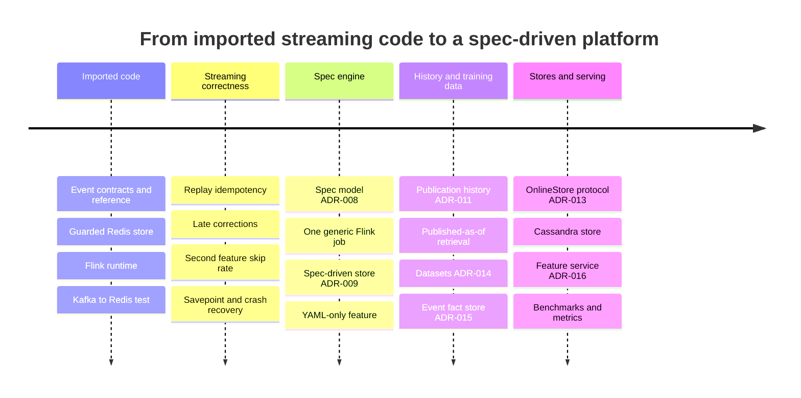

<a id="top"></a>

<div align="center">
  
</div>

# Streaming integration provenance

<div align="center">

[Timeline](#timeline) · [Imported components](#imported-components) · [Development](#development-inside-featureforge) · [Current implementation](#current-implementation) · [Verification boundaries](#verification-boundaries) · [Current state](#current-state)

</div>

FeatureForge incorporates streaming functionality into the same platform as its
offline feature engineering and online serving paths. The source repository
records the origin of imported components. It is not a separate platform.

| | |
|---|---|
| Source repository | `oster-dev/featureforge-stream` |
| Source tag | `v0.1.0` |
| Source commit | `a681c281806af492a05b2b4a141f2683f752e1a9` |

Exclusions listed for an early import stage apply to that stage only, not to the
current repository.

> [!NOTE]
> This document is the change log of the streaming path: where each part came from, which pull
> request added it and what its tests do and do not show. For the current design read
> [ARCHITECTURE.md](../ARCHITECTURE.md), and for status read [STATUS.md](../STATUS.md).

---

## Timeline



The first column was imported from the source commit. Everything after it is development
inside FeatureForge. The tables list every change with its merge commit.

<details>
<summary><b>Changes up to PR #62</b> · imports, streaming correctness, the spec engine, history and datasets</summary>

<br>

| Change | Merge commit | Content |
|---|---|---|
| Import 1 | n/a | Event validation, right-closed timestamp mapping, play-count reference, unit tests, golden fixture |
| Import 2 | n/a | Event routing, guarded Redis play-count store, Kafka-to-Redis materializer, unit tests, `streaming` dependency group |
| Import 3 | n/a | Live Redis integration tests including a controlled `WATCH` conflict |
| Import 4 | n/a | Flink runtime configuration, validation and play-count jobs, joined Kafka-to-Redis test |
| PR #6 | `fdbbfe8` | Bounded replay idempotency, event-identity conflict test, `--no-restart` option |
| PR #7 | `c8df9a8` | Unified batch and streaming online access |
| PR #8 | `7a9851f` | Rejected-event routing, continuous late correction, too-late routing |
| PR #9 | `94cad8a` | `user_skip_rate_24h` feature |
| CI fixes | up to `1ba2b93` | Fresh TaskManager per skip-rate test. Last recorded state of `1ba2b93`: all three CI jobs green |
| PR #11 | `1c1a8ac` | Declarative feature spec model and validation (ADR-008) |
| PR #12 | `1281d2c` | CI hardening, fresh TaskManager per Flink test module, TaskManager metaspace logging |
| Skip-rate scenarios on the generic job | `1ad56ce` | The skip-rate job scenarios run on the hand-written and the generic job |
| Play-count golden fixture on the generic job | `0ea7156` | The play-count spec reproduces its golden fixture on the generic job |
| Play-count late events on both jobs | `7d97afe` | The play-count late-event scenarios run on both jobs |
| Play-count replay and identity conflict | `a8cb607` | The play-count replay idempotency and identity conflict run on both jobs |
| Skip-rate Flink-to-Redis on both jobs | `4535162` | The skip-rate Flink-to-Redis test runs on both jobs |
| Joined play-count flow on both jobs | `8058076` | The joined play-count flow runs on both jobs |
| Hand-written jobs removed | `a3c2da2` | The hand-written feature jobs are removed. Last version: tag `hand-written-jobs-final` |
| Savepoint stop and resume | `c2e9365` | The generic job stops with a savepoint and a new job resumes from it, with dedupe and window state intact (play-count spec) |
| TaskManager crash recovery | `e56934d` | The generic job recovers from a TaskManager crash with checkpoint state (play-count spec) |
| Dedupe expiry after TTL (PR #30) | `de74e6d` | The dedupe state expires after its TTL: a redelivery inside it is ignored, one after it is counted again. The job expires the state with a processing-time timer because the PyFlink 1.20 state TTL did not expire it (play-count spec, shortened TTL) |
| PR #31 | `8146b70` | The merge commit of the dedupe expiry change is recorded in this document |
| YAML-only content feature (PR #32) | `a108622` | `content_play_count_1h` (entity `content_id`) runs on the generic job from a YAML spec alone and matches hand-calculated windows |
| PR #33 | `0386f97` | `validate-spec` command for feature specs |
| PR #34 | `8360f83` | `test-spec` command: a spec is evaluated on a JSONL event file with the spec reference, without Docker |
| PR #35 | `52b113a` | ADR-009: spec-driven online stores and materializer |
| Count-vector decision function (PR #36) | `9e1324b` | One decision function for count-vector updates, compared with the hand-written skip-rate policy |
| Spec-driven Redis store (PR #37) | `d42230f` | Feature record parser and spec-driven Redis store with `online.ttl` expiry |
| Spec-driven materializer (PR #38) | `9711627` | Spec-driven Kafka-to-Redis materializer |
| YAML-only feature from events to Redis (PR #39) | `7513240` | `content_play_count_1h` runs from events to Redis through the validation job, the generic job, the spec-driven materializer and store, without a new Python file |
| PR #40 | `764f779` | The spec-driven online path is recorded across README, STATUS and the design documents |
| PR #42 | `a02a378` | ADR-010: time and availability model of the streaming features |
| Thin wrappers for the original features (PR #43) | `a780341` | The stores and materializers of the two original features are thin wrappers over the spec-driven store and materializer, `online.ttl` now applies to all three features, ADR-010 accepted |
| PR #44 | `4858bc7` | The thin wrappers and ADR-010 are recorded in this document |
| PR #45 | `09dc93d` | The skip rate is read through the unified client, and its identity conflict is tested |
| PR #46 | `8207da2` | ADR-011: history table layout and evidence append |
| PR #47 | `870599a` | The history table and an idempotent evidence append for spec-driven features |
| PR #48 | `fbcf2ad` | The spec-driven materializer appends publication evidence |
| PR #49 | `3fc2dcf` | Published-as-of retrieval over the history table |
| PR #50 | `9c83d93` | A spec-driven Spark backfill with parity to the spec reference |
| PR #51 | `405f2b1` | `backfill-spec` writes spec-driven Spark backfills as Parquet |
| PR #52 | `eee8255` | A PostgreSQL catalog profile for the history table in Docker Compose |
| PR #53 | `23c2e3b` | ADR-012: label specs |
| PR #54 | `e605399` | A deterministic behavioral simulator for interaction events |
| PR #55 | `421c1bb` | mypy in the dev tooling and in CI, existing type errors fixed |
| PR #56 | `bc15dda` | The `LabelSpec` model, loader and `validate-label-spec` command (ADR-012) |
| PR #57 | `a6f0ffc` | The exact label reference evaluation (ADR-012) |
| PR #58 | `f9c30c0` | The Spark label evaluation with parity to the reference (ADR-012) |
| PR #59 | `c2c15a8` | ADR-013: online store protocol and a Cassandra backend (decision only) |
| PR #60 | `fa0dade` | ADR-014: training datasets from features and labels |
| PR #61 | `cd8ff57` | The event-time training dataset |
| PR #62 | `a05be67` | The published-as-of mode: a Spark join of a pinned history snapshot, status columns, the history start cut, a manifest with snapshot ids |

</details>

<details>
<summary><b>Changes from PR #63 to PR #134</b> · event fact store, online stores, feature serving and measurements</summary>

<br>

| Change | Merge commit | Content |
|---|---|---|
| PR #63 | `98c10c4` | Run the published-as-of and dataset integration tests |
| PR #64 | `55d490d` | Bring all documents up to date with history, labels and training datasets |
| PR #65 | `2e6e1c2` | Prove online-offline parity of published_as_of against Redis (ADR-014) |
| PR #66 | `03b1cc0` | Mark the Redis and published-as-of parity test as done |
| PR #67 | `dfa7d1f` | Add the build-training-dataset command (ADR-014) |
| PR #68 | `b59be75` | Add the training dataset loader (ADR-014) |
| PR #69 | `bda7aab` | Add the Arrow batch loader and its benchmark (ADR-014) |
| PR #70 | `f297f12` | Propose ADR-015 for the Iceberg event fact store |
| PR #71 | `9303f5d` | Add the event fact table contract (ADR-015) |
| PR #72 | `e5971a4` | Add the idempotent event append with identity conflicts (ADR-015) |
| PR #73 | `c0a079b` | Add the event writer that appends validated Kafka events (ADR-015) |
| PR #74 | `24d0340` | Read event_time datasets from the event table at a pinned snapshot (ADR-015) |
| PR #75 | `2476fd3` | Rebuild a dataset at a chosen event snapshot (ADR-015) |
| PR #76 | `bb5d4ef` | Add a benchmark for the event append (ADR-015) |
| PR #77 | `2535382` | Let the event writer hold a partial batch (ADR-015) |
| PR #78 | `7f36b8d` | State only what is proven in the README head and show the event fact store |
| PR #79 | `3b3707e` | Describe work by topic instead of plan numbers |
| PR #80 | `8d33741` | Label the streaming migration log by topic and PR |
| PR #81 | `59980a3` | Compare the Flink windows with the event table evaluation (ADR-015) |
| PR #82 | `cddbf7d` | Compare the Redis value with the event table evaluation for duplicate and invalid input (ADR-015) |
| PR #83 | `cdcddc7` | Record the writer and Flink parity test in ADR-015 |
| PR #84 | `0176e66` | Name the spec-driven path as the platform and Feast as batch path v1 |
| PR #85 | `51f0058` | Describe the status by topic and drop plan-stage wording |
| PR #86 | `4bdc49b` | Add ADR-016 for the feature serving service |
| PR #87 | `b45ad00` | Add the feature serving service with status per value and one round trip (ADR-016) |
| PR #88 | `6294466` | Serve features from a real Redis and check status, expiry and one MGET (ADR-016) |
| PR #89 | `5f763a7` | Drill a stopped and a slow Redis behind Toxiproxy for the feature service (ADR-016) |
| PR #90 | `26c9a8f` | Add an open-load benchmark for the feature serving service (ADR-016) |
| PR #91 | `20b3da0` | Record the first feature serving baseline (ADR-016) |
| PR #92 | `b4f0306` | Update STATUS.md with the feature serving baseline and its limits |
| PR #93 | `ab6b3e5` | Parse each spec expression once and check text with one regex (ADR-016) |
| PR #94 | `c400c3c` | Compile spec expressions once and decode records with a per-spec decoder (ADR-016) |
| PR #95 | `a9dc5bc` | Run the feature service as a container in the Compose stack (ADR-016) |
| PR #96 | `1178526` | Export lookup latency and entry status metrics from the feature service (ADR-016) |
| PR #97 | `d3ee450` | Add Prometheus and a Grafana dashboard for the feature service (ADR-016) |
| PR #98 | `f6edc82` | Add the OnlineStore protocol, a store factory and a backend contract suite (ADR-013) |
| PR #99 | `8e61bc0` | Run the online store contract suite in the serving integration job |
| PR #100 | `9ceccc2` | Run a local Cassandra node and check the table schema and conditional writes (ADR-013) |
| PR #101 | `af9aabb` | Add CassandraSpecStore and run the store contract suite for both backends (ADR-013) |
| PR #102 | `3746261` | Let the materializer write to the online store that the spec names (ADR-013) |
| PR #103 | `25bd4b2` | Decide how the feature serving service reads from more than one backend (ADR-016) |
| PR #104 | `127378e` | Read through a ServingReader and move the Redis read behind it (ADR-016) |
| PR #105 | `436a9c0` | Bring STATUS.md up to date and sort the open items of ADR-015 |
| PR #106 | `16f8a01` | Read from Cassandra in the feature serving service (ADR-016) |
| PR #107 | `c668ebe` | Run a spec from events to the service on Cassandra (ADR-013, ADR-016) |
| PR #108 | `5ae169a` | Run the feature serving benchmark against Cassandra (ADR-016) |
| PR #109 | `d465dd5` | Benchmark the Cassandra serving reader against Redis (ADR-016) |
| PR #110 | `f4076ce` | Compare two benchmark reports with a noise rule (ADR-016) |
| PR #111 | `209da76` | Read serving rows as plain tuples from Cassandra (ADR-016) |
| PR #112 | `f6c102a` | Measure plain tuple rows for the Cassandra reader (ADR-016) |
| PR #113 | `5af38e1` | Set the comparison threshold to 10 percent and add make bench-compare (ADR-016) |
| PR #114 | `8989796` | Add a runner with presets and safety checks and a CI smoke job (ADR-016) |
| PR #115 | `19eb273` | Record the serving baselines of Redis and Cassandra after change 5 (ADR-016) |
| PR #116 | `1aa83e9` | Remove statements that the Cassandra reader and the benchmarks made stale |
| PR #117 | `575d958` | Count the error type of failed entries and judge the capacity by the median too (ADR-016) |
| PR #118 | `d852555` | Let the runner replace the warm-up of a preset (ADR-016) |
| PR #119 | `2205a4b` | Test whether a longer warm-up avoids the bursts after the seed (ADR-016) |
| PR #120 | `8b6cfc8` | Show Redis and Cassandra serving numbers and the serving path in the README (ADR-016) |
| PR #121 | `8a431e3` | Add the design document with the time model, store contract and comparison (ADR-016) |
| PR #122 | `6908063` | Add make quickstart that writes three demo values and reads them through the feature service (ADR-016) |
| PR #123 | `fc7ce15` | Add a dev container with Python, Docker and the quickstart (ADR-016) |
| PR #124 | `4ff9a2c` | Link the design, benchmarks and observability documents in the README |
| PR #125 | `fa74891` | Pin the dev container base image to a distribution release |
| PR #126 | `514f735` | Add the measured Codespace setup and quickstart times |
| PR #127 | `5386727` | Read Redis on the event loop instead of a worker thread (ADR-016) |
| PR #128 | `c40d4b6` | Record the git state of the benchmark script's own tree |
| PR #129 | `94625c4` | Extend the Redis rates of the record preset to 6,000 req/s (ADR-016) |
| PR #130 | `dca0138` | Record the Redis serving baseline after change 6 (ADR-016) |
| PR #131 | `3a31f56` | Add the second Redis record run and the latency monitor result (ADR-016) |
| PR #132 | `734f747` | Record the Cassandra serving baseline after change 6 (ADR-016) |
| PR #133 | `5420fb4` | Export the event loop lag of the feature service (ADR-016) |
| PR #134 | `6f259c0` | Add a tour notebook from a spec to a measured service |

</details>

---

## Imported components

Computation and validation semantics, Redis key names, store semantics and
assertions were preserved in every import. Adaptions were limited to package
imports, test filenames, fixture locations, Kafka topic names, the `integration`
pytest marker, and the new `streaming` optional dependency group.

### Import 4 specifics

The Flink image installs the project without transitive dependencies to avoid
conflicting with the Apache Beam installation in the base image. Pydantic is
installed explicitly for the streaming contracts.

The joined test established the first end-to-end proof for one play event:
publish to Kafka, validate in Flink, compute `user_play_count_1h`, materialize
into Redis, read the stored feature and assert entity, count and window
metadata. It did not establish checkpoint recovery, sustained operation or all
late-event behaviors.

### Skip-rate import (PR #9)

Imported from the source tag and adapted from `featureforge_stream` to
`featureforge.streaming`:

- `src/featureforge/streaming/contracts/user_skip_rate.py`
- `src/featureforge/streaming/reference/user_skip_rate.py`
- `src/featureforge/streaming/skip_rate_store.py`
- `src/featureforge/streaming/materialize_skip_rate.py`
- `jobs/user_skip_rate_24h.py` (replaced by the generic job when the hand-written jobs were removed; the last version is in the tag `hand-written-jobs-final`)
- `tests/unit/test_skip_rate_update_policy.py`, `tests/unit/test_user_skip_rate.py`
- `tests/integration/test_redis_skip_rate_store.py`
- `tests/integration/test_skip_rate_materialization.py`
- `tests/integration/test_skip_rate_flink_to_redis.py`
- `tests/integration/test_user_skip_rate_job.py`

The play-count job `jobs/user_play_count_1h.py` came with Import 4 and was
replaced in the same way.

---

## Development inside FeatureForge

### Replay and identity conflicts (PR #6)

The replay test publishes repeated deliveries of the same logical play event
with different `ingested_at` values, reprocesses through fresh bounded
executions, and requires the stored feature and its serialized Redis value to be
identical before and after replay. The materializer resumes with its existing
consumer group and reports the repeated updates as stale or unchanged.

The conflict test publishes two events with the same `event_id` and different
`content_id`. It requires a non-zero exit code, `EventIdentityConflictError`
in the output and a message naming the event ID. A subprocess timeout is a test
failure, not an accepted conflict result. The job option `--no-restart` disables
automatic restarts for this diagnostic run and changes neither computation nor
Redis write policies.

Replay executions reconstruct results from Kafka input. They do not restore Flink
state from a checkpoint or savepoint. Restoring from a savepoint and from a
checkpoint after a crash is covered separately (see Savepoint resume and Crash recovery below). Since the replay and
identity conflict change both replay tests run against the generic job.

### Unified online access (PR #7)

`OnlineFeatureClient` reads user engagement and content popularity through Feast
and `user_play_count_1h` through the Redis streaming store. Each value carries
backend, availability, observation time, age, freshness class, schema version
and error type where applicable.

- Availability and freshness are separate dimensions.
- A valid zero stays present. A missing value is never replaced by zero. A
  backend error is not reported as missing.
- Combined reads report `atomic: false`.
- Batch observation timestamps come from the Feast online response
  (`to_dict(include_event_timestamps=True)`, checked with Feast 0.66.0,
  epoch seconds), never from the latest offline partition.
- A feature event timestamp is not evidence of publication time or of
  availability to an earlier prediction.
- Freshness classes: `fresh`, `stale`, `unknown`, `future`. A feature without a
  usable timestamp is not classified as fresh. Freshness against a historical
  demo reference time says nothing about the current wall clock.
- `python -m featureforge.online` exits `0` for successful reads including
  explicit missing values, `1` for feature errors, `2` for invalid requests.

### Routing and late events (PR #8)

The routing test publishes invalid JSON, a valid play event, a contract-invalid
event and a second valid event. It requires exactly two validated and two
rejected records with reasons `INVALID_JSON` and `EVENT_CONTRACT_VIOLATION`,
proving that rejected records do not block valid follow-up processing.

The late-event test runs the play-count job in detached continuous mode and
verifies that a distinct late event corrects an already emitted window from one
to two, and that an event too late for all windows reaches the late topic with
schema `v1`, reason `TOO_LATE_FOR_ALL_ASSIGNED_WINDOWS`, the feature name and
the original payload. It waits for observable outputs rather than fixed sleeps,
cancels its own resolved job ID and cleans up its isolated topics. Since the play-count late-event change
it runs against the generic job.

This test verifies Flink's Kafka outputs. It does not run corrections through the
Redis materializer. The Redis policy is covered separately by Redis integration
tests.

Test topics are created with `message.timestamp.type=LogAppendTime`, because
historical record timestamps interfered with broker retention. The payload
`event_time` is preserved.

### Skip-rate feature (PR #9)

```text
skip_rate = skip_count / (play_count + skip_count)
window    = (observation_time - 24 hours, observation_time]
```

The reference deduplicates by `event_id`, validates identity conflicts across the
complete input and excludes `ingested_at` from identity. Impression and complete
events count toward neither value.

The Flink job uses 24-hour sliding windows with a one-minute slide, a 10-minute
bounded-out-of-orderness watermark, 30 minutes of allowed lateness and a 48-hour
deduplication TTL. Since the hand-written jobs were removed these parameters come from the spec. The Redis
store compares `(play_count, skip_count)` componentwise within one observation
window and never compares rates by magnitude. A newer window replaces an older
one. Incomparable vectors raise `SkipRateUpdateConflictError`.

### CI stabilization

Running many PyFlink jobs against one long-lived TaskManager became unstable in
GitHub Actions after roughly 7 to 8 jobs: jobs delivered no output, then failed
with exhausted restart attempts. Raising timeouts and metaspace only delayed the
failure.

The skip-rate suite recreates the TaskManager before every test, starts jobs with
`--parallelism 1`, waits for a terminal job state after cancelling, and reports
the root cause from the Flink REST API. Since PR #12 the CI job additionally
recreates the TaskManager before every Flink test module through
`scripts/ci/run_flink_integration.sh`, runs all modules even if one fails, and
logs the TaskManager metaspace after each module to test a class-loading-leak
hypothesis. This **isolates** the tests. The underlying TaskManager failure is
not yet explained.

### Declarative feature spec (PR #11)

`src/featureforge/spec/` defines a validated YAML specification for streaming
features (ADR-008). `feature_repo/specs/` contains specs for `user_play_count_1h`
and `user_skip_rate_24h`. The specs are validated, evaluated by an exact
reference, and drive the generic Flink job `jobs/feature_from_spec.py`, which
runs both features (see the next section). Stores and materializers became
spec-driven in PRs #36 to #38, the Spark backfill from a spec covers count, sum and avg aggregations, and the two original Spark features are hand-written. `online.ttl`
in a spec is enforced by the spec-driven store. Since PR #43 the stores of
the two original features delegate to it, so all three features expire.

### Generic job consolidation

The generic job builds the windowed computation from a plan derived from a spec.
It supports count aggregations and one entity key. Both features moved to it one
test group at a time, each verified before the next, with the hand-written job kept as a
parity check until all tests passed on the generic job:

| Test group | What ran on both jobs |
|---|---|
| Skip-rate job scenarios | Eight scenarios: late corrections in both directions with duplicates, too-late routing, both window edges, zero denominator |
| Play-count golden fixture | Exact field set and hand-calculated windows |
| Play-count late events | The late correction and the too-late routing |
| Play-count replay and identity | Replay idempotency including the Redis materializer, and the event-identity conflict failure |
| Skip-rate Flink to Redis | The flow with corrections and replay |
| Joined play-count flow | From validation to Redis |

When the generic job became the only job, the hand-written jobs `jobs/user_play_count_1h.py` and
`jobs/user_skip_rate_24h.py` were removed, together with the `hand_written` test
parameters. Both jobs wrote to the same default topics as the generic job, so
the materializers and stores are unchanged. No deployment configuration
referenced the removed files. The last version is the tag
`hand-written-jobs-final`. The independent oracle stays: the pure-Python
references and the hand-calculated golden fixtures.

### Savepoint resume

`tests/integration/test_generic_job_recovery.py` stops the generic job for the
play-count spec with a savepoint and starts a new job from it. The Compose
stack mounts one `flink-savepoints` volume into JobManager and TaskManager,
and the Flink image creates `/opt/flink/savepoints` owned by the `flink` user.

The test requires that the new job restored the savepoint. This check matters:
a job that replays from the earliest offset reaches the same counts, so the
final values alone would not prove a restore. It also requires that a
redelivered event is not counted again, that a late correction lands in the
restored window state, and that the late topic stays empty.

This covers a planned stop and resume. Recovery after a crash is covered by
the crash recovery test. Both tests are shown for the play-count spec only.

### Crash recovery

`tests/integration/test_generic_job_checkpoint_recovery.py` starts the generic
job for the play-count spec with the cluster restart strategy, so without
`--no-restart`. After the first event is processed, it waits for a checkpoint
that was triggered later (checkpoint ids follow trigger order), kills the
TaskManager and starts it again.

The test requires that a checkpoint was restored for the same job, that this
checkpoint is not a savepoint and is not older than the one holding the state,
that a redelivered event is not counted again, that a late correction lands in
the restored window, and that the late topic stays empty. The Kafka sinks are
`AT_LEAST_ONCE`, so the test waits for a window value of at least 2 and
checks it, instead of counting emissions.

The JobManager keeps running. The checkpoints live in JobManager memory, so
this does not cover JobManager loss or checkpoints on a shared volume. The
test restarts the TaskManager in its cleanup and runs in its own CI module, so
the next module starts from a fresh TaskManager anyway.

### Dedupe expiry

`tests/integration/test_generic_job_dedupe_ttl.py` runs the generic job with a copy of the
play-count spec: 20 s windows, 5 s slide, 10 s allowed lateness and a 30 s dedupe TTL. The
shortened values satisfy the spec rule that the dedupe TTL is at least window plus allowed
lateness. The test publishes an event and waits for its window. A redelivery after about 15 s
must not be counted. A second redelivery after about 36 s must be counted, so the window
reaches 2. This also shows that an ignored duplicate does not refresh the retention.

The first version of the test failed. The job used Flink state TTL with `OnCreateAndWrite`
and `NeverReturnExpired`, and the dedupe state did not expire in PyFlink 1.20.3: the
redelivery stayed ignored after 80 s, while a fresh event with a new ID updated the same
window. The behavior matches the reported issue FLINK-34625. Since PR #30 the job
registers a processing-time timer when it first sees an event ID and clears the state when
the timer fires.

Replay protection is therefore bounded by the TTL. An event redelivered after expiry is
counted again. The test uses the shortened spec only. The production values of 24 h and
48 h are configuration and are not exercised.

### Content feature from YAML only

`tests/integration/test_generic_job_content_play_count.py` runs
`content_play_count_1h` on the generic job without code changes. The spec is the
play-count spec with `content_id` as entity. The test asserts the job plan (entity
key and feature name), then publishes plays for two contents: content A gets three
plays from two users, one of them playing twice, and content B gets one play. Plays
of different users count together for one content item, and content B must not
influence A. The expected count per window is hand-calculated from the play
offsets. Every expected window must be present, no window may be emitted twice,
every record has exactly the expected fields, and the late topic stays empty.

### Practitioner commands (PRs #33 and #34)

`python -m featureforge.cli validate-spec` checks spec files against the spec
model and the event contract. `python -m featureforge.cli test-spec` evaluates a
spec with the spec reference on a JSONL event file for one entity and one
observation time and can check expected values with `--expect`. Both use exit
codes (0 ok, 1 invalid input or failed expectation, 2 missing file) and run
without Docker. `test-spec` runs the reference, not the Flink job.

### Spec-driven online path (ADR-009)

Stores and materializers were hand-written per feature. ADR-009 replaces them
with one decision function, one store and one materializer that take the spec.
In PR #43 the hand-written stores and materializers of the two original
features became thin wrappers over this code. Their typed models, constructors
and command lines are unchanged.

- **Decision function (PR #36).** `contracts/count_vector.py` orders windows
  first and compares same-window count vectors componentwise. A vector with one
  component is the append-only play-count rule. Incomparable vectors raise
  `UpdateConflictError`. Derived values are never ordered. A test compares it
  with the hand-written skip-rate decision on 768 combinations.
- **Record parser and store (PR #37).** `contracts/feature_record.py` parses the
  record the generic job emits and validates it against the spec: field set,
  schema version, feature name, entity id (non-empty, no whitespace), window
  length, non-negative integer counts and derived values recomputed from the spec
  expressions. It reads what the hand-written models write, and the hand-written
  models read what it writes. `spec_store.py` implements `RedisSpecStore` with
  the same `WATCH`/`MULTI` loop and 16 retries as the hand-written stores. Its
  default keys equal the keys of the two original features. `online.ttl` is set
  as a Redis expiry with every written update, runs in wall-clock time and is
  not extended by unchanged or stale updates. The store refuses `window_replace`,
  non-Redis specs and composite keys. Unit tests use a mocked pipeline (retry,
  the 16-attempt limit, the TTL argument), and nine integration tests run against
  a real Redis.
- **Materializer (PR #38).** `materialize_spec.py` derives the feature topic from
  the spec (equal to the topics of the two original features), validates each
  record and writes it through the store. It keeps the behavior of the
  hand-written materializers: single-partition topics only, empty ranges and
  tombstones rejected, offsets committed only after a successful write. Unit
  tests reuse the fakes of the existing materializer tests for three specs. An
  integration test with real Kafka and Redis publishes six records for
  `content_play_count_1h` (a correction, a duplicate, a second entity, a newer
  window with a smaller count and an older window) and requires the results
  `{"stale": 1, "unchanged": 1, "written": 4}`, the stored values, the TTL and
  that a second run with the same group does nothing.

### End-to-end proof

`tests/integration/test_content_play_count_end_to_end.py` runs the whole path for
a feature that has no job, store, materializer or record type of its own: the
validation job, the generic Flink job on the mounted spec
`feature_repo/specs/content_play_count_1h.yaml` (both bounded), `materialize_spec`
and a read through `RedisSpecStore`.

Content `content_000001` has plays at 11:30 and 11:40, and the second event is
delivered twice. Content `content_000002` has one play at 11:30. The expected
values are hand-calculated: 70 windows ending 11:30 to 12:39 and 60 windows
ending 11:30 to 12:29, so 130 records. The final windows are 12:39 and 12:29,
both with count 1. A counted duplicate would show as 2 in the last window of
`content_000001`. The stored value has a Redis expiry within `online.ttl`. A
second run with the same consumer group does nothing. A replay with a new group
reads all 130 records again and yields 128 `stale` and 2 `unchanged`, so a
replay cannot undo the stored state.

### Parity of Redis and published-as-of (PR #65)

`tests/integration/test_materialize_spec_kafka_to_history.py` runs the play-count spec through two
bounded runs of one entity and requires that the value in Redis equals the value that
`published_as_of` returns from the history. It covers one entity. Several entities and the TTL
expiry are not compared.

### Dataset command and loaders (PRs #67 to #69)

`build-training-dataset` writes a dataset in either mode. `load_training_dataset` reads one back
with pandas and checks it against the manifest. `open_training_batches` makes the same checks from
the Parquet metadata and yields Arrow batches in partition order
([ADR-014](adr/ADR-014-training-datasets.md)).

### Event fact store (ADR-015, PRs #70 to #77, #81 and #82)

Validated events are kept as immutable Iceberg facts in `facts.interaction_events`, partitioned by
`day(event_time)` and with `ingested_at`
([ADR-015](adr/ADR-015-iceberg-event-fact-store.md)).

- **Idempotent append.** `EventLog.append` is idempotent by `event_id`: the first row wins and
  keeps its `ingested_at`, and the same id with another payload fails and writes nothing.
- **Event writer.** It reads the raw topic in its own consumer group, validates with
  `route_event_json`, appends before it commits the offset and counts rejections without storing
  them. It does not run in Flink. `--max-batch-seconds` lets a partial batch wait, so a low rate
  writes fewer, larger files.
- **Pinned reads.** `build-training-dataset --mode event_time --events-root` reads the table at
  the snapshot that is current at the start, or at `--events-snapshot-id`, and records it in the
  manifest.
- **Comparison with the online path.** The windows of the Flink job and the value in Redis are
  compared with an evaluation of the event table, for one input with a duplicate and two invalid
  payloads.

The writer and the Flink job read the topic independently, so an event can be online before it
is in the table or the other way round. The table has one writer, no compaction and no retention.

### Online store protocol and Cassandra (ADR-013, PRs #98 to #102 and #107)

The spec-driven store became one of two backends behind the `OnlineStore` protocol
([ADR-013](adr/ADR-013-online-store-protocol.md)).

- **Protocol and factory (PR #98).** `read` returns a validated record or `None`, `write`
  returns `written`, `unchanged` or `stale`. A store factory follows `online.store` in the spec.
  One contract suite, `tests/integration/test_online_store_contract.py`, defines the behavior.
- **Cassandra node and schema (PR #100).** One local node behind the Compose profile
  `cassandra`, one table `online_features` with the partition `(entity_key, entity_value)` and
  the clustering column `feature`. `ensure_schema` never alters a table and fails on a mismatch.
- **`CassandraSpecStore` (PR #101).** Lightweight transactions guard the write, `USING TTL`
  sets the expiry, and the payload is the JSON of the Redis value, unchanged. The contract suite
  runs for both backends.
- **Materializer (PR #102).** `materialize_spec` writes to the backend that the spec names,
  shown from Kafka to Cassandra in `tests/integration/test_materialize_spec_kafka_to_cassandra.py`.
- **End to end (PR #107).** `tests/integration/test_cassandra_end_to_end.py` runs
  `content_play_count_1h` from events through the validation job, the generic Flink job, the
  materializer and the feature service on Cassandra, with only `online.store` changed.

The local Cassandra is one node. It proves the protocol logic and nothing about replication.

### Feature serving (ADR-016, PRs #86 to #97 and #103 to #133)

The unified client of PR #7 is a library with fixed feature groups, Feast on the path and one
entity per call. The feature serving service is the network contract for features that are
defined by specs ([ADR-016](adr/ADR-016-feature-serving.md)).

- **Service (PR #87).** A request names several entities and features and gets one entry per
  pair with a status: `ok`, `missing`, `stale` or `backend_error`. A value is never replaced by a
  silent zero. There are no retries in the request path.
- **Real Redis and fault drills (PRs #88 and #89).** The status, the expiry and one `MGET` per
  request are checked against a real Redis. A stopped and a slow Redis behind Toxiproxy give
  `backend_error` within the budget, and the service recovers.
- **Readers (PRs #104 and #106).** The service reads through a `ServingReader`, chosen by
  `online.store`. The Cassandra reader makes one partition read per entity and runs them
  concurrently.
- **Metrics and dashboard (PRs #96, #97 and #133).** Lookup duration, entries by status, requests
  by outcome and the event loop lag, with Prometheus and a Grafana dashboard in the Compose
  stack ([observability.md](observability.md)).
- **Measurements (PRs #90 to #94, #108 to #119 and #127 to #132).** An open-load benchmark, a
  compare script with a noise rule and a runner with safety checks. The numbers, the setup and
  the limits are in [benchmarks.md](benchmarks.md) and nowhere else in this document.
- **Quickstart (PRs #122 and #123).** `make quickstart` writes demo values through the spec
  store and reads them through the service, locally or in a dev container.

<div align="right"><a href="#top">Back to top</a></div>

---

## Current implementation

| Component | Location | Behavior |
|---|---|---|
| Validation and routing | `jobs/validate_and_route_events.py` | Valid and rejected outputs, continuous or bounded |
| Play count 1h | `jobs/feature_from_spec.py` with `feature_repo/specs/user_play_count_1h.yaml` | 1 h windows, 1 min slide, 24 h dedupe TTL |
| Skip rate 24h | `jobs/feature_from_spec.py` with `feature_repo/specs/user_skip_rate_24h.yaml` | 24 h windows, 1 min slide, 48 h dedupe TTL |
| Content play count 1h | `jobs/feature_from_spec.py` with `feature_repo/specs/content_play_count_1h.yaml` | 1 h windows, 1 min slide, 24 h dedupe TTL, entity `content_id` |
| Materializers | `src/featureforge/streaming/materialize.py`, `materialize_skip_rate.py` | The two original features. Thin entry points over `materialize_spec` that keep the original command lines. Single-partition topics, empty ranges and tombstones rejected, offsets committed only after the store write succeeds, all from the generic code |
| Online stores | `online_store.py`, `skip_rate_store.py` | The two original features. Thin wrappers over `RedisSpecStore` that keep the typed models and constructors. Guarded Redis writes with `online.ttl` expiry |
| Spec-driven materializer | `src/featureforge/streaming/materialize_spec.py` | Any count or ratio spec. Topic derived from the spec, records validated against the spec, written to the store that the spec names, same guarantees as the original materializers |
| Spec-driven store | `src/featureforge/streaming/spec_store.py`, `contracts/feature_record.py`, `contracts/count_vector.py` | Any count or ratio spec with one entity key. Guarded writes with `WATCH`/`MULTI`, `append_only` and `componentwise_monotonic`, `online.ttl` as Redis expiry |
| Unified access | `src/featureforge/online.py` | Batch features, streaming play count and skip rate. The skip-rate reader is optional in the constructor and always set by `from_local` |
| Feature specs | `src/featureforge/spec/`, `feature_repo/specs/` | Drive the generic Flink job for all three features |
| History and published-as-of | `src/featureforge/streaming/history.py`, `published_as_of.py`, `published_spark.py` | One Iceberg table per spec, an idempotent append by update identity, the evidence append of `materialize_spec` with `--history-root`, and the rule of ADR-010 in Python and as one Spark join |
| Labels and training datasets | `src/featureforge/spec/label_model.py`, `label_reference.py`, `label_spark.py`, `training_dataset.py` | Label windows `(t, t + horizon]`, and datasets in `event_time` and `published_as_of` mode with a manifest |
| Event fact store | `src/featureforge/streaming/event_log.py`, `event_writer.py`, `events_spark.py` | One Iceberg table of validated events, idempotent by `event_id`. The writer reads the raw topic in its own consumer group and commits the offset after the append. Spark reads a pinned snapshot |
| Online store protocol | `src/featureforge/streaming/store_protocol.py` | `OnlineStore` with `read` and `write`, and the store factory `create_online_store` that follows `online.store` |
| Cassandra store | `src/featureforge/streaming/cassandra_store.py`, `cassandra_schema.py`, `cassandra_connection.py` | Any count or ratio spec with one entity key. Lightweight transactions, `USING TTL`, the same payload as Redis |
| Feature serving service | `src/featureforge/feature_service.py`, `service_api.py`, `serving_reader.py`, `redis_serving_reader.py`, `cassandra_serving_reader.py`, `service_metrics.py` | One entry with a status per entity and feature, a budget per request, no retries, Prometheus metrics |

All three features run on the generic job and share watermark delay (10 min),
allowed lateness (30 min), checkpointing (10 s), too-late side outputs,
event-ID dedupe and explicit failure for conflicting payloads. Identical
duplicates neither emit nor refresh the dedupe retention. A processing-time timer per event ID enforces the retention.

The play-count store accepts newer windows (including zero), rejects older
windows, leaves identical values unchanged, accepts increasing same-window
corrections and rejects decreasing ones. These rules apply to the append-only
play-count contract and are not a general policy. The write result `stale`
describes rejection under an ordering policy and is distinct from the read
interface's freshness class. The spec-driven store applies the same ordering to
any count vector and adds the TTL.

The unified interface reads the skip rate next to the play count. A missing key, including an expired one, is reported as missing, never as zero.

---

## Verification boundaries

> [!WARNING]
> A row marked **Not verified** is not a guarantee. Fresh bounded reprocessing is not recovery,
> and passing replay tests are not exactly-once delivery.

| Claim | Status |
|---|---|
| Rejected-event routing, late correction, too-late routing, skip-rate corrections, duplicates, replay of retained output | Verified locally and in CI |
| Savepoint stop and resume | Verified for the play-count spec on the generic job: dedupe and window state survive |
| Checkpoint recovery after a TaskManager crash | Verified for the play-count spec on the generic job: dedupe and window state survive |
| JobManager failure and checkpoints on a shared volume | **Not verified.** Checkpoints are held in JobManager memory |
| Dedupe expiry after the TTL | Verified for the play-count spec with a shortened TTL (30 s): a redelivery after expiry is counted again. The production values of 24 h and 48 h are not exercised |
| Multiple Kafka partitions | **Not verified.** Topics are single-partition |
| Sustained operation and performance targets of the streaming path | **Not verified.** There is no soak run and no throughput number for the Flink job or the materializer |
| Latency of the feature serving service | Measured on one laptop with one service process, for Redis and Cassandra ([benchmarks.md](benchmarks.md)). Local measurements, not production numbers |
| Exactly-once delivery | **Not claimed.** Flink Kafka sinks use `AT_LEAST_ONCE` |
| Zero emission for inactive users | **Not established.** A newer window can replace a value with zero, but no window job emits zero merely because time advances |
| Streaming publication evidence and published-as-of retrieval | Verified: the history append, the Python `published_as_of`, and the Spark join of a pinned snapshot, which equals the Python rule at the publication and TTL boundaries on randomized histories. The parity between a Redis value and the published-as-of value over two bounded runs of one entity is tested (PR #65). **Not verified:** gaps inside the history, several appender processes, and the parity for several entities and at TTL expiry. Backfills and datasets never write a `published_at` |
| Training datasets | Verified in both modes: the leakage rule at `t` and at `t + horizon`, exclusion of incomplete label windows, the cut at the latest history start including its edge, status columns with null values, and the manifest counts and snapshot ids. Composite keys fail by design in `published_as_of` mode |
| Atomic mixed batch and stream reads | **Not provided** (`atomic: false`) |
| Spec-driven execution in Flink | Verified for count and ratio features: the generic job is the only implementation of all three streaming features |
| Spec-driven store and materializer for count and ratio specs | Verified end to end for `content_play_count_1h` (events to Redis: hand-calculated windows, redelivered event, TTL, rerun, replay, and events to Cassandra through the service). Verified for the skip-rate spec by unit tests and Redis integration tests. The two original features run on the same code through thin wrappers |
| `online.ttl` as an expiry | Verified for the spec-driven store: set by written updates, not extended by unchanged or stale updates, measured in wall-clock time. The two original features get the same expiry through their wrappers |
| `WATCH` retry of the spec-driven store | Verified with a mocked pipeline and, through the two wrappers, with a real concurrent writer on Redis |
| Online store contract on two backends | Verified: one contract suite runs for Redis and for Cassandra, and the materializer writes to the backend that the spec names. Cassandra runs as one local node, so replication and the failure of a node are **not verified** |
| Status per served value | Verified: `ok`, `missing`, `stale` and `backend_error` against a real Redis, a stopped and a slow Redis, and a real Cassandra. The budget is a socket timeout and not a deadline over the whole request |
| Event fact store | Verified: the idempotent append, the identity conflict, the offset commit after the append, and a dataset from a pinned snapshot. **Not verified:** several writers, compaction, retention and several partitions |
| `window_replace` store policy | **Not implemented** |
| Spark features from a spec | Count aggregations only (`backfill-spec`). Other operators fail loudly, and the two original Spark features are hand-written |

Fresh bounded reprocessing is not recovery. Cancelling a test job during cleanup
is not a recovery test. Passing replay, routing and correction tests must not be
described as end-to-end exactly-once.

Event types in the contract that are not produced by a Flink job (for example
impression or complete) do not imply separate streaming features for them.

### Test-environment notes

The online-serving tests are not marked `integration`. They can run under
`-m "not integration"` when their availability check passes, which verifies
offline files and Redis connectivity but not that expected online values are
materialized. The unified, routing, late-event, savepoint, crash-recovery,
dedupe-expiry, skip-rate, spec-driven store, spec-driven materializer,
end-to-end, Cassandra, contract-suite and feature-service tests are marked `integration`. So are the Spark tests that read the history and the dataset tests with a history.

### Open test-maintenance items

- Add subprocess timeouts to the original joined Kafka-to-Redis test.
- Clean up the Redis key and topics created by older joined and replay tests.
- Use separate rejected and too-late topics in the original joined test.
- Align the online-serving tests with the `integration` marker boundary.
- Rename the `hand_written` field in `test_feature_from_spec_job.py`, which now
  holds the Python reference function.

These are maintenance items and not failures of passing tests.

---

## Current state

FeatureForge has an integrated, tested streaming path with event validation,
event-time windows, bounded replay idempotency, identity-conflict detection,
guarded materialization, rejected-event routing, continuous late
correction, savepoint stop and resume, recovery from a TaskManager crash, dedupe expiry after a shortened TTL, and
three streaming features. All three features run on one generic spec-driven Flink job. A
spec-driven store and materializer serve count and ratio features on Redis or Cassandra, and a
feature defined by a YAML spec alone (`content_play_count_1h`) is proven from
events to Redis and from events to the feature service on Cassandra. The stores and materializers
of the two original features are thin wrappers over the spec-driven ones. Accepted updates are
recorded in a publication history, validated events in an event fact table, and training datasets
read both at pinned snapshots. The feature serving service returns a status for every value, and
its latency is measured on one laptop. Unified batch and stream online access through
`OnlineFeatureClient` covers the play count and the skip rate. A Spark backfill from a spec covers
count, sum and avg aggregations, and the two original Spark features are hand-written.

Remaining before the streaming path can be called complete: JobManager-failure
recovery verification, verification at the production TTL values, gap detection inside the
streaming history, several Kafka partitions, a soak run, and a reproducible completion
demonstration. These must be
completed or explicitly scoped. For current test and CI results see the README
badge and the Actions page, not this document.

---

<div align="center">

[README](../README.md) · [Architecture](../ARCHITECTURE.md) · [Status](../STATUS.md) · [Design](DESIGN.md) · [Benchmarks](benchmarks.md)

<a href="#top">Back to top</a>

</div>
